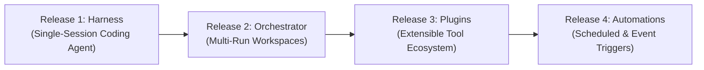

# Kantha — Product Vision & Foundations

**Status:** DRAFT — Awaiting Gate 1 Formal Review  
**Version:** 1.0.0  
**Effective Date:** 2026-11-21  
**Document Level:** Level 1 — Vision & Foundation

---

## 1. Product Purpose & Value Proposition

Kantha is an agentic AI coding assistant designed to bridge the **Verification Gap** and **Capability Gap** in automated software engineering. Unlike open-ended conversational chatbots that output speculative code snippets, Kantha executes bounded, verified software engineering tasks directly against granted code repositories.

By coupling a **Gateway** (application security, provider connections, budget governance, and user collaboration) with a **Harness** (durable execution runtime, generation-fenced leases, deterministic verifiers, and crash recovery), Kantha guarantees that every proposed code change is traceable, observable, tested, and backed by cryptographic and machine-verified evidence.

---

## 2. Intended Users & Personas

1. **Autonomous Senior Engineer (The "Delegator"):**
   - *Needs:* Wants to hand off well-specified bug fixes, refactorings, test generation, and feature slices to an agent while focusing on higher-level system architecture.
   - *Expectations:* The agent must not break working baselines, must preserve uncommitted dirty state, must run tests deterministically, and must stop cleanly when blocked.
2. **Technical Lead / Engineering Manager (The "Auditor"):**
   - *Needs:* Complete observability into what the AI agent did, which files were touched, how many tokens/dollars were spent, and why mutating actions were permitted.
   - *Expectations:* Enforced human-in-the-loop approvals for dangerous commands, hard budget ceilings, full audit trails, and zero risk of proprietary source code leaking into untrusted logs.
3. **Platform / Operations Engineer (The "Custodian"):**
   - *Needs:* Predictable resource usage, zero runaway background processes, clean process teardown, and resilient recovery when workers crash or pods redeploy.
   - *Expectations:* Generation fencing to prevent split-brain repository writes, OpenTelemetry tracing to SigNoz without prompt/credential leakage, and containerized isolation.

---

## 3. Core User Journeys

### Journey 1: Ordinary Conversational Chat (Baseline)
The user selects an AI provider and model, asks technical questions, discusses architecture, and streams markdown responses via the AI SDK UI-message protocol. The Gateway manages session state, provider egress, and token budgets.

### Journey 2: Autonomous Repository Task (The Core Engine)
1. **Submission:** The user assigns a bounded coding task (e.g., "Implement live provider streamText bridge in GatewayInference and ensure zero regression").
2. **Workspace Preflight:** The Harness initializes an isolated workspace, pins the base Git commit, and verifies baseline build health.
3. **Planning & Acceptance Pinning:** The Harness reviews repository instructions (`AGENTS.md`) and pins explicit, executable acceptance criteria (`checkCommand`).
4. **Execution & Continuation Loop:** The agent uses read-only tools to explore, drafts unified diffs, and requests mutating tool executions.
5. **Deterministic Verification:** The Harness evaluates every pinned acceptance check in a read-only subshell.
6. **Delivery & Evidence:** The user receives a clean candidate diff along with machine-verified test output receipts.

### Journey 3: Human Approval Flow
When a proposed tool call touches an action policy gate marked `Ask` (e.g., executing a database migration script or deleting files), the Harness checkpoints durable intent, transitions to `awaiting_approval`, and suspends. The user inspects the exact arguments digest and approves or denies in the browser UI. Upon approval, execution resumes instantly; upon denial, the agent is informed and explores alternative paths.

### Journey 4: Disconnect, Reconnect & Interruption Recovery
The user initiates a long-running task and closes their laptop or loses network connectivity. The Harness worker continues running in the background. If the host restarts or crashes mid-execution, a new worker reclaims the lease via generation fencing, inspects the durable checkpoint, reconciles any in-flight tool action, and resumes without duplicate billable provider attempts or repeated destructive operations. The user reconnects via SSE and views the reconstructed run state.

---

## 4. Multi-Horizon Capability Roadmap

Kantha is engineered in strict vertical horizons. No downstream release may begin until its predecessor passes all formal acceptance gates.

| Release | Focus | Core Capabilities | Exit Gates |
|---|---|---|---|
| **Release 1: Harness** *(Current)* | Single recoverable coding session | Durable journal, generation-fenced leases, Gateway inference adapter, repository tools (read/search/patch), deterministic verification, bounded repair loop, approval suspension. | Pass A1–A9 matrix; demonstrate end-to-end task execution with worker crash recovery. |
| **Release 2: Orchestrator** | Multi-agent coordination | Task decomposition, parent-child run trees, workspace concurrency, fan-out/fan-in delegation, aggregate budget accounting, global cancellation. | Coordinated multi-worker completion of cross-module features. |
| **Release 3: Plugins** | Extensibility & Ecosystem | Third-party tool manifests, capability review, scoped credential isolation, versioned extension points, in-flight runtime pinning. | Safe sandbox execution of external MCP and native plugins. |
| **Release 4: Automations** | Event-driven autonomy | Cron schedules, webhook triggers, CI/CD event listeners, service identities, missed execution reconciliation. | Unattended background executions with strict backpressure. |

---

## 5. Non-Negotiable Constraints

1. **Gateway Authority Boundary:** The Gateway alone derives actor identity, repository permissions, and budgets. LLM context and repository text have zero authority.
2. **Single-Writer Lease:** At most one active worker may write to a session's journal, guarded by monotonic generation fencing.
3. **Durable Intent Before Dispatch:** Mutating actions must record persistent intent before execution to enable safe crash recovery.
4. **Deterministic Verification:** Completion claims are invalid without machine-verified check results.
5. **No Spec, No Code:** All development must follow the 6-level SDD methodology.

---

## 6. Explicit Non-Goals (What Kantha is NOT)

- **Not an Unbounded AGI Chatbot:** Kantha does not engage in open-ended life advice or ungrounded conversation. It is an engineering tool for software repositories.
- **Not a Multi-Run Orchestrator in Release 1:** Release 1 executes exactly one bounded coding task per session. Multi-agent swarms and subagent delegation belong strictly to Release 2.
- **Not a Replacement for Version Control:** Kantha works *with* Git; it never bypasses Git commits, branches, or worktrees.
- **No Unsandboxed Arbitrary Shell Access:** Unrestricted terminal execution on the host OS is prohibited by default.
- **No Direct Model Egress from Harness:** The Harness never holds API keys and never communicates directly with LLM providers.

---

## 7. Open Architectural Decisions Needing Product Owner Sign-Off

Before transitioning this document from `DRAFT` to `APPROVED` (Gate 1), the following questions require explicit alignment:
1. **Decision D-01:** Hosting topology for Release 1 worker: in-process Next.js Node runner vs. separate worker process daemon.
2. **Decision D-03:** Approval ergonomics: strictly per-action vs. session-scoped pre-approvals for read-only workspace operations.
3. **Decision D-05:** Isolation bar for Release 1: Git worktree path containment vs. Docker container sandbox.

*(See `docs/00-foundation/open-questions.md` for full decision briefs and recommendation matrices).*
