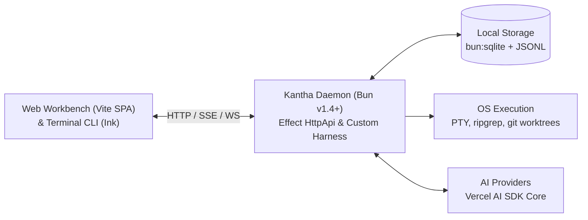

# Kantha Architecture

Kantha is a local-first, autonomous AI coding workbench and daemon that executes, tests, and verifies software tasks in code repositories.

---

## 1. Monorepo Architecture & Component Ownership

| Layer | Responsibility | Location | Stack |
|---|---|---|---|
| **Daemon** | Core process managing API ingress, session lifecycle, Effect Harness step loop, PTY bridges, and tool dispatch. | `apps/daemon` | Bun v1.4+, Effect-TS (`effect`, `HttpApi`), Vercel AI SDK, `bun-pty`, ripgrep |
| **Web Workbench** | Browser UI for task prompts, streaming responses, diff review, tool approvals, and embedded interactive terminal. | `apps/web` | Vite 6+, React 19, TanStack Router, TanStack Query, Tailwind CSS v4, Radix UI, `@xterm/xterm` |
| **Terminal CLI** | Console companion for terminal-first developers. | `apps/cli` | React Ink, Bun |
| **Protocol** | Shared typed contracts, schemas, and real-time streaming events. | `packages/protocol` | Effect Schema |
| **Database** | Embedded local persistence in WAL mode with relational schemas and event streaming. | `packages/db` | `bun:sqlite`, Drizzle ORM |
| **UI Primitives** | Reusable accessible component primitives. | `packages/ui` | Radix UI, Tailwind CSS v4 |

---

## 2. Invariants & Guarantees

1. **Local-First Independence:** Zero external cloud databases or serverless timeout constraints.
2. **Resource Scoping:** All subprocesses and PTY sessions are lifecycle-managed via Effect `Scope` (`Effect.acquireRelease`) to eliminate zombie handles.
3. **Decoupled Clients:** Active agent tasks persist safely in the daemon; clients reconnect and replay streaming history seamlessly.
4. **Pure SPA:** Zero SSR hydration overhead; builds to static assets ready for direct daemon serving or future desktop packaging (e.g. Tauri v2).
