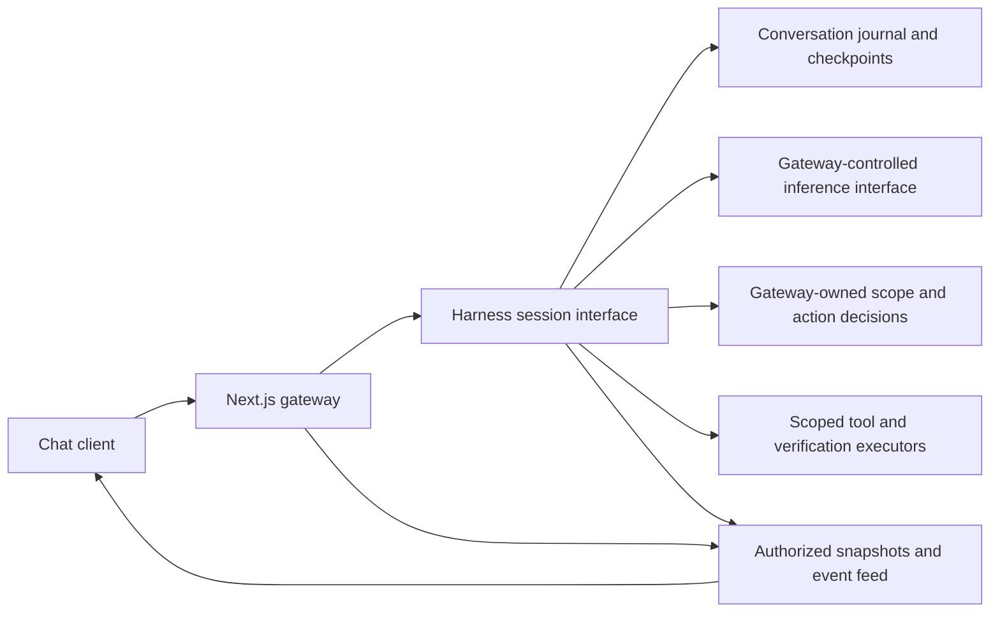

# Kantha architecture

Kantha is moving from gateway-backed chat to a coding assistant that can carry out and verify work in a repository. The gateway is the baseline for this plan. The harness is the next release. It owns execution within one session. Once that release passes its completion gates, the orchestrator can coordinate multiple runs. Plugins and automations come after the orchestrator.

## Implementation status

| Area | Status in this workspace | Starting point |
| --- | --- | --- |
| Gateway | Existing application code for authenticated chat, provider connections, model discovery, usage, sessions, events and an inert approval fixture. Deployment qualification is tracked separately. | [System design](docs/gateway/SYSTEM-DESIGN.md) · [Contracts](docs/gateway/CONTRACTS.md) · [Running and release checks](docs/gateway/RUNNING.md) |
| Harness | H0–H1 fixture implementation reported. Production inference, repository effects and deployment qualification are planned. | [H0–H1 handoff](docs/harness/HANDOFF-H0-H1.md) · [Feature map](docs/harness/features/README.md) · [Implementation plan](docs/harness/IMPLEMENTATION-PLAN.md) |
| Orchestrator | Planned after harness release. | [Release sequence](#release-sequence) |
| Plugins and automations | Planned after orchestrator release. | [Release sequence](#release-sequence) |

## Ownership and dependencies

Arrows show permitted calls or publication. Gateway composition injects inference, policy, storage and executor interfaces. Keep the harness independent of Next.js route handlers, provider credentials and browser components. Place it in the existing repository initially. Introduce a process boundary when persistent hosting or execution isolation requires one.

| Owner | Responsibility | Interface other layers use |
| --- | --- | --- |
| Client | Submits user intent, displays assistant and tool activity, requests Stop, renders approvals and reconnects. | Existing AI SDK UI-message stream, gateway commands, snapshots and SSE. |
| Gateway | Derives actor, workspace and repository authority. Owns application session and submission mapping, provider credentials, egress, hard-budget admission, usage settlement and durable business audit. | Scoped run and action commands, attempt admission and inference, authorized read projections. |
| Harness | Owns input delivery within a session, model steps, tool continuation, context, checkpoints, verification and recovery. | Admit or observe a run, cancel, deliver an approval decision and read its projection. |
| Tool execution | Validates the operation against the granted scope, executes it in the qualified environment and returns a bounded result or reconciliation evidence. | Versioned invocation and result contract. Tool lookup and policy decisions remain independent. |

### State ownership

The gateway owns the public run ID, submission deduplication and authorization. The harness owns the conversation journal for harness sessions. Existing gateway-only chat retains its app-owned transcript. Publish runtime progress to gateway read models through idempotent checkpoints with stable source event IDs. A browser reconnect observes the existing run. A public-run mapping can exist before execution starts, so the gateway must be able to redeliver the mapped input using the same identity.

Treat gateway audit, the harness journal and executor reconciliation as distinct records. A harness checkpoint can prove what the runner recorded. An executor receipt or verified repository state is needed to establish what happened outside the journal. Persist action intent before dispatch and reconcile unknown outcomes before continuing.

The proposed shared deployment uses Neon managed PostgreSQL for transactional state and exports the committed harness journal as versioned JSONL. The current single-process profile and fixtures use SQLite. The [persistence contract](docs/harness/features/PERSISTENCE.md) defines data ownership, recovery and migration. Use OpenTelemetry and SigNoz for diagnostics and the repository evaluation suite for release evidence. [Operations contract](docs/harness/features/OPERATIONS.md)

### From request to verified outcome

1. The gateway authorizes the request, persists the public run mapping, and hands the harness a scoped submission with pinned run assets.
2. A fenced session writer claims the input. The harness assembles context and exposes a snapshot of eligible tool definitions. Each physical provider attempt goes through gateway admission and settlement.
3. The model proposes a complete tool call. The harness validates it, obtains an action decision, persists intent, dispatches through the appropriate executor and records the result before another model step depends on it.
4. The harness evaluates the task’s acceptance checks and records evidence, unresolved work and cleanup status. The gateway projects the outcome for authorized clients.

## Release sequence

| Release | Owns | Required before moving on |
| --- | --- | --- |
| 1. Harness | One recoverable coding session, built-in tools, scoped skills, verification, permissions and observable outcomes. | Pass all enabled-capability release gates in the [implementation plan](docs/harness/IMPLEMENTATION-PLAN.md). Demonstrate one real repository task and interruption recovery. |
| 2. Orchestrator | Delegation, dependency graphs, concurrency, workspace allocation, cancellation propagation and aggregate outcomes. | Execute each task through a stable harness run contract. Verify parent and child attribution, scoped grants, aggregate budgets, dependency failures and restart recovery. |
| 3. Plugins | Trusted extension installation, versioned extension points and scoped registrations. | Verify compatibility, permission review, provenance, unload/revocation and behavior of in-flight runs pinned to a version. Route contributed capabilities through the existing tool boundary. |
| 4. Automations | Schedules, event triggers, durable dispatch and execution history. | Verify trigger deduplication, missed and overlapping executions, service identity, cancellation, backpressure and audit. Submit through the orchestrator or harness interfaces. |

## Where to make changes

Use [AGENTS.md](AGENTS.md) to select the controlling document. For harness work, trace each change from the [feature contract](docs/harness/HARNESS.md) through its [milestone and acceptance evidence](docs/harness/IMPLEMENTATION-PLAN.md). The [source guide](docs/harness/SOURCES.md) maps the course and OpenCode references to Kantha decisions and explains how to write future feature documents.
