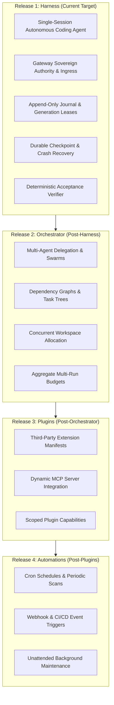

# Scope & Non-Goals Specification

**Status:** DRAFT — Awaiting Gate 1 Formal Review  
**Version:** 1.0.0  
**Effective Date:** 2026-11-21  
**Document Level:** Level 1 — Foundation

---

## 1. Product Scope by Release Horizon

To maintain engineering velocity and prevent architectural overreach, Kantha strictly partitions features across four sequential release horizons. Development within an advanced horizon is prohibited until its predecessor passes all formal acceptance gates.

---

## 2. Release 1 (Harness) — Scope Boundaries

### 2.1 In-Scope Capabilities
- **Single Autonomous Coding Session:** Executing exactly one bounded repository task at a time per session.
- **Gateway Identity & Egress Governance:** Next.js server-side session authentication, repository workspace grants, hard token budget checks, and encrypted provider credential storage.
- **Gateway-Mediated Inference:** Routing all LLM requests through the Gateway's `IHarnessInference` abstraction using `@ai-sdk` provider drivers.
- **Append-Only Conversation Journal:** Tamper-evident, sequenced journal recording all steps, text deltas, proposed tool calls, results, and verification verdicts.
- **Generation-Fenced Leases:** Preventing split-brain repository writes through monotonic generation counters.
- **Durable Checkpointing & Interruption Recovery:** Storing execution state in `HarnessCheckpoint` prior to external side effects; reconciling in-flight actions upon worker restart.
- **Repository Tooling:** Scoped file reading, directory listing, regex/ripgrep searching, and atomic unified diff patching within granted workspace roots.
- **Human-in-the-Loop Approvals:** Suspending execution on mutating tool calls, binding approvals to cryptographic argument digests, and enforcing TTL timeouts.
- **Deterministic Verification Engine:** Pinning acceptance criteria during planning and executing automated checks in read-only subshells before concluding a task.
- **Single-Process & Shared Persistence:** SQLite database for development; schema and contracts prepared for Neon PostgreSQL shared deployment.

### 2.2 Out-of-Scope Capabilities (Deferred to Later Releases)
- **Multi-Agent Coordination:** Spawning peer agents, parent-child task delegation, and swarm consensus (Deferred to Release 2).
- **Concurrent Workspace Branches:** Simultaneous execution of multiple tasks against branching worktrees in a single session (Deferred to Release 2).
- **Dynamic Third-Party Plugins:** Installing arbitrary untrusted npm packages or dynamic plugins (Deferred to Release 3).
- **Dynamic MCP Client Protocol:** Connecting to arbitrary third-party Model Context Protocol (MCP) servers (Deferred to Release 3).
- **Scheduled / Unattended Automations:** Triggering runs via cron schedules, GitHub webhook events, or external message queues (Deferred to Release 4).
- **Desktop Electron Shell & Local PTY:** Running as a native desktop Electron app with interactive PTY terminal emulation (Deferred to future roadmap).

---

## 3. Explicit Non-Goals (What Kantha Will NOT Do)

1. **Not an Unbounded Conversational Chatbot:**
   - *Rationale:* Kantha is an autonomous software engineering assistant, not a general-purpose dialogue companion. Features like open-ended trivia, unstructured brainstorming, or non-technical chatter are outside product scope.
2. **Not a Silent Auto-Committer to Remote Git Branches:**
   - *Rationale:* Kantha produces verified candidate changes and evidence in local worktrees. It shall never push commits directly to upstream remote repositories (`git push origin main`) without explicit human command.
3. **Not a Security Bypass Engine:**
   - *Rationale:* Kantha respects repository boundaries, file permissions, and `.gitignore` configurations. It shall never attempt to read host secrets (`~/.ssh`, `~/.aws`), bypass environment protections, or crack access controls.
4. **Not a Multi-Tenant Public Hosting Platform:**
   - *Rationale:* Release 1 is designed for individual developers, small engineering teams, and dedicated corporate workspaces. It does not provide public multi-tenant untrusted code execution or billing marketplace infrastructure.
5. **Not a Direct-Egress Runtime:**
   - *Rationale:* The Harness execution runtime shall never connect directly to LLM provider endpoints. All network egress is brokered by the Gateway to enforce budgets, prevent key leaks, and ensure centralized compliance auditing.
