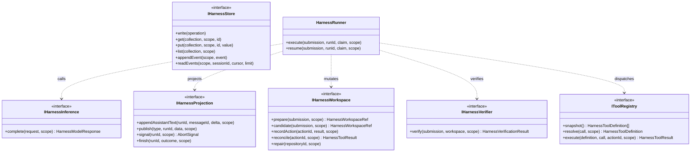

# Architecture Contracts and Interface Boundaries

**Status:** Authoritative interface specification.
**Source References:** `src/lib/harness/contracts.ts`, `src/lib/gateway/contracts/`, `docs/gateway/CONTRACTS.md`

## 1. Architectural Boundary Separation

The boundary between Daemon, Harness, and Client is strictly maintained via dependency injection and shared contracts.
The domain contracts (`packages/protocol`) have **zero imports** from client UI frameworks, React, or transport-specific modules.



## 2. Core Boundary Interfaces

### 2.1 `IHarnessStore` (Persistence Boundary)
Supplied by the Daemon to isolate database technology (embedded `bun:sqlite` with Drizzle ORM and JSONL event log):
```ts
export interface IHarnessStore {
  write<T>(operation: () => T): T;
  get<T>(collection: string, scope: string, id: string): T | null;
  list<T>(collection: string, scope: string): T[];
  put<T>(collection: string, scope: string, id: string, value: T): void;
  appendEvent(scope: string, event: NewHarnessEvent): StoredHarnessEvent;
  readEvents(scope: string, sessionId: string, cursor: number, limit: number): StoredHarnessEvent[];
}
```

### 2.2 `IHarnessInference` (Model Egress Boundary)
Abstracts provider transport, streaming, and per-attempt accounting:
```ts
export interface HarnessModelRequest {
  runId: string;
  modelId: string;
  step: number;
  task: string;
  history: string[];
  tools: HarnessToolDefinition[];
  signal?: AbortSignal;
}

export interface HarnessModelResponse {
  attemptId: string;
  text: string;
  toolCalls: HarnessToolCall[];
  finishReason: 'stop' | 'tool_calls' | 'cancelled';
}

export interface IHarnessInference {
  complete(request: HarnessModelRequest, scope: HarnessScope): Promise<HarnessModelResponse>;
}
```

### 2.3 `IHarnessProjection` (Client Event Boundary)
Transmits real-time deltas and lifecycle events to the Gateway SSE broadcaster:
```ts
export interface IHarnessProjection {
  appendAssistantText(runId: string, messageId: string, delta: string, scope: HarnessScope): Promise<void>;
  publish(type: string, runId: string, data: Record<string, unknown>, scope: HarnessScope): void;
  signal(runId: string, scope: HarnessScope): AbortSignal;
  finish(runId: string, outcome: HarnessOutcome, scope: HarnessScope): Promise<void>;
}
```

### 2.4 `IHarnessWorkspace` & `IHarnessVerifier` (Execution & Feedback Boundary)
Isolates file mutation, action intent recording, and deterministic verification:
```ts
export interface IHarnessWorkspace {
  prepare(submission: HarnessSubmission, scope: HarnessScope): HarnessWorkspaceRef;
  candidate(submission: HarnessSubmission, scope: HarnessScope): HarnessWorkspaceRef;
  recordAction(actionId: string, result: HarnessToolResult, scope: HarnessScope): void;
  reconcile(actionId: string, scope: HarnessScope): HarnessToolResult | null;
  repair(repositoryId: string, scope: HarnessScope): void;
}

export interface IHarnessVerifier {
  verify(submission: HarnessSubmission, workspace: HarnessWorkspaceRef, scope: HarnessScope): HarnessVerificationResult;
}
```

## 3. Data Integrity & Contract Invariants

1. **Submission Digest:** Every submission payload is normalized and cryptographically hashed (`submissionDigest`). Replays with identical digests return the existing run; replays with conflicting payloads are rejected with HTTP 409 (`HarnessError('conflict')`).
2. **Action Identity Format:** Action IDs are globally unique and deterministic: `action_${runId}_${callId}`. This allows interruption recovery to reconcile prior dispatches without duplicate side effects.
3. **Event IDs:** Every journal entry produces a stable source event ID (`stableSourceEventId`) based on sha1 hash of `(runId, sequence, type, data)`. Browser SSE streams deduplicate on this identity.
4. **Output Bounds:** Model-visible tool results are strictly capped at 8,192 UTF-8 bytes. Projected UI summaries are capped at 1,024 bytes. Full outputs are referenced as opaque artifacts.
