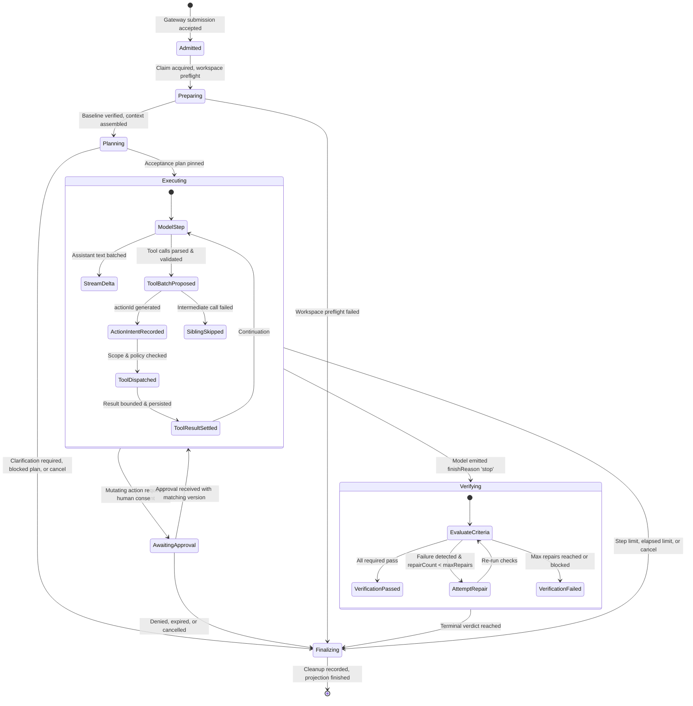

# Execution Lifecycle

**Status:** Canonical task lifecycle specification.
**Source References:** `docs/harness/HARNESS.md`, `src/lib/harness/runner.ts`, `src/lib/harness/service.ts`

## 1. Lifecycle State Machine

Every autonomous coding task executed by the Harness traverses a strict state machine:

## 2. Phase-by-Phase Gates

| Phase | Entry Condition | Invariants & Actions | Exit Condition / Advancing Gate |
|---|---|---|---|
| **Admitted** | Submission payload validated, actor authorized, submission digest recorded in `harness_inbox`. | Public `runId` issued. Checkpoint created in `admitted` state. | Monotonic writer lease acquired with generation 1. |
| **Preparing** | Writer claim active and verified. | Workspace directory initialized. Base Git commit hash recorded. Baseline checks executed to record pre-existing dirty/broken state. | Workspace ref constructed (`baseRevision`, `candidateDigest`, `baselineEdits`). |
| **Planning** | Workspace prepared. | Read applicable root `AGENTS.md` and scoped path instructions. Gather read-only discovery. | Verifier pins observable acceptance criteria (`HarnessAcceptanceCriterion[]`). |
| **Executing** | Acceptance plan pinned. | Run model inference loop. Batch tool calls. Check action policy (allow/ask/deny). Record durable intent before dispatch. Cap output to 8,192 bytes. | Model emits `finishReason === 'stop'` or step limit (24) / timeout (20 min) reached. |
| **AwaitingApproval** | Tool action classified as requiring human decision. | Suspend runner loop. Persist pending action ID, approval version, and expiration TTL (default 5 min). | Human decision (`approve` or `deny`) submitted with matching action ID and version. |
| **Verifying** | Execution loop completed without fatal error. | Evaluate every declared criterion against the final candidate workspace. No writes permitted during verification. | If all pass → verdict `completed`. If failures and repairs < `maxRepairs` (v1 default 0 in fixtures, up to 2 in staging) → repair loop. |
| **Finalizing** | Terminal state reached (`completed`, `failed`, `cancelled`, `interrupted`). | Append `handoff` entry to journal. Release workspace resources and locks. Mark checkpoint terminal. Notify Gateway projection. | Projection `finish()` acknowledged. |

## 3. Failure Handling & Interruption Recovery

1. **Worker Termination during Model Call:**
   The Gateway attempt reservation remains recorded with unknown usage. Upon recovery, the recovering worker inspects the journal, reconciles with the Gateway ledger, and resumes at step `N` without duplicated billable attempts.
2. **Worker Termination during Tool Dispatch:**
   The checkpoint records `pendingActionId = action_${runId}_${callId}`. When a fresh worker claims the run via `HarnessRunner.resume()`:
   - It invokes `IHarnessWorkspace.reconcile(pendingActionId)`.
   - If the workspace has a definitive receipt (e.g., file modified, command exit code recorded), the result is recovered and execution continues.
   - If the outcome cannot be proven, the run is terminated as `interrupted` with a typed reason, preventing double execution of destructive operations.
3. **Lease Expiration (Split-Brain Prevention):**
   If a worker hangs or experiences high GC pause, its claim lease expires. Another worker reclaims with `generation + 1`. If the old worker attempts to write, `assertClaim` throws `stale_claim` and the old worker terminates itself.
