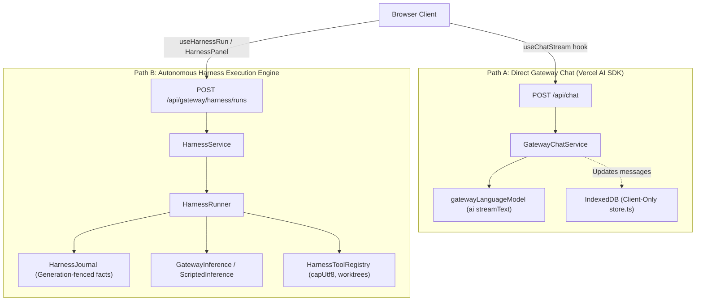

# Duplicated Responsibilities & Dual Execution Paths Audit

**Status:** AUDIT COMPLETE  
**Date:** 2026-11-21  
**Auditor:** Principal TypeScript Architect, Backend Engineer & AI Agent Runtime Architect  

---

## 1. Primary Finding: The Two Competing AI Execution Paths

The audit confirms an architectural fracture in Kantha: **there are currently two independent and competing AI execution paths**:

### Path A: Gateway Chat (`src/app/api/chat/route.ts` & `src/lib/gateway/server/chat-service.ts`)
* **Role:** Single-turn/conversational assistant streaming via Vercel AI SDK (`createUIMessageStreamResponse`).
* **Execution:** Calls `ai.streamText` directly via `gatewayLanguageModel`.
* **State & Memory:** Messages are held in client-side IndexedDB (`src/lib/chat/store.ts`). The gateway DB only tracks basic run metadata and message summaries in `GatewayRunService`.
* **Tools:** No tool loop or iterative tool execution.
* **Safety:** Two-phase attempt accounting (`reserveAttempt` / `settleAttempt`) and egress proxying are implemented.

### Path B: Harness Execution (`src/app/api/gateway/harness/runs/route.ts` & `src/lib/harness/runner.ts`)
* **Role:** Multi-step autonomous coding agent runtime inspired by OpenCode patterns.
* **Execution:** Iterative reasoning loop in `HarnessRunner.execute()`, stepping through model calls, sequential tool batches, and deterministic verification.
* **State & Memory:** Append-only generation-fenced journal (`src/lib/harness/journal.ts`) and durable checkpoints.
* **Tools:** Safe tool registry (`src/lib/harness/tools.ts`), output bounding (`capUtf8`), path guards, and Git worktrees.

### Conflict Analysis & Architectural Risk
1. **Divergent Evolution:** If both engines remain separate, feature improvements in the Harness (e.g., token compaction, skill loading, permission approval, tool dispatch) will not benefit Chat, while conversational features in Chat will remain inaccessible to the autonomous agent.
2. **Double Accounting / Leases:** Both paths register runs with `GatewayRunService.beginRun()`, but they track progress and completions completely differently.
3. **Session Fragmentation:** A user interacting in Chat cannot seamlessly delegate a coding task to the Harness and observe it within the same unified conversation thread.

---

## 2. In-Depth Investigation of Duplicated Subsystems

### 2.1 Gateway Sessions vs. Client-Side Persistence
| Dimension | Client Store (`src/lib/chat/store.ts`) | Gateway Database (`src/lib/gateway/runs/session-service.ts`) |
| :--- | :--- | :--- |
| **Storage Engine** | Browser IndexedDB (`kantha-chat` DB) | SQLite (`sessions`, `runs`, `events` tables) |
| **Authority** | Non-authoritative client cache | Authoritative server system of record |
| **Ownership** | Tab/Browser local storage | Scoped by authenticated `workspaceId` & `actorId` |
| **Data Stored** | Full raw message text, reasoning, attachment data URLs | Run records, submission keys, latest run ID, session status |
| **Risk / Issue** | Inconsistency upon tab reload or multi-device login. If IndexedDB is wiped, the user loses conversational context even though Gateway session records persist. |

### 2.2 Gateway Inference vs. Harness Inference
| Dimension | Gateway Language Model (`src/lib/gateway/providers/language-model.ts`) | Harness Inference (`src/lib/harness/inference.ts`) |
| :--- | :--- | :--- |
| **Mechanism** | Wraps `@ai-sdk/openai`, `@ai-sdk/anthropic` via `customFetch` | Normalized stream protocol with tool call fragment buffering |
| **Accounting** | Direct call to `UsageService.reserveAttempt` inside `chat-service.ts` | Injected `IAttemptLedger` reserving attempts before each physical step |
| **Tool Calling** | AI SDK default tool parsing | Buffers argument fragments to guarantee complete JSON before emitting |
| **Target Unification** | Harness inference should become the unified model execution engine across Kantha, delegating attempt reservations to Gateway authority. |

### 2.3 Run Cancellation Duplication
Two routes perform the exact same operation:
1. `src/app/api/gateway/runs/[id]/cancel/route.ts` -> Calls `runService.cancelRun(id, reason, ctx)`.
2. `src/app/api/gateway/harness/runs/[id]/cancel/route.ts` -> Calls `harness.service.cancel(id, reason, scope)`, which internally calls `this.services.runs.cancelRun(...)`.

**Recommendation:** Deprecate `/api/gateway/harness/runs/[id]/cancel` in favor of the canonical `/api/gateway/runs/[id]/cancel`.

### 2.4 Model Listing Duplication
Three endpoints provide overlapping model listings:
1. `/api/chat/models` (`src/app/api/chat/models/route.ts`): Returns models decorated with connection labels, `defaultModel`, and `source`.
2. `/api/models` (`src/app/api/models/route.ts`): Returns raw catalog models with optional `connectionId` filtering.
3. `/api/v1/models` (`src/app/api/v1/models/route.ts`): Direct re-export of `/api/models`.

**Recommendation:** Unify model retrieval under `/api/gateway/models` with query parameter flags (`?decorated=true`).

### 2.5 Computer Agent Logic Fragmentation
The Orgo Cloud Computer integration is scattered across four disparate locations:
1. `src/lib/harness/computer-agent.ts`: Computer agent step loop (`runComputerAgent`).
2. `src/lib/gateway/providers/orgo-computer.ts`: Orgo REST client for screenshots and actions.
3. `src/lib/gateway/providers/computer-inference.ts`: Prompt formatting for computer actions.
4. `src/lib/gateway/server/computer-agent-service.ts`: Gateway database journaling and accounting for computer runs.

**Recommendation:** Consolidate all desktop automation and Orgo logic into `src/lib/integrations/computers/orgo/`.
