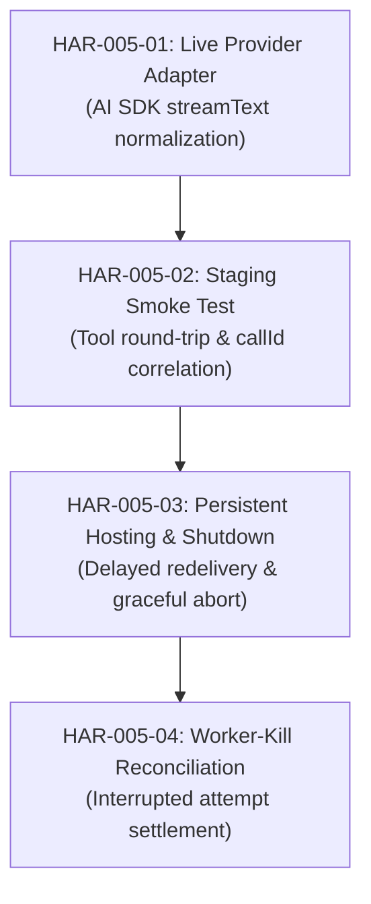

# Tasks Breakdown: HAR-005 — Gateway-Mediated Model Inference

**Parent Feature:** `HAR-005` — [SPEC.md](SPEC.md)
**Status:** In Progress (H2 completion phase)

## Task Dependency Order

## Task Registry

| Task ID | Title | Objective | Dependencies | Status | Task Document |
|---|---|---|---|---|---|
| `HAR-005-01` | Live Provider Adapter Qualification | Implement live AI SDK `streamText` adapter to normalize model stream into `HarnessModelResponse` with exact tool calls and chunk buffering. | HAR-001, GW-003, H2 fixture | **READY** | [HAR-005-01.md](tasks/HAR-005-01.md) |
| `HAR-005-02` | Tool-Capable Staging Smoke | Verify full round trip against a live provider with complete tool call/result correlation and single attempt settlement. | HAR-005-01 | **PLANNED** | [HAR-005-02.md](tasks/HAR-005-02.md) |
| `HAR-005-03` | Persistent Hosting & Graceful Shutdown | Implement independent process lifecycle, graceful SIGINT/SIGTERM handling, and lease-aware claim teardown. | HAR-005-02 | **PLANNED** | [HAR-005-03.md](tasks/HAR-005-03.md) |
| `HAR-005-04` | Worker-Kill Reconciliation & Spend Audit | Verify recovery of killed workers during in-flight provider attempts; assert ledger reconciliation to `unknown` without leaks. | HAR-005-03 | **PLANNED** | [HAR-005-04.md](tasks/HAR-005-04.md) |

## Sizing Verification
- Each task touches ≤ 3 source files.
- Each task has an executable test script with unambiguous assertions.
- No circular dependencies exist.
- Each task produces a durable artifact or test script that subsequent tasks build upon.
