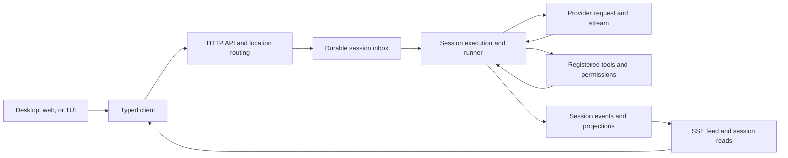

# OpenCode V2 harness and tools

This guide links to the public OpenCode docs and maps them to the implementation at [dev commit `fb67e33a1322`](https://github.com/anomalyco/opencode/tree/fb67e33a13226fb774dd10a946649270eaacb632), inspected on 17 November 2026. The server API, the session harness, and provider transport are different boundaries. For the chat presentation, see [Thinking, tools, and the chat timeline](../frontend/OPENCODE-CHAT-TIMELINE.md).

## Start with these docs

| Read | What it explains |
|---|---|
| [Build docs](https://opencode.ai/docs/build/), [JavaScript SDK](https://opencode.ai/docs/build/sdk/), and [Effect SDK](https://opencode.ai/docs/build/sdk/effect/) | How to host OpenCode, customize it, use worktrees, and subscribe to events. |
| [JavaScript Client](https://opencode.ai/docs/build/client/) and [HTTP API](https://opencode.ai/docs/api) | How a separate client connects to the server and calls Session, Event, Permission, Model, and other API groups. |
| [V2 specifications index](https://github.com/anomalyco/opencode/tree/fb67e33a13226fb774dd10a946649270eaacb632/specs/v2), [Session contract](https://github.com/anomalyco/opencode/blob/fb67e33a13226fb774dd10a946649270eaacb632/specs/v2/session.md), and [Tools contract](https://github.com/anomalyco/opencode/blob/fb67e33a13226fb774dd10a946649270eaacb632/specs/v2/tools.md) | The harness contracts for prompt admission, execution, tool calls, persistence, retries, and recovery. Start here for the internals. |
| [Event stream architecture](https://github.com/anomalyco/opencode/blob/fb67e33a13226fb774dd10a946649270eaacb632/specs/v2/event-stream-architecture.md) | The accepted design for SSE fan-out, bounded queues, and slow consumers. |
| [Agents](https://opencode.ai/docs/agents/), [Tools](https://opencode.ai/docs/tools/), and [Permissions](https://opencode.ai/docs/permissions/) | Agent instructions, model and step settings, available tools, and rules and approvals. |
| [Server plugins](https://opencode.ai/docs/build/plugins/server/), [MCP servers](https://opencode.ai/docs/mcp-servers/), and [Plugin overview](https://opencode.ai/docs/build/plugins/) | Authoring tools, plugin lifecycles and hooks, local and remote MCP integrations, and extension entry points. |
| [Providers](https://opencode.ai/docs/providers/), [Models](https://opencode.ai/docs/models/), [Provider policy](https://github.com/anomalyco/opencode/blob/fb67e33a13226fb774dd10a946649270eaacb632/specs/v2/provider-policy.md), and [Console](https://opencode.ai/docs/console/) | Provider and model selection, options and reasoning variants, and organization policy. |
| [Instructions](https://opencode.ai/docs/instructions/), [Skills](https://opencode.ai/docs/skills/), and [Compaction](https://opencode.ai/docs/compaction/) | How configuration and project guidance enter the model context and how older context is compressed. |

The specs index distinguishes current contracts, accepted decisions, drafts, and historical alternatives. Use the generated API reference and pinned Protocol definitions for exact public types. The linked implementation is a dev-branch snapshot, so it can differ from an installed release.

## From submission to model and tool execution

1. **The server admits a prompt.** The app submits to `POST /api/session/:sessionID/prompt`. Core records the input in a session inbox before scheduling execution. The runner brings it into model-visible history at a safe boundary. New input may steer at the next boundary or wait in the queue. The API can accept an input without waking the runner, and retrying an already admitted input ID has defined idempotency rules. [Protocol route](https://github.com/anomalyco/opencode/blob/fb67e33a13226fb774dd10a946649270eaacb632/packages/protocol/src/groups/session.ts#L342) · [Server handler](https://github.com/anomalyco/opencode/blob/fb67e33a13226fb774dd10a946649270eaacb632/packages/server/src/handlers/session.ts#L290) · [Session admission spec](https://github.com/anomalyco/opencode/blob/fb67e33a13226fb774dd10a946649270eaacb632/specs/v2/session.md#prompt-admission-precedes-execution)
2. **Core coordinates the run.** The coordinator tracks one active execution per session in the current process and can run different sessions concurrently. The Location supplies the filesystem, tools, permissions, plugins, and model settings. The runner reads projected history, resolves the agent and model, assembles instructions and tool definitions, applies step and context limits, and starts the next step. [Execution spec](https://github.com/anomalyco/opencode/blob/fb67e33a13226fb774dd10a946649270eaacb632/specs/v2/session.md#execution-is-process-local) · [Run coordinator](https://github.com/anomalyco/opencode/blob/fb67e33a13226fb774dd10a946649270eaacb632/packages/core/src/session/run-coordinator.ts) · [Runner loop](https://github.com/anomalyco/opencode/blob/fb67e33a13226fb774dd10a946649270eaacb632/packages/core/src/session/runner/llm.ts#L236)
3. **The provider layer streams model output.** The implementation separates normalized model events from provider wire framing, transport and error classification. The provider HTTP executor is an outbound inference boundary, while the server exposes the inbound session API. OpenCode Console policies are another layer and are documented separately. [Provider request executor](https://github.com/anomalyco/opencode/blob/fb67e33a13226fb774dd10a946649270eaacb632/packages/ai/src/route/executor.ts) · [Protocol framing](https://github.com/anomalyco/opencode/blob/fb67e33a13226fb774dd10a946649270eaacb632/packages/ai/src/route/framing.ts) · [Step stream consumer](https://github.com/anomalyco/opencode/blob/fb67e33a13226fb774dd10a946649270eaacb632/packages/core/src/session/runner/step.ts#L130) · [Console policies](https://opencode.ai/docs/console/#policies)
4. **The runner dispatches complete tool calls.** After recording a call, it can start a local execution while other output is still arriving. A streamed fragment of an argument does not execute a tool. A provider-executed call supplies its result through the provider stream. The runner publishes durable terminal tool outcomes before settling the step. When the turn needs another step, it reloads projected history so the next model request sees the tool results. [Step implementation](https://github.com/anomalyco/opencode/blob/fb67e33a13226fb774dd10a946649270eaacb632/packages/core/src/session/runner/step.ts#L118-L159) · [Session step spec](https://github.com/anomalyco/opencode/blob/fb67e33a13226fb774dd10a946649270eaacb632/specs/v2/session.md#one-step-may-have-several-physical-attempts)
5. **The client observes the run through events and reads.** Text and reasoning deltas keep the current view active. The server encodes public events for SSE once and uses an independent bounded queue per subscriber. A lagging connection can fail without blocking other subscribers. Durable projections supply the recoverable view of session content. [Event publisher](https://github.com/anomalyco/opencode/blob/fb67e33a13226fb774dd10a946649270eaacb632/packages/core/src/session/runner/publish-llm-event.ts#L433-L515) · [Event feed](https://github.com/anomalyco/opencode/blob/fb67e33a13226fb774dd10a946649270eaacb632/packages/server/src/event-feed.ts) · [Event architecture spec](https://github.com/anomalyco/opencode/blob/fb67e33a13226fb774dd10a946649270eaacb632/specs/v2/event-stream-architecture.md)

## How the tools are built

| Layer | What happens |
|---|---|
| Definition and registration | A tool declares its description, input schema, execute function, and optional output schema. Built-ins, trusted plugins, and dynamic tools share the contract. Registrations have Location scope. A model request captures the tool registrations it advertised so a later registration change cannot silently swap the implementation for that request. |
| Invocation | The tool receives validated input and its session, agent, assistant-message, and call identities. The runtime rejects invalid input before executing anything. A progress callback can publish activity while the tool is still running. |
| Permissions | The tool formulates the permission request at the appropriate operation, and the permission service applies policy and approvals. Config supports allow, ask, and deny rules. A shared tool type does not give every tool the same host privileges. |
| Results | Model-facing content is the durable representation. An optional typed output is a machine value for Code Mode. Separate compact UI metadata supports tool-specific renderers. Large model-facing output is bounded independently of the producer's capture limits. |
| Cancellation and failure | A normal tool failure can go back to the model. User interruption, infrastructure failures, and stale calls are handled separately. Stale executing calls are reconciled before further model work after recovery. |

[Tools contract](https://github.com/anomalyco/opencode/blob/fb67e33a13226fb774dd10a946649270eaacb632/specs/v2/tools.md) · [Registry and captured definitions](https://github.com/anomalyco/opencode/blob/fb67e33a13226fb774dd10a946649270eaacb632/packages/core/src/tool.ts) · [Input and output runtime](https://github.com/anomalyco/opencode/blob/fb67e33a13226fb774dd10a946649270eaacb632/packages/core/src/tool/runtime.ts) · [Contributor guardrails](https://github.com/anomalyco/opencode/blob/fb67e33a13226fb774dd10a946649270eaacb632/packages/core/src/tool/AGENTS.md)

- **Built-ins** cover file reads, search and edits, shell, web, images, questions, skills, automation, and subagents. The exact configured set depends on the runtime and policy. The source for individual host tools is collected under `core/src/tool/plugin`. [Tool catalog](https://opencode.ai/docs/tools/) · [Built-in tool source](https://github.com/anomalyco/opencode/tree/fb67e33a13226fb774dd10a946649270eaacb632/packages/core/src/tool/plugin)
- **Code Mode** uses the `execute` tool to compose calls. The current tool docs describe namespaces for session operations, worktrees, and the desktop-attached browser. Nested built-in and MCP operations still enforce their permissions. [Execute and namespaces](https://opencode.ai/docs/tools/#execute)
- **Subagents** run in background child sessions on this V2 snapshot. The call returns the child session ID, and a later session notification reports when it goes idle. This explains why the chat can show a launch and a separate outcome. [Subagent docs](https://opencode.ai/docs/tools/#subagent) · [Child session implementation](https://github.com/anomalyco/opencode/blob/fb67e33a13226fb774dd10a946649270eaacb632/packages/core/src/tool/plugin/subagent.ts#L49-L58)
- **Extensions** use server plugin registrations, hooks, and MCP. Tools discovered from MCP can participate in Code Mode or be exposed directly, depending on their configuration. [Server plugin Tools](https://opencode.ai/docs/build/plugins/server/#tools) · [Tool hooks](https://opencode.ai/docs/build/plugins/server/#tools-1) · [MCP config](https://opencode.ai/docs/mcp-servers/#config)

## Streaming and recovery are separate

| Need | Interface on the inspected V2 source |
|---|---|
| Submit a turn | `POST /api/session/:sessionID/prompt` admits input. |
| Observe live activity | `GET /api/event` is a live SSE subscription. The public client docs explain subscription and recovery. |
| Read the session's model context | `GET /api/session/:sessionID/context` returns active context. Use the typed client's session projections for the appropriate persisted view. |
| Replay durable session events | Experimental `GET /api/experimental/session/:sessionID/log` supports `after` and `follow`. It is distinct from the live feed. |
| Stop execution | `POST /api/session/:sessionID/interrupt` targets an active locally owned run. |

[Session protocol](https://github.com/anomalyco/opencode/blob/fb67e33a13226fb774dd10a946649270eaacb632/packages/protocol/src/groups/session.ts) · [Event protocol](https://github.com/anomalyco/opencode/blob/fb67e33a13226fb774dd10a946649270eaacb632/packages/protocol/src/groups/event.ts) · [Client stream docs](https://opencode.ai/docs/build/client/#stream-events) · [Durable replay spec](https://github.com/anomalyco/opencode/blob/fb67e33a13226fb774dd10a946649270eaacb632/specs/v2/session.md#durable-events-are-session-scoped)

A logical step can have multiple physical provider attempts. The spec distinguishes scheduled retry, continuation after partial output, limited overflow compaction, and terminal failure. Compaction changes the context sent to the model while keeping the full transcript. Process-start recovery uses an execution claim and reconciles stale tool states. It cannot prove whether an interrupted external operation already took effect, so the spec does not promise exactly-once provider requests or tool side effects. [Retry, compaction and recovery](https://github.com/anomalyco/opencode/blob/fb67e33a13226fb774dd10a946649270eaacb632/specs/v2/session.md#retry-is-narrow-and-observable)
