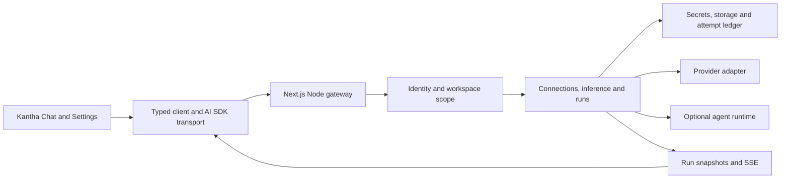

# Kantha gateway

The primary architectural reference is the supplied `GATEWAY_REVERSE_ENGINEERING.md`, dated 2026-11-15. Use its §§2–4 for the topology and request lifecycle, §5 for the screen flows, and §6 for the upstream file map. The supplied copy lives at `C:/Users/bharg/.gemini/antigravity/scratch/opencode/GATEWAY_REVERSE_ENGINEERING.md`. The GitHub links below pin the matching local OpenCode checkout of `anomalyco/opencode` at `67139d6827af3a337c80472c33f9cb7c6c2ce500`. The browsed `dev` branch had advanced. The attachment and upstream repository files serve as reference material. The [Kantha agent instructions](../../AGENTS.md) govern work in this repository.

## Start here

1. [Agent work plan](IMPLEMENTATION-PLAN.md) defines ownership, parallel work, integration order and acceptance.
2. [Gateway contracts](CONTRACTS.md) defines the proposed boundaries, route groups, session state and recovery behavior.
3. [Frontend UI/UX plan](../frontend/README.md) maps workflows, screen states and component reuse.
4. [Running the gateway](RUNNING.md) describes configuration, deployment scope and the verification commands.
5. [System design for implementers](SYSTEM-DESIGN.md) maps code ownership, overload behavior, and follow-on implementation slices.

For the newer OpenCode V2 snapshot, see [OpenCode harness and tools](OPENCODE-HARNESS.md) and the [chat timeline source guide](../frontend/OPENCODE-CHAT-TIMELINE.md).

## What OpenCode shows

| OpenCode evidence | Kantha decision |
|---|---|
| Shared schemas, protocol groups, server composition and client types have distinct dependencies. See [package layout](https://github.com/anomalyco/opencode/tree/67139d6827af3a337c80472c33f9cb7c6c2ce500/packages), [repository instructions](https://github.com/anomalyco/opencode/blob/67139d6827af3a337c80472c33f9cb7c6c2ce500/AGENTS.md), [protocol](https://github.com/anomalyco/opencode/blob/67139d6827af3a337c80472c33f9cb7c6c2ce500/packages/protocol/src/api.ts) and [route composition](https://github.com/anomalyco/opencode/blob/67139d6827af3a337c80472c33f9cb7c6c2ce500/packages/server/src/routes.ts). | Keep contracts in shared TypeScript. Compose services and adapters in Next.js Node handlers. Give React one typed client boundary. Add packages or services when a deployment or ownership boundary needs them. |
| Process readiness, scope resolution, provider execution and event delivery are independent. See [process](https://github.com/anomalyco/opencode/blob/67139d6827af3a337c80472c33f9cb7c6c2ce500/packages/server/src/process.ts), [location scope](https://github.com/anomalyco/opencode/blob/67139d6827af3a337c80472c33f9cb7c6c2ce500/packages/server/src/location.ts), [provider executor](https://github.com/anomalyco/opencode/blob/67139d6827af3a337c80472c33f9cb7c6c2ce500/packages/ai/src/route/executor.ts), [event feed](https://github.com/anomalyco/opencode/blob/67139d6827af3a337c80472c33f9cb7c6c2ce500/packages/server/src/event-feed.ts) and [shared client events](https://github.com/anomalyco/opencode/blob/67139d6827af3a337c80472c33f9cb7c6c2ce500/packages/client/src/shared-events.ts). | Derive workspace authorization in the app, keep provider transport behind an adapter, and use a recoverable session projection with SSE for run status. |
| OpenCode keeps product surfaces in separate feature folders. See [connection setup](https://github.com/anomalyco/opencode/blob/67139d6827af3a337c80472c33f9cb7c6c2ce500/packages/app/src/servers/connect/screen.tsx), [server list](https://github.com/anomalyco/opencode/blob/67139d6827af3a337c80472c33f9cb7c6c2ce500/packages/app/src/settings/servers/servers.tsx), [providers](https://github.com/anomalyco/opencode/blob/67139d6827af3a337c80472c33f9cb7c6c2ce500/packages/app/src/settings/providers/providers.tsx), [usage](https://github.com/anomalyco/opencode/blob/67139d6827af3a337c80472c33f9cb7c6c2ce500/packages/app/src/usage/dialog.tsx) and [composer](https://github.com/anomalyco/opencode/tree/67139d6827af3a337c80472c33f9cb7c6c2ce500/packages/app/src/composer). | Use the existing Kantha dashboard, Settings and Chat routes. Deliver the equivalent flows as separate vertical slices with shared states and fixtures. |
| Public contribution guidance calls for scoped PRs, design review of UI and core features, affected-package checks and client regeneration when the protocol changes. OpenCode also keeps repository skills for distinct test layers. See [contributing](https://github.com/anomalyco/opencode/blob/67139d6827af3a337c80472c33f9cb7c6c2ce500/CONTRIBUTING.md), [skills](https://github.com/anomalyco/opencode/tree/67139d6827af3a337c80472c33f9cb7c6c2ce500/.opencode/skills) and [test workflow](https://github.com/anomalyco/opencode/blob/67139d6827af3a337c80472c33f9cb7c6c2ce500/.github/workflows/check-test.yml). | Assign one implementation agent per bounded slice, merge contract changes first, review the UI flow before each user-facing slice and verify each handoff against shared fixtures. |
| OpenCode's product has a runtime subagent tool with child sessions and foreground/background completion. See [subagent implementation](https://github.com/anomalyco/opencode/blob/67139d6827af3a337c80472c33f9cb7c6c2ce500/packages/core/src/tool/plugin/subagent.ts). | The delivery plan uses coding-agent work assignments immediately. Product delegation is a later slice with its own permission, budget and recovery contract. The public repository establishes these engineering and runtime patterns. Its maintainers' private task assignments are unknown. |

## Kantha implementation

- [Chat](../../src/app/chat/page.tsx) uses AI SDK `useChat` with durable sessions. The [chat handler](../../src/app/api/chat/route.ts) returns a UI-message stream with session and run IDs. The [v1 chat](../../src/app/api/v1/chat/completions/route.ts) and [v1 models](../../src/app/api/v1/models/route.ts) routes retain the application's chat stream and model catalog behavior.
- [Provider settings](../../src/components/block/model-providers-view.tsx) manages server-side connections and discovery. The [model catalog](../../src/app/api/models/route.ts) only reads eligible models from authorized connections. The [provider transport](../../src/lib/gateway/providers/egress.ts) enforces the configured destination for outbound credentials and inference.
- [Authenticated ingress](../../src/lib/gateway/server/ingress.ts) derives workspace scope. The [service registry](../../src/lib/gateway/server/registry.ts) opens durable SQLite stores for encrypted credentials, runs, events, approvals and usage. See [verification and deployment](RUNNING.md).

## Initial scope

Deliver protected provider setup, model discovery and a streaming chat turn using one configured OpenAI-compatible adapter. Preserve Stop, safe error feedback and the existing in-app chat stream. Then add durable run recovery, approval with an inert tool, and operational views. Keep Electron pairing, external server fleets, PTY, MCP and WebSocket transport outside the initial release scope.

Use OpenTelemetry with SigNoz for proposed diagnostics. Qualify the actual gateway-mediated inference path with protocol and per-attempt accounting fixtures. Qualify OpenWorker Harness lifecycle, durable session recovery and real pending interactions in a persistent Node deployment before enabling it. The app owns identity, authorization, credentials, hard-budget admission and durable business audit regardless of adapter. Any enabled agent runtime owns the agent loop. The first chat milestone exercises the existing chat flow without an agent loop. [Harness operations contract](../harness/features/OPERATIONS.md)
