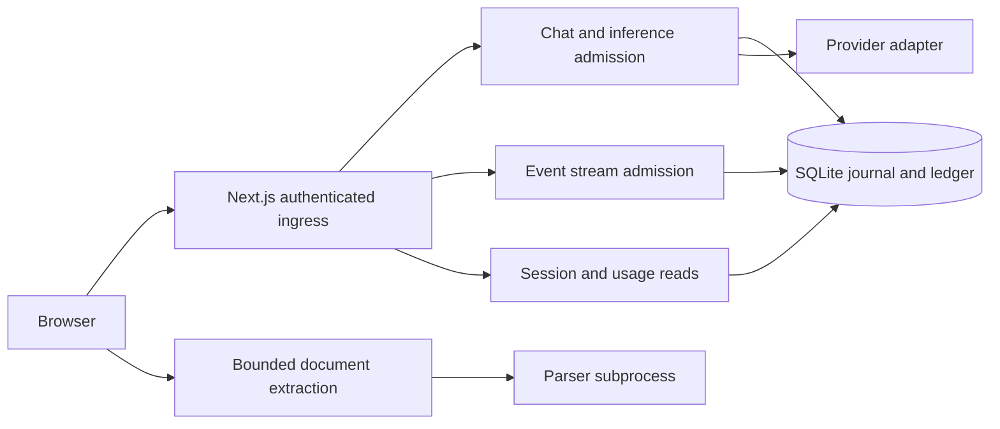

# Kantha system design

The supported deployment is one persistent Next.js Node process with a local SQLite volume. Next.js owns authentication, tenancy, provider egress, hard-budget admission, and the business audit trail. Use this guide alongside the [gateway contracts](CONTRACTS.md), [deployment guide](RUNNING.md), and [performance notes](../PERFORMANCE.md).

## Architecture and ownership

| Concept | Current implementation | Where agents extend it |
| --- | --- | --- |
| Trust boundary | Ingress derives workspace and actor from server-authenticated credentials. The provider adapter resolves a configured connection, and the secret store supplies credentials on the server. Gateway failures carry request IDs and known error codes. | [Ingress](../../src/lib/gateway/server/ingress.ts), [provider egress](../../src/lib/gateway/providers/egress.ts), [connection store](../../src/lib/gateway/server/connection-store.ts) |
| Bulkhead and backpressure | Inference and SSE have separate per-process and per-workspace concurrency limits. The gateway rejects work immediately when a limit is reached. The document parser has its own bounded queue and uses subprocesses to contain native crashes. | [Capacity](../../src/lib/gateway/server/capacity.ts), [registry](../../src/lib/gateway/server/registry.ts), [document queue](../../src/lib/chat/document-queue.ts) |
| Idempotency and single writer | An established session and submission key identify a run. A repeat with equivalent input returns the recorded run. A changed payload conflicts. SQLite transactions enforce one active run per session. | [Run service](../../src/lib/gateway/runs/session-service.ts), [chat service](../../src/lib/gateway/server/chat-service.ts) |
| Consistency and recovery | State transitions and replay events commit together. The run lease detects interrupted work. Budget reservation and settlement stay in the durable ledger. | [Run state](../../src/lib/gateway/runs/state.ts), [storage](../../src/lib/gateway/server/storage/database.ts), [usage service](../../src/lib/gateway/server/usage-service.ts) |
| Read model and replay | Session listing and event polling read metadata. Snapshot reads include the transcript. SSE polls the workspace journal, resumes by sequence, and asks for a fresh snapshot if the cursor falls outside retention. The stream pulls one event at a time. | [Event feed](../../src/lib/gateway/runs/event-feed.ts), [events route](../../src/app/api/gateway/events/route.ts) |
| Observability | Liveness and readiness serve process probes. Protected status adds request correlation, durable activity counts, and the calling workspace's local inference and SSE occupancy. | [Health contract](../../src/lib/gateway/contracts/health.ts), [status route](../../src/app/api/gateway/status/route.ts) |

## Inference admission and release

The registry wires the chat service to the model catalog, run journal, usage ledger, and inference capacity. The browser chat route asks for an AI SDK stream. The session submission route asks for a run and uses the event journal to observe it. The chat service owns the provider stream lifetime for both routes. Its input parser normalizes the two request formats, and the provider prompt builder converts the durable transcript to model messages and estimates input tokens from the same projection.

1. Authenticate and validate the request. Resolve provider selection from authorized workspace data. For an established session, check its submission mapping before acquiring capacity.
2. Validate the provider connection and acquire one inference slot. Workspace saturation returns HTTP 429 with `rate_limited`. Process saturation returns HTTP 503 with `service_unavailable`. Both return `Retry-After: 2`. A refusal creates no run, implicit session, attempt reservation, or upstream request.
3. Begin the durable run under the session's single-writer transaction. Release immediately if this transaction fails or returns a concurrent replay. Reserve the attempt against the hard budget before the provider request.
4. Keep the slot through stream cleanup and durable finalization. An explicit Stop, a timeout, or provider failure follows the same release path. Browser disconnect leaves the admitted run active so it can finish and persist its result. A finalization error still releases local capacity. The durable lease and ledger provide the recovery path.

A client retry that needs durable deduplication supplies the same session ID and submission key. The implicit-session chat form allocates a session after capacity admission. Clients recover the session ID from the accepted response, then use its snapshot or event feed to observe the existing run.

## Event stream admission and release

Authenticate and check session scope first. A missing cursor receives a one-frame resync response. Requests with a valid cursor acquire an event slot before the SSE response begins. Workspace saturation returns HTTP 429 with `subscriber_overflow`. Process saturation returns HTTP 503 with `service_unavailable`. Both return `Retry-After: 2`. A disconnect, resync, or terminal stream cleanup releases the slot. Resume from a stored cursor and deduplicate by sequence.

A stream can outlive a request's first response frame. Attach capacity cleanup to stream completion and cancellation. Keep capacity separate from durable run state, and keep the workspace identifier server-derived. Occupancy resets on restart and describes the current process. The status response includes the calling workspace's occupancy, its effective cap, and the configured process cap.

## Follow-on implementation slices

| Slice | Start when | Implementation and acceptance |
| --- | --- | --- |
| Shutdown and recovery | Staging restart tests show interrupted active work or traffic continues during shutdown. | Wire deployment-owned drain signals to readiness and workload admission. Persist run outcomes through the existing lease and accounting services. Test a signal during chat and SSE, rejection of new work, recovery from the same run id, and bounded process exit. |
| Circuit breaker | Provider timeouts or transient failures repeatedly consume a significant portion of inference capacity. | Scope failure state to the workspace connection and revision. Use a bounded cooldown and one half-open probe. Treat credential failures, caller cancellation, and budget refusal separately. Verify isolation across providers and connection rotation. Any actual retry receives a distinct reservation and reconciliation path. |
| Durable jobs | Work must survive restart or continue after the caller disconnects. | Persist scoped job intent and a stable idempotency key. Claim jobs with a lease, cap attempts, record terminal outcomes, and fence workers that lose ownership. Test crash between claim, side effect, and acknowledgement. The existing upload queue is in memory and the caller waits for the result. |
| Multiple replicas | A deployment requires multiple active nodes and measured queue or database contention justifies the migration. | Qualify a shared transactional store, migration, backup/restore, and fenced run ownership. Choose whether quotas remain per instance or require a shared limit. Test two processes racing the same submission and reserve, plus stream reconnect to another replica. A wake-up channel can accelerate event delivery while the durable sequence remains the replay source. |

## Implementation and review checklist

1. Start at the real route or worker entry point. Identify who owns each durable write and where workspace scope is derived.
2. Specify the idempotency key, commit point, timeout, and cleanup owner before adding asynchronous work. Test duplicate delivery, cancellation, and one failure before and after the commit.
3. Document a cache key and its invalidation rules. Keep hard budget, credential, and authorization decisions on authoritative storage.
4. Add a fixture that proves overload behavior with deterministic caps. Observe upstream call count, durable state, retry headers, and capacity after cancellation. Keep payloads and credentials out of error telemetry.
5. Run `npm run test:gateway`, build the app, then run `npm run test:routes` and `npm run test:chat`. Record fixture, browser, and deployment evidence with their environments. Update the contract and runbook when public behavior changes.
