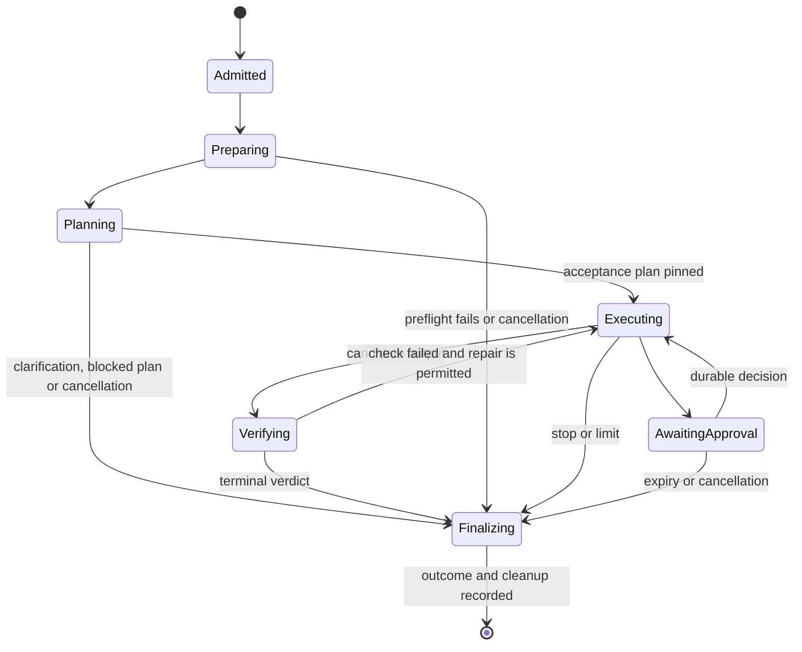

# Kantha harness specification

**Status:** Proposed. Read the [system architecture](../../architecture.md) for cross-component ownership, the [feature map](features/README.md) for subsystem contracts and the [implementation plan](IMPLEMENTATION-PLAN.md) for release gates. Existing gateway behavior is defined in the [gateway contracts](../gateway/CONTRACTS.md).

## Product outcome

A user assigns a bounded coding task against a granted repository. Kantha initializes a reproducible workspace, reads applicable instructions, uses authorized tools and skills, verifies the requested behavior and returns evidence tied to the resulting repository state. The user can stop execution, resolve an approval and reconnect to the same run. After a failure, the harness can resume from a safe boundary or explain what remains unresolved.

The initial release supports one active task per session. Separate sessions can run within deployment capacity. A second distinct submission to a busy session receives a conflict. Steer, queued follow-ups and child runs can build on the same admission boundary when their semantics are specified.

## Required lifecycle for every repository task

The runner applies this lifecycle to each task admitted against a repository. Task-specific checks come from the acceptance plan and repository profile. The formatter fixture supplies one acceptance plan for exercising the lifecycle.

| Gate | Condition for advancing | If the condition is unmet |
| --- | --- | --- |
| Define the task | Persist the requested outcomes, allowed targets, protected existing work, material assumptions and a criterion for each required outcome. Use read-only discovery to resolve repository questions and record evidence for assumptions. | Block affected changes when unresolved ambiguity would change user-visible behavior, authorized scope or the definition of success. Report the decision or evidence needed to proceed. |
| Prepare the workspace | Pin revision, dirty state, applicable instructions, environment and approved check profile. Record the baseline results needed to attribute later failures. | Diagnose unavailable prerequisites and distinguish known baseline failures from missing evidence. Gate edits using the [workspace contract](features/WORKSPACE.md). |
| Execute and checkpoint | Each action is permitted for the task and current grant. Persist consequential results and the next eligible step before dependent work. | Deny prohibited actions, wait for a durable approval when required, and reconcile uncertain effects before continuing. |
| Verify and repair | Evaluate every required criterion against the final candidate through its supported entry point. Verify task scope and preservation of baseline work alongside the requested behavior. | Feed actionable findings into bounded repair, or record the incomplete criteria and why work stopped. [Verification contract](features/VERIFICATION.md) |
| Finalize and hand off | Persist the verdict, evidence, remaining work and cleanup disposition. A fresh authorized worker can find the next safe action from the durable records. | Surface unresolved effects and the last verified state. A pending effect that can change the result blocks success. |

## Failure modes the harness must handle

These are failure modes to test in Kantha. The [scenario suite](features/OPERATIONS.md#repository-evaluation-suite) exercises them across tasks and repositories.

| Failure mode | Harness behavior and observable outcome |
| --- | --- |
| Scope drifts or a request is partly fulfilled | Pin the bounded goal and acceptance criteria. Check the final diff against authorized scope and report each incomplete criterion. |
| An ambiguous request leads to a wrong implementation | Resolve existing behavior from contracts, entry points and reproducible checks. Record consequential assumptions and pause affected mutations when the outcome depends on missing input. |
| Relevant instructions are buried, stale or lost during compaction | Resolve repository and path guidance at the pinned revision. Record provenance and reconstruct the active constraints and unresolved work after restart. |
| Edits begin in an invalid environment or overwrite existing work | Preflight the workspace and declared checks, capture existing failures and dirty state, and reconcile final changes against that baseline. |
| Interruptions lose progress or repeat side effects | Resume from the fenced journal and durable intent. Reconcile existing results and report interruption if an effect remains unknown. |
| A passing command or confident summary hides unfinished behavior | Verify the final candidate against required behavior through its normal entry point. Missing, failed and stale evidence prevents completion. |
| Repair loops consume budget or leave a broken handoff | Bound retries and execution time. Record check evidence, cleanup disposition and the next eligible action. Turn repeated failures into reviewed regression cases. |

## Module map

These are responsibilities for the first implementation. Group closely related behavior around stable interfaces and split modules only where each can own its policy independently.

| Module | Owns | Public behavior |
| --- | --- | --- |
| Session | Durable input admission and delivery, ordering, session claim, journal and recovery. | Submit or find an input by stable identity, provide the next eligible input, checkpoint, recover and project state. The runner asks for eligible input through this interface. |
| Agent definition and context | Versioned instructions, scoped skill selection, model context construction, token budget and compaction. | Resolve a pinned run definition and construct each model request from instructions, current input and durable history. |
| Runner | One session’s model and tool loop, continuation, stop conditions and progression to verification. | Run or cancel the claimed submission and publish typed state transitions. |
| Tool registry and invocation | Versioned definitions, advertised snapshots, input validation, dispatch coordination and normalized results. | Advertise eligible definitions, resolve an invocation against its snapshot and return safe results. |
| Workspace and executors | Preparation, source identity, capability enforcement, bounded execution, evidence and cleanup. | Prepare a scoped workspace, perform an authorized operation, reconcile it by action ID and release owned resources. |
| Verification | Acceptance criteria, check selection, execution evidence and completion verdict. | Evaluate declared checks against an immutable reference to the final task state. |

The gateway supplies scope, policy, inference and audit through server-controlled interfaces. Repository text, model output and skill instructions provide task context. They carry no authority to grant access or dispatch tools.

## Session and recovery contract

The harness accepts a scoped submission containing the public session and run IDs, a stable input identity, task scope and pinned run assets. It returns the same admission receipt on redelivery and exposes cancellation and approval decisions as separate commands. The gateway derives scope before issuing any command and owns its public response.

Project the durable phases as `admitted`, `preparing`, `planning`, `executing`, `awaiting_approval`, `verifying` and `finalizing`. Admission can be gateway `queued`; active phases use `running` and approval wait uses `waiting_for_approval`. Project `recovering` while reestablishing authority, then resume the last durable phase or finalize as `interrupted`. Planning follows workspace preflight and may use gateway-metered inference and policy-allowed read-only tools. Candidate writes start only after the verifier pins the acceptance plan.

The [browser projection](features/PROJECTION-CONTRACT.md#snapshot-and-events) carries the phase alongside gateway status. A required check that cannot run produces a blocked criterion and a failed run with a typed reason. A material question produces a terminal `failed` run with `clarification_required` and a structured question. The UI labels it **Clarification needed**. An answer starts a new task linked to the original run under the [verification contract](features/VERIFICATION.md). Unresolved effects follow the [operator disposition contract](features/APPROVALS.md#unresolved-effects).

| Boundary | Required behavior |
| --- | --- |
| Admit, prepare and plan | Persist stable submission identity and input digest before delivery. Same key and payload return the same run, and a different payload conflicts. Pin workspace/repository identity, base revision, environment profile, agent and skill versions, model selection and tool configuration. Record baseline changes and check availability in preflight, then pin the acceptance plan before edits. |
| Claim and run | Fence claims with a monotonically increasing generation or equivalent storage-enforced mechanism. Check ownership at journal mutations and at action dispatch. Serialize delivery through the session owner. Keep durable state transitions distinct from live text and progress updates. |
| Step and continue | Logical step, provider attempt and tool call have distinct stable identifiers. Persist completed calls and results in order before continuation. Enforce step, elapsed time, context, action and budget limits. Use the gateway policy for provider retries, with a separate reservation and settlement for each attempt. |
| Wait and cancel | Persist exact pending action and expiry before releasing active execution. Resume on the same action identity and decision. Cancellation stops new dispatch, signals active operations and records acknowledged terminal state or unresolved work after reconciliation. |
| Recover | Reclaim expired execution only when the former generation can no longer mutate state or dispatch. Reconcile in-flight provider usage and tool intent, reuse recorded results and verify current repository grants. Continue from a safe checkpoint. If execution cannot be reconciled, surface interruption with evidence and require explicit disposition before further dependent actions. |
| Observe | Publish authorized status through gateway projections and SSE. Replay from a cursor without duplicating results. Expired cursors recover through a snapshot and watermark. A browser reconnect observes the same run. |

The durable checkpoint records input position, current step and pending calls, attempt/action identities, pinned assets, workspace reference, verification evidence, outcome and remaining work. Persist the checkpoint with its journal changes or use a recoverable publication mechanism. Context compaction produces a derived summary with a journal watermark. Preserve the original transcript and keep unresolved tool calls, approval/action records and acceptance criteria in the active working context.

## Tools and permissions

| Capability | Release behavior |
| --- | --- |
| Repository inspect | Enumerate, search and read within a granted workspace. Bound files, bytes, time and output, and constrain path resolution at the executor boundary. |
| Repository edit | Apply bounded patches with expected file state and preserve pre-existing user changes. Review the resulting diff and record a receipt or reconcile against repository state after interruption. |
| Verification commands | Run repository checks in a qualified isolated environment with approved command profiles, bounded resources and restricted egress. Record command identity, exit result and artifact reference. |
| Skill discovery and load | Resolve eligible versioned instruction bundles and load only the selected skill content. Use the skill contract below. |
| Approval and cancellation | Surface exact pending action and expiry through the gateway. Stop capability dispatch when permission, lease or deadline expires. |

Each tool declares an ID and implementation version, input and result schemas, required permission scope, side-effect class, timeout and output bounds. The runner advertises a snapshot per model request. On execution it checks current grants, so a pinned definition remains reproducible while a revoked grant takes effect.

1. Accept a complete, validated call and resolve it against the advertised snapshot. Preparation can inspect necessary safe metadata to determine the scoped operation.
2. Evaluate allow, ask or deny against authenticated scope, capability and exact target. Approvals bind actor, workspace, run, action ID, normalized arguments, tool version and expiry. A change to the action requires a new decision.
3. Persist intent before dispatch. Pass the same action ID across recovery and retries. An executor can only repeat an operation with a proven reconciliation or idempotency contract. A worktree is useful for checkout separation and requires a separate isolation boundary for execution.
4. Persist one terminal tool result. Return bounded model-visible content, optional schema-validated machine output and separate safe UI metadata. Large outputs remain access-controlled artifact references. Use typed errors for invalid input, denied action, tool failure and uncertain execution.

General shell access, unrestricted network access, remote MCP and third-party tool loading require separate qualification before enablement. The first release can meet its coding workflow with scoped reads, patches and predefined verification commands.

## Skills and repository instructions

A skill is a versioned instruction bundle with a stable ID, description, applicability, source, digest and entry document such as `SKILL.md`. Discover metadata first. Load selected content and approved supporting references on demand. Resolve conflicts deterministically within the configured instruction hierarchy and record sources used. Pin the resolved bundle for the run. Recheck repository access before every protected load.

The context builder loads the root `AGENTS.md` as the repository map and applicable nested instructions for the paths in scope. Re-evaluate path coverage when work moves into a new subtree. Read product contracts and verification instructions at the pinned source revision. A skill can guide tool selection and checks. Executable or network actions suggested by its content go through ordinary tool policy. Record provenance of repository guidance and contextual artifacts so a reviewer can reconstruct the run.

## Verification and handoff

Define observable task criteria during initialization. Store their IDs, checks and pass/fail/blocked status outside model context. A deterministic verifier evaluates required results from the declared checks. A separate review step can assess requirements that need judgment using the task, diff and evidence. The implementer's completion claim is informational.

Capture the task and workspace revision or diff digest, checks and results, scoped artifact references, known baseline failures, incomplete criteria and next action. Revoke leases and stop owned processes on exit. Preserve useful authorized changes and pending reconciliation. Mark the run complete only when the required checks pass against the current output and cleanup has a recorded disposition.

Pin maximum model steps, repair rounds, elapsed run time, concurrent actions and tool output sizes in the run profile. Choose and verify their values in H0 and stage qualification. Stop on exhausted limits, cancellation, or an unresolved effect. Return the last verified state and the next required action.

### Proposed v1 run profile

Use 24 total logical model steps, including planning and repair, a maximum of 2 repair rounds, and one in-flight tool action per run. Start qualification with a 20-minute wall-clock deadline from admission and a 5-minute approval TTL capped by the run deadline. Approval wait counts toward the deadline. Persist both timestamps so recovery preserves the original limits. The wall deadline stops further dispatch and signals active operations. Reconcile in-flight effects before publishing a terminal outcome.

Cap model-facing text per tool result at 8,192 UTF-8 bytes and each projected UI activity summary at 1,024 UTF-8 bytes. Link separate bounded evidence when authorized. These proposed defaults require qualification under the chosen model and deployment profiles. The [fixture handoff](HANDOFF-H0-H1.md#fixture-limits) records the implemented values.

Use the [acceptance matrix](IMPLEMENTATION-PLAN.md#acceptance-matrix) and [repository evaluation suite](features/OPERATIONS.md#repository-evaluation-suite) to verify this specification. The [persistence contract](features/PERSISTENCE.md) defines transactional recovery and transcript portability. The [source guide](SOURCES.md) traces design decisions.
