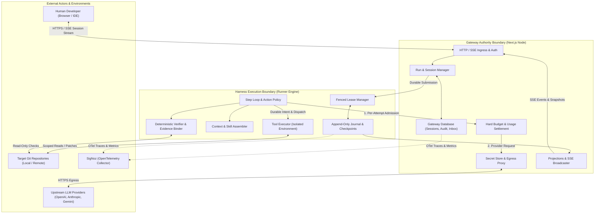

# Architecture Inventory & Gap Analysis (Pass 1)

**Status:** Reviewed & Baseline Established  
**Date:** 2026-11-21  
**Author:** Principal Software Architect & SDD Systems Designer  
**Scope:** Kantha AI Coding Assistant (Gateway–Harness System)  
**Governance:** Level 2 Architecture Specification (Pass 1 of SDD Blueprint)

---

## 1. Executive Summary

Kantha is a dual-tier agentic coding platform designed to autonomously execute and verify bounded software engineering tasks in source repositories. The architecture cleanly bifurcates authority and execution:
1. **The Gateway** (Next.js Node application) is the sovereign authority: it governs user authentication, repository access grants, egress proxies, model provider credentials, budget admissions, and durable business audit.
2. **The Harness** (isolated execution runtime) is the execution engine: it governs the step-continuation loop, generation-fenced leases, append-only conversation journal, checkpointing, tool dispatch, and deterministic verification.

This document establishes the authoritative inventory of system boundaries, state ownership, runtime lifecycle, and concurrency mechanisms, explicitly distinguishing **Verified Code**, **Fixtures/Stubs**, **Intended Architecture**, and **Proposed Changes**. It concludes with a structured inventory of unresolved architectural gaps that must be closed before downstream feature coding.

---

## 2. System Boundaries & External Actors



### External Actors
- **Human Developer (Browser Client):** Submits repository tasks, inspects real-time step streaming, approves/denies mutating actions, requests run cancellation, and receives verified diff candidates and test evidence.
- **Upstream AI Providers:** External language model APIs (OpenAI, Anthropic, Google Gemini, OpenAI-compatible). The Harness never connects directly to these; all egress routes through the Gateway.
- **Target Git Repositories:** Source code workspaces undergoing modification. Must be isolated to prevent destructive corruption of host environments.
- **SigNoz / OTel Collector:** Ingestion sink for metrics, spans, and telemetry, operating under strict privacy/redaction allowlists.

---

## 3. Component Responsibilities & State Ownership

A central rule of Kantha is **single authoritative ownership per state domain**. Dual-writer states or ambiguous state boundaries are architectural violations.

| Domain / State Entity | Authoritative Owner | Secondary Observers | Storage Location | Invariants & Guarantees |
|---|---|---|---|---|
| **Actor Identity & Org Membership** | **Gateway** | Harness | `gateway_db.users`, session JWT | Cryptographically verified on server. Repository code has zero access. |
| **Workspace Grants & Allowed Roots** | **Gateway** | Tool Executor | `gateway_db.workspace_grants` | Scoped file paths are resolved and validated at admission time. |
| **Provider API Credentials** | **Gateway** | None (Harness never sees keys) | `SecretStore` (encrypted at rest) | Server memory only. Never rendered to client, logs, or LLM context. |
| **Public Run ID (`runId`)** | **Gateway** | Client, Harness | `gateway_db.runs`, `harness_inbox` | Universally unique, monotonic run identifier returned to client upon submit. |
| **Submission Deduplication** | **Gateway** | Harness | `gateway_db.harness_inbox` | Keyed by `(workspaceId, inputId)`. Replays existing `runId` on idempotency hit. |
| **Budget Admission & Settlement** | **Gateway** | Harness | `gateway_db.usage_ledger` | Pre-attempt reservation; post-attempt settlement with exact token counts. |
| **Execution Journal** | **Harness** | Gateway Projections | `harness_journal` (append-only) | Sequence-ordered, gap-free, tamper-evident log of steps, deltas, and tool results. |
| **Active Worker Lease (`HarnessClaim`)** | **Harness** | Gateway Supervisor | `harness_claims` | Single active writer per `runId`. Monotonically increasing `generation`. |
| **Execution Checkpoint** | **Harness** | Gateway Projections | `harness_checkpoints` | Single authoritative recovery cursor. Updated before any external side effect. |
| **Action Intent (`actionId`)** | **Harness** | Tool Sandbox | `harness_checkpoints.pendingActionId` | Format: `action_${runId}_${callId}`. Persisted before tool dispatch. |
| **Workspace Modifications & Diff** | **Tool Sandbox / Workspace** | Harness Verifier | Isolated Git working tree / worktree | Base commit pinned at admission; changes tracked as candidate digest. |
| **Acceptance Criteria & Verdict** | **Harness Verifier** | Gateway Projections | `harness_checkpoints.verification` | Pinned during Planning; evaluated deterministically during Verifying. |

---

## 4. Subsystem Deep-Dive & Execution Boundaries

### 4.1 Inference & Egress Boundary
- **Gateway Mediation:** The Harness cannot call provider SDKs directly. It delegates to `IHarnessInference.complete(request, scope)`.
- **Per-Attempt Reservation:** Before each physical LLM call:
  1. The Gateway evaluates hard token and dollar budgets.
  2. If budget permits, it grants a single-attempt admission ticket (`attemptId`).
  3. The Gateway invokes the model provider via `@ai-sdk` egress proxy.
  4. Upon completion or failure, the Gateway settles actual token usage in `usage_ledger`.
- **Tool Call Parsing & Validation:** Model responses proposing tool calls are structurally validated against advertised schemas before any execution.

### 4.2 Tool Execution & Sandboxing Boundary
- **Durable Intent Before Dispatch:** Prior to executing any tool:
  1. The Harness generates a deterministic `actionId = action_${runId}_${callId}`.
  2. The checkpoint is persisted to durable storage with `pendingActionId = actionId`.
  3. Only after checkpoint persistence does the tool runner receive the dispatch command.
- **Action Policy Matrix:**
  - **Allow:** Read-only operations within granted boundaries (`file_read`, `directory_list`, `ripgrep_search`). Executed immediately.
  - **Ask:** Mutating or high-impact actions (`file_patch`, `file_create`, `terminal_exec`). The Harness transitions to `awaiting_approval` and suspends execution.
  - **Deny:** Forbidden actions (path traversal outside workspace, access to `.env` or `.git` internals, dangerous shell commands). Rejected immediately with typed `HarnessError('denied')`.
- **Bounded Tool Outputs:** Tool output strings are capped at 8,192 bytes. Oversized outputs are truncated with a deterministic summary and persisted to artifact storage if full inspection is required.

### 4.3 Storage & Persistence Boundary
- **`IHarnessStore` Interface:** A decoupled document and event store interface isolating SQL drivers from business logic.
- **Dual Storage Topology:**
  - *Current Baseline (Single-process / Local):* SQLite backed with WAL mode (`GatewayDatabase(':memory:')` or local file).
  - *Target Production (Distributed):* Neon managed PostgreSQL with connection pooling, transactional outbox in Gateway, and periodic JSONL journal archival.
- **Event Ordering:** Every event in `appendEvent` receives a monotonic, gap-free `sequence` number shared within the transaction to enable deterministic browser SSE replay.

### 4.4 Run Lifecycle & State Machine
The execution lifecycle follows a strict seven-phase deterministic progression:

```
[Admitted] 
    │ (Lease claimed, gen 1)
    ▼
[Preparing] ──(Preflight failed)──► [Finalizing]
    │ (Baseline verified, context assembled)
    ▼
[Planning] ──(Clarification needed)──► [Finalizing]
    │ (Criteria pinned)
    ▼
[Executing] ◄───► [AwaitingApproval]
    │ (Model finishReason: 'stop')
    ▼
[Verifying] ──(Check failed & repair < maxRepairs)──► [Executing]
    │ (All passed OR max repairs reached)
    ▼
[Finalizing] ──► [Terminal Outcome: completed | failed | cancelled | interrupted]
```

### 4.5 Leases, Fencing & Concurrency Rules
- **Monotonic Generation Fencing:** Every claim acquisition increments `generation` (`gen = prev_gen + 1`).
- **Single-Writer Enforcement:** Every journal append, checkpoint save, and state mutation invokes `assertClaim(runId, generation, scope)`.
- **Split-Brain Mitigation:** If a worker experiences a long stop-the-world GC pause or network partition exceeding `leaseMs` (default 30,000 ms), another worker reclaims with `generation + 1`. When the stale worker wakes, its next write fails with `HarnessError('stale_claim')`, causing it to immediately abort and clean up.

### 4.6 Checkpointing & Interruption Recovery
- **Authoritative Recovery Cursor:** `HarnessCheckpoint` contains everything necessary for a cold worker to resume:
  - `phase`, `step`, `inputPosition`, `lastSourceEventId`
  - `pendingCallId`, `pendingActionId`
  - `completedCallIds`, `toolResults`, `skippedCallIds`
  - `repairCount`, `claimGeneration`
- **Crash Recovery Workflow:**
  1. Worker restarts or fresh worker claims expired lease.
  2. Inspects `pendingActionId`:
     - Calls `IHarnessWorkspace.reconcile(pendingActionId)`.
     - If verified receipt exists (e.g., file was written, command exit code logged), the result is absorbed into `toolResults`, clearing `pendingActionId`.
     - If outcome is unverifiable (uncertain side effect), execution terminates with `interrupted` to prevent double-execution of destructive actions.
  3. Resumes at `step` without re-running completed tool calls.

### 4.7 Human Approvals & Decision Binding
- When an action policy evaluates to `Ask`:
  1. The Harness checkpoints the pending action with an approval digest: `SHA256(actionId + runId + normalizedArgs)`.
  2. Emits an `approval_requested` SSE event to the Gateway and Client.
  3. Execution suspends with a configurable TTL (default 5 minutes).
  4. If the user approves, the Gateway validates that the approval decision payload matches the exact pending digest.
  5. If denied or expired, the action is marked `status: 'denied'` and the model step is informed to pick an alternative path or finalize.

### 4.8 Deterministic Verification
- **Verify, Don't Trust:** The LLM's assertion "I fixed the issue and tests pass" is treated as untrusted text.
- **Criteria Pinning:** During the `Planning` phase, the Harness pins an immutable array of `HarnessAcceptanceCriterion`:
  - `criterionId`, `behavior`, `checkCommand`, `required: true/false`.
- **Execution in `Verifying` Phase:** The verifier executes each check in an isolated, read-only subshell.
- **Bounded Repair Loop:**
  - If any required check fails and `repairCount < maxRepairs` (v1 default 0 in fixtures, up to 2 in staging):
    - Diagnostic evidence is formatted into a repair prompt.
    - Run returns to `Executing` phase with incremented `repairCount`.
  - If checks fail and `repairCount >= maxRepairs`: Run concludes as `failed`.

---

## 5. Architectural Implementation Status

To prevent conflating aspirational diagrams with working code, the table below provides a strict classification of current repository reality:

| Architecture Area | Implementation Status | Evidence in Repository | Gaps / Missing Capabilities |
|---|---|---|---|
| **Gateway Auth & Ingress** | **Verified Existing Code** | `src/lib/gateway/server/ingress.ts`, `access.ts`, `src/app/api/gateway/access/route.ts` | Session cookie verification verified; OAuth token refresh flow needs staging test. |
| **Gateway Provider Connections** | **Verified Existing Code** | `src/lib/gateway/server/connection-store.ts`, `providers/` | Mock and custom provider connection storage works; live credential encryption needs HSM/KMS in prod. |
| **Gateway Chat Streaming** | **Verified Existing Code** | `src/app/api/chat/route.ts`, `chat-service.ts` | AI SDK v5 `useChat` stream works for Gateway-only chat. |
| **Gateway Run & Session Store** | **Verified Existing Code** | `src/lib/gateway/runs/run-service.ts`, `session-service.ts` | Session and run records persisted in SQLite database. |
| **Gateway Usage & Budgeting** | **Verified Existing Code** | `src/lib/gateway/server/usage-service.ts`, `src/app/api/gateway/usage/route.ts` | In-memory token budgeting and ledger tracking works. |
| **Gateway SSE Event Feed** | **Verified Existing Code** | `src/lib/gateway/runs/event-feed.ts`, `src/app/api/gateway/events/route.ts` | SSE endpoint functional with replay cursor support. |
| **Gateway Approvals Service** | **Existing Fixture / Stub** | `src/lib/gateway/server/approval-service.ts`, `src/app/api/gateway/approvals/` | Memory fixture only. Does not yet bind to live Harness suspension lifecycle. |
| **Harness Domain Contracts** | **Verified Existing Code** | `src/lib/harness/contracts.ts` | Type definitions fully specified; zero external framework dependencies. |
| **Harness Journal & Checkpoints** | **Verified Existing Code** | `src/lib/harness/journal.ts` | Append-only journal, monotonic generation claims, checkpoint save/restore verified in H1 tests. |
| **Harness Runner Lifecycle** | **Verified Existing Code** | `src/lib/harness/runner.ts` | Lifecycle state machine, tool continuation loop, repair counter verified in unit fixtures. |
| **Harness Service & Submission** | **Verified Existing Code** | `src/lib/harness/service.ts` | Input deduplication, admission receipts, and background runner dispatch verified in H1. |
| **Harness Inference Adapter** | **Partial (Fixture Coverage)** | `src/lib/harness/inference.ts`, `scripts/test-h2-inference.mjs` | Scripted fixture model and token estimation verified. **Live provider `streamText` bridge not yet connected.** |
| **Repository Tools & Workspace** | **Proposed / Fixture Only** | `src/lib/harness/tools.ts`, `fixture.ts` | Only mock tools (`file_read`, `echo`) exist. Real git worktree management and diff patching not built. |
| **Deterministic Verification** | **Proposed (H4)** | `docs/harness/features/VERIFICATION.md` | Interface `IHarnessVerifier` defined; live test execution harness not implemented. |
| **Durable Human Approvals** | **Proposed (H4)** | `docs/harness/features/APPROVALS.md` | Flow designed; suspension timer and client resume protocol not connected. |
| **Local Persistence Store** | **Canonical (ADR-003)** | `docs/technology/DATABASE-STRATEGY.md` | Local-first `bun:sqlite` with Drizzle ORM in WAL mode + append-only JSONL event log. Zero cloud setup. |
| **Persistent Bun Daemon** | **Canonical (ADR-001 & ADR-002)** | `docs/technology/RUNTIME-TOPOLOGY.md` | Runs as an independent Bun v1.4+ OS daemon hosting Effect HttpApi and Custom Effect Harness. |

---

## 6. Comprehensive Unresolved Architectural Decisions & Gaps

The following decisions are tracked across feature design:

| Gap / Decision ID | Domain | Description | Current Resolution | Status |
|---|---|---|---|---|
| **D-01** | Runtime Hosting | Hosting topology: Persistent Bun v1.4+ Daemon running Effect HttpApi and Custom Effect Harness. | Adopted in ADR-001 & ADR-002. Decouples execution from web server timeouts and browser disconnects. | **RESOLVED** |
| **D-02** | Database Driver | Persistence strategy: Local-first `bun:sqlite` with Drizzle ORM in WAL mode + JSONL event stream. | Adopted in ADR-003. Sub-millisecond local ACID transactions; zero cloud setup. | **RESOLVED** |
| **D-03** | Approval Granularity | Per-action approval vs. "Approve Once for Session" (Session grants). | Per-action `Ask` policy for all mutating tools. | User approval fatigue leading to rubber-stamping or broken automation. |
| **D-04** | Context Compaction | Compaction threshold and token budget allocation across history vs. tools vs. repo docs. | Token count heuristic with 8KB tool cap. | LLM context overflow during extended repair sessions; prompt truncation bugs. |
| **D-05** | Workspace Isolation | Filesystem isolation mechanism: Git worktrees vs. Docker containers vs. microVMs. | Local Git worktree with sanitized relative paths. | Arbitrary code execution vulnerability if shell tools are exposed on the host OS. |
| **D-06** | Evidence Artifact Store | Storage sink for raw tool outputs, diffs, and test logs: Local FS vs. S3-compatible bucket. | Local `.gateway-data/artifacts` directory. | Lost evidence on multi-container deployments or ephemeral pod restarts. |
| **D-07** | Live Model Matrix | Baseline model support for coding runs: Claude 3.5 Sonnet vs. GPT-4o vs. Gemini 1.5 Pro. | AI SDK provider abstraction. | Tool calling format nuances, schema adherence disparities across providers. |
| **D-08** | Eval Benchmark Suite | Qualification test suite for release gates: synthetic repos vs. SWE-bench style tasks. | Pinned fixture repo with 3 scripted tasks. | Inability to measure real-world completion accuracy before production deployment. |
| **G-01** *(New)* | SSE Reconnect Protocol | Client reconnect semantics after network drop: snapshot replay vs. delta streaming cursor. | Cursor-based event log in `IHarnessStore`. | Duplicate rendering of assistant text deltas or skipped tool execution cards. |
| **G-02** *(New)* | Multi-File Patching | Atomic diff application strategy: unified diff vs. whole-file overwrite vs. AST edits. | Undecided in `IHarnessWorkspace`. | Corrupted merge conflicts when an LLM produces truncated diffs. |
| **G-03** *(New)* | Process Kill Semantics | Signal propagation when user clicks "Stop": aborting HTTP vs. sending `SIGKILL` to sandboxed tools. | AbortSignal propagated to inference only. | Orphaned background child processes consuming 100% CPU on host. |

---

## 7. Pass 1 Sign-Off & Recommendation

**Architectural Assessment:**  
The Gateway–Harness boundary is exceptionally clean and conceptually sound. The domain contracts in `src/lib/harness/contracts.ts` demonstrate high architectural maturity: zero Next.js leaks, strict dependency inversion, generation-fenced leases, and durable action intent.

**Recommendation:**  
Proceed immediately to **Pass 2 (Product Vision & Constitution)** to formalize the non-negotiable engineering laws and foundation requirements that lock these boundaries into the repository constitution. No production code should be written until Gates 1–4 are formally closed.
