# Kantha roadmap dependencies

**Status:** Proposed. Based on existing `architecture.md` release sequence and feature contracts.

## Dependency graph

```mermaid
flowchart TD
    subgraph Foundation
        HAR-001["HAR-001<br/>Domain contracts"]
        GW-008["GW-008<br/>Gateway database"]
        GW-001["GW-001<br/>Auth and scope"]
    end

    subgraph Gateway["Gateway (existing code)"]
        GW-002["GW-002<br/>Connections"] --> GW-001
        GW-003["GW-003<br/>Chat and streaming"] --> GW-001
        GW-003 --> GW-002
        GW-004["GW-004<br/>Sessions and runs"] --> GW-001
        GW-005["GW-005<br/>Usage accounting"] --> GW-001
        GW-006["GW-006<br/>Event feed and SSE"] --> GW-004
        GW-007["GW-007<br/>Secret store"] --> GW-001
        GW-009["GW-009<br/>Capacity"] --> GW-008
        GW-010["GW-010<br/>Health"] --> GW-008
        GW-011["GW-011<br/>Approval service"] --> GW-004
    end

    subgraph Harness-H1["Harness H0–H1 (implemented)"]
        HAR-002["HAR-002<br/>Journal"] --> HAR-001
        HAR-003["HAR-003<br/>Runner"] --> HAR-001
        HAR-003 --> HAR-002
        HAR-004["HAR-004<br/>Service"] --> HAR-003
        HAR-007["HAR-007<br/>Fixture tools"] --> HAR-001
        HAR-008["HAR-008<br/>Gateway adapter"] --> HAR-001
        HAR-008 --> GW-008
        INT-001["INT-001<br/>GW–HAR interfaces"] --> HAR-001
    end

    subgraph Harness-H2["Harness H2 (partial)"]
        HAR-005["HAR-005<br/>Inference"] --> HAR-001
        HAR-005 --> GW-003
        HAR-005 --> GW-005
        HAR-006["HAR-006<br/>Token estimation"] 
    end

    subgraph Harness-H3["Harness H3 (proposed)"]
        HAR-009["HAR-009<br/>Context and skills"] --> HAR-003
        HAR-009 --> HAR-005
        HAR-010["HAR-010<br/>Workspace and tools"] --> HAR-001
        HAR-010 --> HAR-003
    end

    subgraph Harness-H4["Harness H4 (proposed)"]
        HAR-011["HAR-011<br/>Verification"] --> HAR-003
        HAR-011 --> HAR-010
        HAR-012["HAR-012<br/>Durable approval"] --> HAR-003
        HAR-012 --> GW-011
        HAR-013["HAR-013<br/>Bounded repair"] --> HAR-011
    end

    subgraph Harness-H5["Harness H5 (proposed)"]
        HAR-014["HAR-014<br/>Persistence"] --> HAR-002
        HAR-014 --> GW-008
    end

    subgraph Integration
        INT-002["INT-002<br/>Chat integration"] --> GW-006
        INT-002 --> HAR-003
        INT-003["INT-003<br/>Browser projection"] --> GW-006
        INT-003 --> HAR-003
        INT-003 --> INT-002
    end

    subgraph Browser
        BRW-001["BRW-001<br/>Chat UI"] --> GW-003
        BRW-002["BRW-002<br/>Harness panel"] --> INT-002
        BRW-003["BRW-003<br/>Provider settings"] --> GW-002
        BRW-004["BRW-004<br/>Task submission"] --> INT-003
        BRW-005["BRW-005<br/>Approval UI"] --> HAR-012
        BRW-005 --> INT-003
    end

    subgraph Infrastructure
        INF-001["INF-001<br/>Observability"]
        INF-002["INF-002<br/>PostgreSQL"] --> GW-008
        INF-002 --> HAR-014
        INF-003["INF-003<br/>Release suite"] --> HAR-011
        INF-004["INF-004<br/>Deployment"] --> INF-001
        INF-004 --> INF-002
    end
```

## Implementation order

The critical path follows the harness milestone sequence defined in `docs/harness/IMPLEMENTATION-PLAN.md`:

1. **Foundation** (done): HAR-001, GW-008, GW-001 — contracts and existing gateway
2. **H1 layer** (done): HAR-002, HAR-003, HAR-004, HAR-007, HAR-008, INT-001
3. **H2 layer** (partial): HAR-005, HAR-006 — complete live provider qualification
4. **H3 layer** (next): HAR-009, HAR-010 — context assembly and repository tools
5. **H4 layer**: HAR-011, HAR-012, HAR-013 — verification, approval, repair
6. **H5 layer**: HAR-014, INF-001, INF-002, INF-003, INF-004 — persistence, ops, staging
7. **Integration**: INT-002, INT-003 — can begin alongside H3 for projection wiring
8. **Browser**: BRW-004, BRW-005 — after integration features land

## Dependency rules

- No feature may begin implementation until all its dependencies are at least IN_PROGRESS with their contracts stable.
- Contract-defining features (HAR-001, INT-001) must be DONE before consuming features start.
- Browser features depend on their integration layer, never directly on harness internals.
- Infrastructure features (INF-*) can progress in parallel with their harness dependencies for setup work, but qualification requires the harness features.
