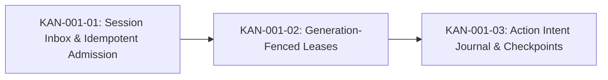
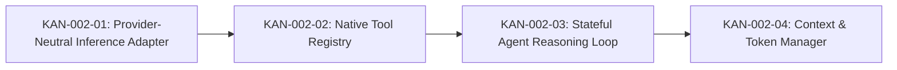

# Implementation Plan: Native Kantha Harness & Capability Adapters

**Status:** APPROVED FOR IMPLEMENTATION PLANNING  
**Date:** 2026-11-21  
**Architecture Specification:** [SPEC-native-kantha-harness-architecture.md](../specs/SPEC-native-kantha-harness-architecture.md)  
**Strategy:** Evolve existing Kantha architecture into a 100% native, production-grade agent platform using OpenCode on local C: drive strictly as an architectural reference (zero OpenCode runtime dependencies).

---

## 1. Governance & Execution Rules

1. **One Atomic Task Per Session**: Each subsequent AI coding session implements exactly one scoped task file.
2. **Deterministic Verification Gate**: A task is only marked `DONE` when:
   - All verification commands specified in the task file pass with recorded evidence.
   - Clean TypeScript check (`npm run typecheck` exits 0).
   - Zero ESLint errors on modified paths.
   - Task handoff document is committed.
3. **No Wholesale Rewrites**: Existing Gateway routes, authentication, database mappings, and verified sandbox contracts are preserved and extended incrementally.
4. **Authority Guard**: Gateway retains sovereign authority over credentials (`ORGO_API_KEY`, `COMPOSIO_API_KEY`, AI provider keys) and user/workspace grants.

---

## 2. Master Implementation Roadmap

| Phase | Milestone Name | Feature ID | Scope & Outcome | Status |
| :---: | :--- | :--- | :--- | :---: |
| **1** | **Foundation & State Durability** | `KAN-001` | Session Inbox, generation-fenced leases, and write-ahead action intent journal. | READY |
| **2** | **Core Runtime & Reasoning Engine** | `KAN-002` | Provider-neutral inference, typed tool registry, agent reasoning loop, and context compaction. | QUEUED |
| **3** | **Permissions & Repository Sandbox** | `KAN-003` | `allow`/`ask`/`deny` approvals, safe path guard, and ephemeral Git worktrees. | QUEUED |
| **4** | **Orgo Cloud Computers Adapter** | `KAN-004` | Multi-OS lifecycle (Linux/Windows/macOS), action suite, public URLs, and workflows. | QUEUED |
| **5** | **Composio & Native MCP Client** | `KAN-005` | JSON-RPC stdio/SSE client, Composio Session SDK adapter, and 1,500+ app connectors. | QUEUED |
| **6** | **Omni-Channel Communication** | `KAN-006` | AgentMail (inboxes, calendar), AgentPhone (SMS, iMessage, voice), and Voice streaming. | QUEUED |
| **7** | **Subagents & Verification Engine** | `KAN-007` | Subagent delegation, deterministic proof verification, and end-to-end qualification. | QUEUED |

---

## 3. Detailed Task Breakdown

### Phase 1: Foundation & State Durability (`KAN-001`)

#### Task `KAN-001-01`: Session Inbox & Idempotent Admission
- **File**: `docs/features/native-harness/KAN-001-foundation/tasks/KAN-001-01.md`
- **Goal**: Implement `session_inbox` SQLite table, prompt admission endpoint, `steer` vs `queue` delivery modes, and idempotency on `(session_id, request_id)`.
- **Prerequisites**: Existing SQLite gateway database.
- **Verification**: `node --import tsx --test scripts/test-session-inbox.mjs`

#### Task `KAN-001-02`: Generation-Fenced Execution Leases
- **File**: `docs/features/native-harness/KAN-001-foundation/tasks/KAN-001-02.md`
- **Goal**: Implement single-writer execution leases with monotonically incrementing generation counters and heartbeat timeouts to prevent split-brain execution.
- **Prerequisites**: `KAN-001-01`
- **Verification**: `node --import tsx --test scripts/test-execution-lease.mjs`

#### Task `KAN-001-03`: Action Intent Journal & Crash Recovery
- **File**: `docs/features/native-harness/KAN-001-foundation/tasks/KAN-001-03.md`
- **Goal**: Implement append-only journal facts and write-ahead action intent (`action_${runId}_${callId}`). Add startup orphan reconciliation to fail in-flight actions from crashed processes without duplicate replay.
- **Prerequisites**: `KAN-001-02`
- **Verification**: `node --import tsx --test scripts/test-journal-recovery.mjs`

---

### Phase 2: Core Native Agent Runtime & Inference Engine (`KAN-002`)

#### Task `KAN-002-01`: Provider-Neutral Inference Adapter
- **File**: `docs/features/native-harness/KAN-002-runtime/tasks/KAN-002-01.md`
- **Goal**: Abstract OpenAI, Anthropic, and Gemini models. Provide streaming delta normalization (text, thoughts, structured tool call fragments) and per-attempt budget reservation.
- **Prerequisites**: `KAN-001-03`
- **Verification**: `node --import tsx --test scripts/test-inference-stream.mjs`

#### Task `KAN-002-02`: Native Kantha Tool Registry
- **File**: `docs/features/native-harness/KAN-002-runtime/tasks/KAN-002-02.md`
- **Goal**: Build `IKanthaToolRegistry` supporting standard JSON Schema validation, tri-value outputs (`output` machine value, `content` model markdown, `metadata` UI JSON), and 32KB output bounding.
- **Prerequisites**: `KAN-002-01`
- **Verification**: `node --import tsx --test scripts/test-tool-registry.mjs`

#### Task `KAN-002-03`: Stateful Agent Reasoning Loop
- **File**: `docs/features/native-harness/KAN-002-runtime/tasks/KAN-002-03.md`
- **Goal**: Implement iterative step loop coordinating model requests, tool dispatches, physical attempt retries, terminal settlements, and `AbortSignal` cancellation.
- **Prerequisites**: `KAN-002-02`
- **Verification**: `node --import tsx --test scripts/test-agent-runtime.mjs`

#### Task `KAN-002-04`: Context & Token Manager
- **File**: `docs/features/native-harness/KAN-002-runtime/tasks/KAN-002-04.md`
- **Goal**: Dynamic assembly of system instructions, hierarchical `AGENTS.md` and skill loading, token usage accounting, and sliding-window compaction.
- **Prerequisites**: `KAN-002-03`
- **Verification**: `node --import tsx --test scripts/test-context-compaction.mjs`

---

### Phase 3: Permissions & Repository Sandbox (`KAN-003`)

#### Task `KAN-003-01`: Permissions & Human Approvals Engine
- **File**: `docs/features/native-harness/KAN-003-sandbox/tasks/KAN-003-01.md`
- **Goal**: Policy evaluation (`allow`/`ask`/`deny`), durable suspension checkpoints for `ask`, operator decision submission, and safe resumption.
- **Prerequisites**: `KAN-002-04`
- **Verification**: `node --import tsx --test scripts/test-permissions-engine.mjs`

#### Task `KAN-003-02`: Sandboxed Filesystem & Safe Path Guard
- **File**: `docs/features/native-harness/KAN-003-sandbox/tasks/KAN-003-02.md`
- **Goal**: File read, write, edit, grep, and find tools strictly confined to the workspace root with symlink protection.
- **Prerequisites**: `KAN-003-01`
- **Verification**: `node --import tsx --test scripts/test-path-guard.mjs`

#### Task `KAN-003-03`: Ephemeral Git Worktree Integration
- **File**: `docs/features/native-harness/KAN-003-sandbox/tasks/KAN-003-03.md`
- **Goal**: Isolate task execution in ephemeral git worktrees, capture dirty diffs, and perform clean merges on task completion.
- **Prerequisites**: `KAN-003-02`
- **Verification**: `node --import tsx --test scripts/test-git-worktree.mjs`

---

### Phase 4: Orgo Cloud Computers Adapter (`KAN-004`)

#### Task `KAN-004-01`: Orgo Client & Full Multi-OS Lifecycle
- **File**: `docs/features/adapters/KAN-004-orgo/tasks/KAN-004-01.md`
- **Goal**: Implement `IKanthaComputerProvider` lifecycle: dynamic provisioning for Linux/Windows, stock assignment for macOS, start, stop (freeze), restart, suspend, resume, resize, clone, and delete.
- **Prerequisites**: `KAN-002-02`
- **Verification**: `node --import tsx --test scripts/test-orgo-lifecycle.mjs`

#### Task `KAN-004-02`: Orgo Desktop Action Suite & Multi-OS Normalization
- **File**: `docs/features/adapters/KAN-004-orgo/tasks/KAN-004-02.md`
- **Goal**: High-res screenshot observation with dimension validation, mouse click/move/drag/scroll, text typing, platform shortcut key mapping (Ctrl vs Command), and coordinate boundary guards.
- **Prerequisites**: `KAN-004-01`
- **Verification**: `node --import tsx --test scripts/test-orgo-actions.mjs`

#### Task `KAN-004-03`: Orgo Public URLs, Workflows & Terminal
- **File**: `docs/features/adapters/KAN-004-orgo/tasks/KAN-004-03.md`
- **Goal**: Expose web preview subdomains (`/public-urls`), start/monitor cloud background workflows (`/workflows`), and execute bash/PowerShell commands.
- **Prerequisites**: `KAN-004-02`
- **Verification**: `node --import tsx --test scripts/test-orgo-features.mjs`

---

### Phase 5: Composio Connectors & Provider-Neutral MCP Client (`KAN-005`)

#### Task `KAN-005-01`: Provider-Neutral MCP Client
- **File**: `docs/features/adapters/KAN-005-composio-mcp/tasks/KAN-005-01.md`
- **Goal**: Native TypeScript MCP client supporting stdio child processes and remote HTTP/SSE servers with tool and resource discovery.
- **Prerequisites**: `KAN-002-02`
- **Verification**: `node --import tsx --test scripts/test-mcp-client.mjs`

#### Task `KAN-005-02`: Composio Session SDK Adapter
- **File**: `docs/features/adapters/KAN-005-composio-mcp/tasks/KAN-005-02.md`
- **Goal**: Integrate Composio REST API v3.1 / `@composio/core`. Handle user entity mapping, OAuth Connect Link generation, and Proxy Execute.
- **Prerequisites**: `KAN-005-01`
- **Verification**: `node --import tsx --test scripts/test-composio-adapter.mjs`

#### Task `KAN-005-03`: Tool Registry Dynamic Connector Integration
- **File**: `docs/features/adapters/KAN-005-composio-mcp/tasks/KAN-005-03.md`
- **Goal**: Register MCP and Composio toolkits (GitHub, Slack, Jira, Gmail) into `IKanthaToolRegistry` with permission checks and UI connection cards.
- **Prerequisites**: `KAN-005-02`
- **Verification**: `node --import tsx --test scripts/test-connector-registry.mjs`

---

### Phase 6: Omni-Channel Communication Adapters (`KAN-006`)

#### Task `KAN-006-01`: AgentMail Adapter
- **File**: `docs/features/adapters/KAN-006-comms/tasks/KAN-006-01.md`
- **Goal**: Provision inboxes, send/receive emails, parse attachments, manage threads/drafts, and manage calendar events via `agentmail.to`.
- **Prerequisites**: `KAN-002-02`
- **Verification**: `node --import tsx --test scripts/test-agentmail-adapter.mjs`

#### Task `KAN-006-02`: AgentPhone & Voice Adapters
- **File**: `docs/features/adapters/KAN-006-comms/tasks/KAN-006-02.md`
- **Goal**: Provision phone numbers, send/receive SMS/iMessage/WhatsApp, initiate voice calls, capture live transcripts, and stream voice audio via `agentphone.to`.
- **Prerequisites**: `KAN-006-01`
- **Verification**: `node --import tsx --test scripts/test-agentphone-adapter.mjs`

---

### Phase 7: Subagents, Deterministic Verification & End-to-End Release (`KAN-007`)

#### Task `KAN-007-01`: Subagent Delegation Subsystem
- **File**: `docs/features/native-harness/KAN-007-verification/tasks/KAN-007-01.md`
- **Goal**: Spawn child subagent sessions with isolated workspaces, constrained token/step budgets, and completion reporting.
- **Prerequisites**: `KAN-003-03`
- **Verification**: `node --import tsx --test scripts/test-subagents.mjs`

#### Task `KAN-007-02`: Deterministic Verifier & Evidence Binder
- **File**: `docs/features/native-harness/KAN-007-verification/tasks/KAN-007-02.md`
- **Goal**: Automated test runners capturing terminal stdout/stderr, exit codes, and diffs. Binds proof to candidate changes.
- **Prerequisites**: `KAN-007-01`
- **Verification**: `node --import tsx --test scripts/test-verifier-engine.mjs`

#### Task `KAN-007-03`: End-to-End Release Qualification
- **File**: `docs/features/native-harness/KAN-007-verification/tasks/KAN-007-03.md`
- **Goal**: End-to-end integration scenario combining coding tasks, Orgo desktop control, Composio GitHub interaction, and AgentMail notifications with interruption and recovery.
- **Prerequisites**: All previous tasks.
- **Verification**: `npm run test:all && npm run typecheck && npm run build`
