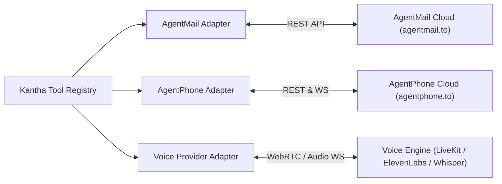

# Specification: AgentMail, AgentPhone & Voice Capability Adapters

**Status:** IN_REVIEW  
**Version:** 1.0.0  
**Date:** 2026-11-21  
**Author:** Principal Systems Architect  
**Scope:** Email, Calendar, SMS, MMS, iMessage, WhatsApp, RCS, Voice Calling, and Audio Streaming Adapters for Kantha  

---

## 1. Overview & Architecture

Kantha agents can communicate with human users, external services, and automated pipelines via real-world communication channels:
1. **AgentMail Adapter (`agentmail.to`)**: API-first email accounts for AI agents. Provides scalable email inboxes, thread grouping, drafts with human review, attachment parsing, calendar scheduling with iCalendar support, and AgentID authentication.
2. **AgentPhone Adapter (`agentphone.to`)**: Programmatic telephony and messaging. Supports SMS, MMS, iMessage, WhatsApp, RCS, voice calling with live streaming transcripts, and phone number provisioning.
3. **Voice Provider Adapter**: Real-time audio streams, speech-to-text (STT), and text-to-speech (TTS) for synchronous conversational interactions.

All communication tools are registered into the `KanthaToolRegistry` under strict permission controls. Outbound emails or phone calls to non-whitelisted recipients automatically trigger `ask` permissions requiring human approval.



---

## 2. AgentMail Adapter Specification

### Capabilities
- **Inbox Provisioning**: Dynamic creation of isolated email inboxes (`user@agentmail.to` or custom domains).
- **Message Dispatch & Retrieval**: Sending structured emails, retrieving threads, parsing attachments (PDF, DOCX, XLSX text extraction).
- **Drafts & Approvals**: Creating drafts for human-in-the-loop review before dispatch.
- **Calendar & Invitations**: Managing calendar events, accepting/declining iCalendar (.ics) invitations, and handling scheduling conflicts.
- **Agent Armor**: Automated scanning of incoming email for prompt injection or adversarial attacks.

### Core TypeScript Contract

```typescript
export interface MailInbox {
  inboxId: string;
  emailAddress: string;
  name: string;
  createdAt: string;
}

export interface SendEmailOptions {
  inboxId: string;
  to: string[];
  cc?: string[];
  subject: string;
  bodyText: string;
  bodyHtml?: string;
  attachments?: Array<{ filename: string; contentBase64: string; contentType: string }>;
  isDraft?: boolean;
}

export interface EmailThread {
  threadId: string;
  subject: string;
  messageCount: number;
  lastMessageAt: string;
  messages: Array<{
    id: string;
    from: string;
    to: string[];
    bodyText: string;
    extractedText?: string;
    receivedAt: string;
    attachments: Array<{ id: string; filename: string; size: number }>;
  }>;
}

export interface CalendarEvent {
  eventId: string;
  inboxId: string;
  title: string;
  startTime: string; // ISO 8601
  endTime: string;
  attendees: string[];
  rrule?: string;
}

export interface IAgentMailAdapter {
  createInbox(name: string, customDomain?: string): Promise<MailInbox>;
  listInboxes(): Promise<MailInbox[]>;
  sendEmail(options: SendEmailOptions): Promise<{ messageId: string; threadId: string; status: 'sent' | 'draft' }>;
  getThread(threadId: string): Promise<EmailThread>;
  listMessages(inboxId: string, limit?: number): Promise<Array<{ id: string; subject: string; from: string; receivedAt: string }>>;
  createCalendarEvent(event: Omit<CalendarEvent, 'eventId'>): Promise<CalendarEvent>;
  respondToInvitation(inboxId: string, eventId: string, decision: 'accept' | 'decline' | 'tentative'): Promise<void>;
}
```

---

## 3. AgentPhone Adapter Specification

### Capabilities
- **Number Provisioning**: Purchasing and configuring SMS- and voice-capable phone numbers.
- **Omni-Channel Messaging**: Sending and receiving across SMS (10DLC), MMS, Apple iMessage, WhatsApp Business, and RCS.
- **Voice Calling**: Initiating outbound voice calls, receiving calls, streaming live audio, and capturing real-time speech-to-text transcripts.

### Core TypeScript Contract

```typescript
export type MessagingChannel = 'sms' | 'mms' | 'imessage' | 'whatsapp' | 'rcs';

export interface SendMessageOptions {
  fromNumber: string;
  toNumber: string;
  channel: MessagingChannel;
  text: string;
  mediaUrls?: string[];
}

export interface OutboundCallOptions {
  fromNumber: string;
  toNumber: string;
  initialPrompt?: string;
  voiceId?: string;
  recordCall?: boolean;
}

export interface CallSession {
  callId: string;
  status: 'initiating' | 'ringing' | 'in_progress' | 'completed' | 'failed';
  durationSeconds: number;
  transcript: Array<{ speaker: 'agent' | 'user'; text: string; timestamp: string }>;
}

export interface IAgentPhoneAdapter {
  listNumbers(): Promise<Array<{ numberId: string; phoneNumber: string; channels: MessagingChannel[] }>>;
  sendMessage(options: SendMessageOptions): Promise<{ messageId: string; status: 'queued' | 'sent' | 'delivered' }>;
  startCall(options: OutboundCallOptions): Promise<{ callId: string }>;
  getCallStatus(callId: string): Promise<CallSession>;
  endCall(callId: string): Promise<void>;
}
```

---

## 4. Voice Provider Adapter Specification

Provides real-time conversational audio processing:
1. **Text-to-Speech (TTS)**: Synthesizes high-fidelity audio chunks from assistant text streams.
2. **Speech-to-Text (STT)**: Transcribes microphone or telephony audio streams with sub-300ms latency.
3. **Session Transport**: WebSocket / WebRTC connection streaming raw PCM audio frames.
