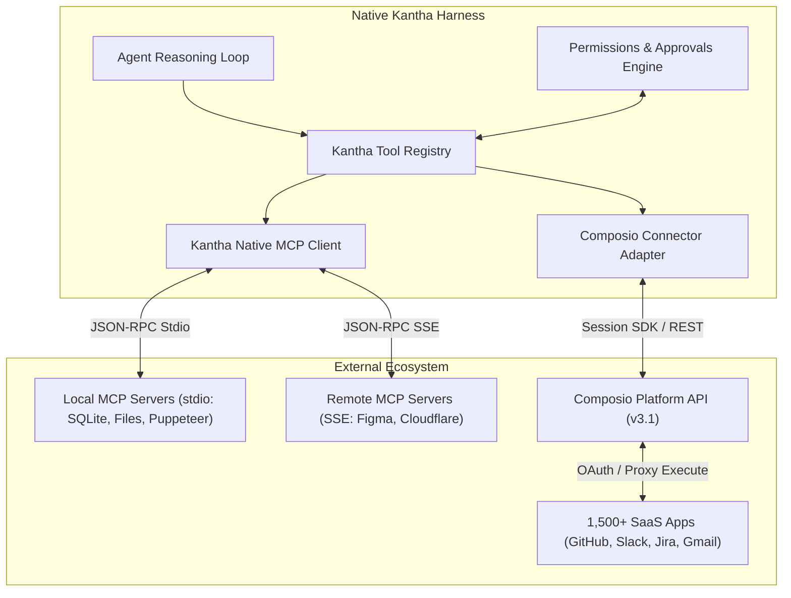

# Specification: Composio Connector & Provider-Neutral MCP Client

**Status:** IN_REVIEW  
**Version:** 1.0.0  
**Date:** 2026-11-21  
**Author:** Principal Systems Architect  
**Scope:** Native Provider-Neutral Model Context Protocol (MCP) Client and Composio Session SDK Integration for 1,500+ App Connectors  

---

## 1. Overview & Architecture

Kantha agents interact with external enterprise SaaS ecosystems (GitHub, Jira, Slack, Salesforce, Google Drive, Notion, etc.) through two complementary layers:
1. **Provider-Neutral Native MCP Client**: A 100% native TypeScript client implementing the Model Context Protocol (JSON-RPC 2.0). Connects to both local stdio processes and remote HTTP/SSE servers, discovers tools/resources, and seamlessly registers them into the `IKanthaToolRegistry`.
2. **Composio Connector Adapter**: Leverages Composio Session SDK v3.1 (`@composio/core`) to manage user accounts, authenticated sessions, OAuth Connect Links, and proxy execution across 1,500+ tools.

Kantha maintains complete ownership over:
- Tool registration, filtering, and schema validation.
- User identity mapping (`entityId = kantha_user_<userId>`).
- OAuth connection status and human approval policies.
- Audit logging of external tool executions.



---

## 2. Provider-Neutral MCP Client Specification

The MCP client implements the standard Model Context Protocol without external harness runtime dependencies.

### Transports Supported
1. **Stdio Transport**: Spawns local executable child processes (`command`, `args`, `env`) with bidirectional newline-delimited JSON-RPC communication over stdin/stdout.
2. **HTTP/SSE Transport**: Connects to remote MCP endpoints via Server-Sent Events for server-to-client notifications and HTTP POST for client requests.

### Core TypeScript Contract

```typescript
export interface MCPServerConfig {
  id: string;
  name: string;
  transport: 'stdio' | 'sse';
  command?: string;
  args?: string[];
  env?: Record<string, string>;
  url?: string;
  headers?: Record<string, string>;
  enabled: boolean;
}

export interface MCPToolSchema {
  name: string;
  description?: string;
  inputSchema: {
    type: 'object';
    properties?: Record<string, unknown>;
    required?: string[];
  };
}

export interface IMCPClient {
  connect(config: MCPServerConfig): Promise<void>;
  disconnect(serverId: string): Promise<void>;
  listTools(serverId: string): Promise<MCPToolSchema[]>;
  callTool(serverId: string, toolName: string, argumentsPayload: Record<string, unknown>, signal?: AbortSignal): Promise<{
    content: Array<{ type: 'text' | 'image' | 'resource'; text?: string; data?: string; mimeType?: string }>;
    isError?: boolean;
  }>;
  listResources?(serverId: string): Promise<Array<{ uri: string; name: string; mimeType?: string }>>;
  readResource?(serverId: string, uri: string): Promise<{ contents: Array<{ uri: string; text?: string; blob?: string }> }>;
}
```

---

## 3. Composio Connector Adapter Specification

Integrates the Composio REST API v3.1 and `@composio/core` into Kantha.

### Core Responsibilities
1. **User Identity & Workspace Mapping**: Maps Kantha users and tenants to Composio Entities (`kantha_usr_${userId}`).
2. **Session Lifecycle**: Creates or retrieves Composio sessions with specified toolkits (e.g. `['github', 'slack']`).
3. **Connect Link Generation**: When an app is not connected or authorization is required, generates a secure OAuth Connect Link for the user to complete in their browser.
4. **Proxy Execute & Tool Invocation**: Dispatches tool calls via Composio's execute API, returning clean responses to the agent while protecting sensitive credentials.

### Core TypeScript Contract

```typescript
export interface ComposioAccountConnection {
  connectionId: string;
  appName: string;
  status: 'ACTIVE' | 'INITIATED' | 'FAILED' | 'EXPIRED';
  authUrl?: string; // Connect Link URL for user approval
}

export interface ComposioToolkitConfig {
  entityId: string; // e.g. kantha_user_123
  toolkits: string[]; // e.g. ['github', 'slack', 'jira']
}

export interface IComposioAdapter {
  getConnectLink(entityId: string, appName: string, redirectUrl?: string): Promise<{ authUrl: string; connectionId: string }>;
  getConnectionStatus(connectionId: string): Promise<ComposioAccountConnection>;
  listConnectedAccounts(entityId: string): Promise<ComposioAccountConnection[]>;
  
  createSession(config: ComposioToolkitConfig): Promise<{ sessionId: string }>;
  getToolkitTools(toolkitName: string): Promise<KanthaToolDefinition[]>;
  executeTool(entityId: string, actionName: string, params: Record<string, unknown>, signal?: AbortSignal): Promise<{
    success: boolean;
    data: unknown;
    error?: string;
  }>;
}
```

---

## 4. Integration into Kantha Tool Registry

The `KanthaToolRegistry` seamlessly indexes both local built-ins and dynamic MCP/Composio tools:
1. Dynamic tools are registered with a clear namespace: `mcp_<serverId>_<toolName>` or `composio_<appName>_<actionName>`.
2. Each tool invocation passes through Kantha's `PermissionsEngine` before reaching the adapter.
3. If an action requires OAuth authorization that has not been completed, the adapter generates an OAuth connect URL, surfaces it to the user in chat via UI metadata, and safely suspends the turn awaiting connection.
