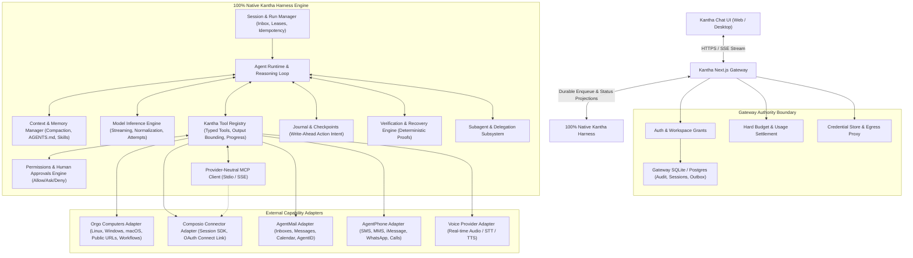

# Specification: Native Kantha Harness Architecture (100% Native TypeScript)

**Status:** IN_REVIEW  
**Version:** 2.0.0  
**Date:** 2026-11-21  
**Author:** Principal Systems Architect & SDD Designer  
**Scope:** Complete Agent Execution Engine, Tool Registry, Providers, Sessions, Lifecycle, Permissions, Checkpoints, and Adapters  

---

## 1. System Vision & Architecture

Kantha is a production-grade, dual-tier autonomous agent platform. It executes and verifies software engineering, remote desktop, API connector, email, and telephony tasks with deterministic evidence and durable crash-recovery.

The architecture strictly enforces clean separation of concerns:
1. **The Gateway** (Next.js Node application) is the **Sovereign Authority**:
   - Manages user identity, workspace isolation, credentials, repository access grants, egress proxying, hard budget admission, and durable business audit.
2. **The Native Harness** (TypeScript execution engine) is the **Autonomous Execution Engine**:
   - Owns prompt admission, execution leases, agent reasoning loop, context assembly, token budgeting, tool execution, permissions/approvals, journal checkpoints, verification, and subagent orchestration.
   - **Zero OpenCode Runtime Dependency**: OpenCode V2 source code on the local machine serves solely as an architectural reference. All packages, protocols, loops, registries, and persistence layers are 100% native Kantha code.
3. **External Capability Adapters**:
   - Standardized, provider-neutral interfaces for specialized execution environments: Orgo Cloud Computers, Composio / MCP Connectors, AgentMail, AgentPhone, and Voice.



---

## 2. Component Ownership & State Separation

| System Component | Owner | State & Persistence | Invariants & Guarantees |
| :--- | :--- | :--- | :--- |
| **Public Run & User Session** | Gateway | Gateway DB (`runs`, `sessions`, `workspaces`) | Gateway owns caller authentication, billing account, and public UUID mapping. |
| **Session Inbox** | Harness | `session_inbox` table / journal facts | Prompt admission precedes execution. Idempotency enforced on `(session_id, request_id)`. |
| **Execution Lease** | Harness | Generation-fenced lease record | Exactly one active execution writer per session per process. Prevents split-brain execution. |
| **Conversation Journal** | Harness | Append-only journal table / JSONL export | Every assistant message, tool invocation, and decision is committed before next model step. |
| **Action Intent** | Harness | Durable intent record `action_${runId}_${callId}` | Persisted before mutating dispatch. Interruption recovery resolves intent without duplicate replay. |
| **Execution Sandbox** | Harness / Executor | Isolated Git worktree / MicroVM / Orgo desktop | Path traversal strictly guarded. Zero unintended mutation on main working tree. |
| **Verification Evidence** | Harness | Candidate evidence bundle | Tasks only marked `DONE` when verified by execution output; self-assessment is informational. |

---

## 3. Detailed Subsystem Specifications & Interface Contracts

### 3.1 Subsystem 1: Session & Run Manager

The Session Manager manages prompt admission, session lifecycle, queueing, and execution lease coordination.

#### Key Patterns & Invariants
1. **Prompt Admission Precedes Execution**: When a user or system submits a prompt, it is first durably inserted into `session_inbox`. The database write succeeds before the execution runner is awakened.
2. **Delivery Modes (`steer` vs `queue`)**:
   - `steer`: Delivers at the next safe step boundary of an active run, allowing the user to guide the in-flight agent.
   - `queue`: Waits until the current run transitions to idle before admitting the prompt.
3. **Idempotency**: Retrying prompt submission with an identical `requestId` and `sessionId` returns the existing admission receipt without creating duplicate turns.
4. **Execution Lease**: A run requires an acquired lease with an incrementing generation counter (`generation_id`). Any runner discovering a superseded generation immediately terminates.

#### Core TypeScript Contract

```typescript
export type DeliveryMode = 'steer' | 'queue';

export interface EnqueuePromptInput {
  sessionId: string;
  requestId: string;
  text: string;
  attachments?: Array<{ type: 'file' | 'image'; uri: string; mimeType: string }>;
  deliveryMode: DeliveryMode;
  metadata?: Record<string, unknown>;
  resume?: boolean; // Default true: wakes execution loop
}

export interface InboxItem {
  id: string;
  sessionId: string;
  requestId: string;
  status: 'enqueued' | 'delivered' | 'cancelled';
  deliveryMode: DeliveryMode;
  text: string;
  attachments: Array<{ type: 'file' | 'image'; uri: string; mimeType: string }>;
  enqueuedAt: string;
  deliveredAt?: string;
}

export interface SessionExecutionLease {
  sessionId: string;
  runId: string;
  generation: number;
  acquiredAt: string;
  heartbeatAt: string;
}

export interface ISessionManager {
  enqueuePrompt(input: EnqueuePromptInput): Promise<InboxItem>;
  getPendingInbox(sessionId: string): Promise<InboxItem[]>;
  deliverNextInboxItem(sessionId: string, currentStep: number): Promise<InboxItem | null>;
  acquireExecutionLease(sessionId: string, runId: string): Promise<SessionExecutionLease>;
  heartbeatLease(lease: SessionExecutionLease): Promise<boolean>;
  releaseLease(lease: SessionExecutionLease): Promise<void>;
  interrupt(sessionId: string, reason: string): Promise<void>;
}
```

---

### 3.2 Subsystem 2: Agent Runtime & Reasoning Loop

The Agent Runtime drives iterative turns between model reasoning, structured tool invocation, context updates, and termination checks.

#### Key Patterns & Invariants
1. **Physical Attempt vs Logical Step**: A single logical step in an agent turn may execute multiple physical model attempts due to transient rate limits, token overflow compaction, or recoverable tool argument formatting.
2. **Terminal Step Settlement**: A step concludes only when all requested tool dispatches reach terminal durable states (success or failure) and outcomes are recorded in the journal.
3. **Step Budget**: Configurable step ceiling (e.g. 50 steps) prevents runaway agent loops.
4. **Durable Intent Before Dispatch**: Before executing any tool that produces side-effects, the runtime commits an action intent record to disk/DB.

#### Core TypeScript Contract

```typescript
export interface AgentRunConfig {
  sessionId: string;
  runId: string;
  agentId: string;
  modelId: string;
  maxSteps: number;
  temperature?: number;
  abortSignal: AbortSignal;
}

export interface StepContext {
  stepIndex: number;
  physicalAttempt: number;
  activeContextTokens: number;
  availableTools: string[];
}

export interface StepResult {
  stepIndex: number;
  status: 'continue' | 'completed' | 'interrupted' | 'error' | 'max_steps_exceeded';
  assistantMessageId: string;
  reasoningText?: string;
  toolCalls: Array<{
    callId: string;
    toolName: string;
    arguments: Record<string, unknown>;
    resultStatus: 'success' | 'failure';
    error?: string;
  }>;
  tokenUsage: { inputTokens: number; outputTokens: number; totalTokens: number };
}

export interface IAgentRuntime {
  executeRun(config: AgentRunConfig): AsyncIterable<StepResult>;
  cancelRun(runId: string, reason: string): Promise<void>;
}
```

---

### 3.3 Subsystem 3: Context & Memory Manager

Responsible for dynamically assembling system prompts, injecting repository guidelines (`AGENTS.md`, `CLAUDE.md`), managing active skills, tracking token usage, and triggering sliding-window compaction.

#### Key Patterns & Invariants
1. **Hierarchical Guidance Loading**: Reads root `AGENTS.md` and dynamically incorporates scoped instructions as the agent navigates directories or tasks.
2. **On-Demand Skill Injection**: Injects specialized skills only when relevant triggers match, conserving model context.
3. **Lossless Compaction**: When context consumption approaches window limits (>70%), older conversational steps are summarized into an authoritative durable checkpoint without losing task contracts, pinned verification criteria, or modified file paths.

#### Core TypeScript Contract

```typescript
export interface ContextItem {
  id: string;
  role: 'system' | 'user' | 'assistant' | 'tool';
  content: string | object;
  tokenCount: number;
  metadata?: {
    pinned?: boolean;
    toolCallId?: string;
    assistantMessageId?: string;
  };
}

export interface AssemblyOptions {
  sessionId: string;
  workingDirectory: string;
  maxContextTokens: number;
  reserveOutputTokens: number;
}

export interface AssembledContext {
  systemPrompt: string;
  messages: ContextItem[];
  totalTokens: number;
  needsCompaction: boolean;
}

export interface IContextManager {
  assembleContext(options: AssemblyOptions): Promise<AssembledContext>;
  compactContext(sessionId: string, targetTokenLimit: number): Promise<void>;
  recordTokenUsage(sessionId: string, stepIndex: number, usage: { prompt: number; completion: number }): Promise<void>;
}
```

---

### 3.4 Subsystem 4: Model Inference Engine

A provider-neutral inference boundary abstracting Anthropic, OpenAI, Google Gemini, and local models.

#### Key Patterns & Invariants
1. **Streaming Normalization**: Normalizes streaming deltas (text chunks, reasoning thoughts, structured tool call fragments) into a unified internal event protocol.
2. **Per-Attempt Reservation & Settlement**: Before issuing an HTTP inference call to an upstream provider, the engine checks and reserves model token budget via the Gateway. Upon completion or failure, the actual token usage is settled.

#### Core TypeScript Contract

```typescript
export interface InferenceRequest {
  modelId: string;
  provider: 'anthropic' | 'openai' | 'gemini' | 'custom';
  systemPrompt: string;
  messages: Array<{ role: string; content: unknown }>;
  tools: Array<KanthaToolDefinition>;
  temperature?: number;
  abortSignal: AbortSignal;
}

export type InferenceDelta =
  | { type: 'text-delta'; text: string }
  | { type: 'reasoning-delta'; thought: string }
  | { type: 'tool-call-start'; callId: string; toolName: string }
  | { type: 'tool-call-delta'; callId: string; argumentsChunk: string }
  | { type: 'tool-call-complete'; callId: string; toolName: string; arguments: Record<string, unknown> }
  | { type: 'finish'; finishReason: 'stop' | 'tool_calls' | 'length' | 'error'; usage: { input: number; output: number } };

export interface IModelInferenceEngine {
  streamInference(request: InferenceRequest): AsyncIterable<InferenceDelta>;
}
```

---

### 3.5 Subsystem 5: Kantha Tool Registry

The central registry for local built-ins, sandboxed file tools, terminal commands, MCP tools, and external capability adapters.

#### Key Patterns & Invariants
1. **Standardized Tool Construction**: Tools declare standard schema validation (`input` and optional `output`), a model-facing description, and an `execute` handler.
2. **Tri-Value Tool Result**:
   - `output`: Ephemeral machine value passed to subsequent programmatic steps (Code Mode).
   - `content`: Model-visible text/markdown stored durably in conversation history.
   - `metadata`: Optional compact UI data for front-end rendering.
3. **Hard Output Bounding**: Output is strictly capped (e.g. 32KB max preview) to prevent context blowup from giant shell outputs or file dumps.

#### Core TypeScript Contract

```typescript
export interface ToolInvocationContext {
  sessionId: string;
  runId: string;
  assistantMessageId: string;
  callId: string;
  abortSignal: AbortSignal;
  reportProgress: (message: string, percentage?: number) => Promise<void>;
}

export interface ToolResponse<TOutput = unknown> {
  content: string; // Model-visible representation
  output?: TOutput; // Machine value
  metadata?: Record<string, unknown>; // UI rendering metadata
}

export interface KanthaToolDefinition<TInput = Record<string, unknown>, TOutput = unknown> {
  name: string;
  description: string;
  inputSchema: object; // JSON Schema draft-07/2020-12
  outputSchema?: object;
  requiresPermission?: boolean;
  permissionDomain?: string; // e.g. 'filesystem.write', 'computer.act', 'bash.exec'
  execute: (input: TInput, ctx: ToolInvocationContext) => Promise<ToolResponse<TOutput>>;
}

export interface IKanthaToolRegistry {
  registerTool(tool: KanthaToolDefinition): void;
  getTool(name: string): KanthaToolDefinition | undefined;
  listTools(): KanthaToolDefinition[];
  executeTool(name: string, input: unknown, ctx: ToolInvocationContext): Promise<ToolResponse>;
}
```

---

### 3.6 Subsystem 6: Permissions & Human Approvals Engine

Enforces safety boundaries, human-in-the-loop approvals, and rule evaluation.

#### Key Patterns & Invariants
1. **Evaluation Policy**: Every tool invocation resolves to `allow`, `ask`, or `deny`.
2. **Durable Suspension Checkpoint**: If a tool triggers `ask`, the session enters `SUSPENDED_APPROVAL`. A durable approval record is written with target tool details.
3. **Safe Resumption**: When an operator responds (`approved` or `rejected`), the session resumes, re-validates the lease generation, and dispatches the action without re-running previous reasoning steps.

#### Core TypeScript Contract

```typescript
export type PermissionDecision = 'allow' | 'ask' | 'deny';

export interface PermissionRequest {
  id: string;
  sessionId: string;
  runId: string;
  callId: string;
  toolName: string;
  permissionDomain: string;
  parameters: Record<string, unknown>;
  requestedAt: string;
}

export interface IPermissionsEngine {
  evaluate(request: Omit<PermissionRequest, 'id' | 'requestedAt'>): Promise<PermissionDecision>;
  suspendForApproval(request: PermissionRequest): Promise<void>;
  submitDecision(requestId: string, decision: 'approved' | 'rejected', operatorId: string): Promise<void>;
  awaitApproval(requestId: string, signal: AbortSignal): Promise<boolean>;
}
```

---

### 3.7 Subsystem 7: Filesystem Operations & Ephemeral Git Worktrees

Guarantees repository isolation, bounded reads/writes, and characterization capture.

#### Key Patterns & Invariants
1. **Safe Path Guard**: Prevents path traversal outside the designated repository or sandbox workspace root.
2. **Ephemeral Worktree Isolation**: All speculative code changes execute in temporary Git worktrees (`.kantha/worktrees/<task-id>`), preserving the user's working branch.
3. **Atomic Commit & Integration**: Once tasks pass verification, changes are cleanly merged or committed back with descriptive commit messages and handoff records.

---

### 3.8 Subsystem 8: Journal, Checkpoints & Crash Recovery

Provides unbreakable state durability and idempotency across server restarts or container crashes.

#### Key Patterns & Invariants
1. **Write-Ahead Action Intent (`action_${runId}_${callId}`)**: Before executing a mutating operation (file write, terminal command, external API call), the runtime records the action intent in SQLite.
2. **Orphan Reconciliation on Boot**: When the Harness boots, it queries for any in-flight actions left in `streaming` or `running` state from an interrupted process. It reconciles these calls (marking them interrupted/failed) and appends recovery instructions rather than blindly re-dispatching side-effects.

---

### 3.9 Subsystem 9: Verification & Deterministic Proof Engine

Enforces the core rule: **A task is only DONE when verified by real execution evidence**.

#### Key Patterns & Invariants
1. **Automated Test Runners**: Executes unit tests, linters, TypeScript typechecks, and browser integration checks in the sandbox.
2. **Evidence Binding**: Captures terminal stdout, stderr, exit codes, test count assertions, and diff snapshots. Binds this evidence to the candidate change and handoff document.

---

### 3.10 Subsystem 10: Subagent Delegation Subsystem

Supports spawning child subagents for focused exploratory, research, or parallel subtasks.

#### Key Patterns & Invariants
1. **Child Session Isolation**: Child subagents operate in isolated child sessions with scoped tool sets and isolated workspace directories.
2. **Budget Delegation**: Parent assigns a strict token and step budget to the child.
3. **Asynchronous Notification**: Parent resumes execution when the child completes, receiving a structured output report.

---

### 3.11 Subsystem 11: Provider-Neutral MCP Client

A native TypeScript Model Context Protocol client allowing Kantha to dynamically connect to MCP servers.

#### Key Patterns & Invariants
1. **Transport Agnostic**: Supports stdio (local processes) and HTTP/SSE (remote servers).
2. **Dynamic Tool Translation**: Discovers MCP tools and registers them into the `IKanthaToolRegistry` as native `KanthaToolDefinition` instances.

---

### 3.12 Subsystem 12: External Capability Adapters

#### A. Orgo Cloud Computers Adapter (`KanthaComputerProvider`)
A complete integration with the Orgo Cloud Computer platform (API Spec 2.0.0, 114 operations across 14 groups):
- **Supported OS Types**:
  - **Linux** (self-serve dynamic provisioning, full desktop, bash/exec, PTY).
  - **Windows** (self-serve dynamic provisioning, full desktop, powershell/cmd, key modifiers).
  - **macOS** (managed provisioning, Apple Silicon, stock/request assignment, Command key modifiers).
- **Lifecycle Suite**: `create`, `start`, `stop` (freezes/frozen status), `restart`, `suspend`, `resume`, `clone`, `fork`, `delete`, `resize`.
- **Desktop Actions**: `screenshot` (base64 JPEG/PNG with width/height validation), `click`, `mouse-move`, `drag`, `type`, `key`, `scroll`, `wait`, `bash`, `exec`, interactive terminal WebSocket.
- **Public URLs API**: Exposing apps running inside the cloud computer on public subdomains (`create`, `list`, `update`, `delete`, `password`).
- **Workflows & Automations API**: Creating, running, and monitoring Orgo background workflows (`POST /workflows`, `POST /workflows/{id}/runs`).

#### Multi-OS Capability Matrix

| Capability | Linux | Windows | macOS |
| :--- | :--- | :--- | :--- |
| **Provisioning** | Dynamic self-serve (`POST /computers`) | Dynamic self-serve (`POST /computers`) | App request / Assigned ID |
| **Shell Backend** | Bash / PTY | PowerShell / CMD | Zsh / PTY |
| **Modifier Key** | `Control` (`Ctrl`) | `Control` (`Ctrl`) | `Meta` (`Command`) |
| **Public URLs** | Full HTTP / Port forwarding | Full HTTP / Port forwarding | Full HTTP / Port forwarding |
| **VNC & WebRTC** | Fully supported | Fully supported | Fully supported |
| **Automations / Workflows** | Fully supported | Fully supported | Fully supported |

#### Core Orgo TypeScript Contract

```typescript
export interface OrgoComputerConfig {
  id: string;
  os: 'linux' | 'windows' | 'mac';
  status: 'creating' | 'running' | 'restarting' | 'updating' | 'suspending' | 'suspended' | 'resuming' | 'frozen' | 'stopped' | 'error' | 'deleted';
  cpu: number;
  ramGb: number;
  diskGb: number;
  location?: string;
  publicUrls?: Array<{ id: string; port: number; url: string }>;
}

export interface ComputerScreenshot {
  image: Buffer;
  mediaType: 'image/png' | 'image/jpeg';
  width: number;
  height: number;
}

export type ComputerAction =
  | { action: 'click'; x: number; y: number; button?: 'left' | 'right' | 'middle' }
  | { action: 'mouse-move'; x: number; y: number }
  | { action: 'drag'; startX: number; startY: number; endX: number; endY: number }
  | { action: 'type'; text: string }
  | { action: 'key'; key: string; modifiers?: Array<'ctrl' | 'alt' | 'shift' | 'meta'> }
  | { action: 'scroll'; deltaX: number; deltaY: number }
  | { action: 'wait'; durationMs: number }
  | { action: 'bash'; command: string; timeoutMs?: number };

export interface IKanthaComputerProvider {
  createComputer(options: { os: 'linux' | 'windows'; cpu?: number; ramGb?: number; diskGb?: number }): Promise<OrgoComputerConfig>;
  getComputer(computerId: string): Promise<OrgoComputerConfig>;
  startComputer(computerId: string): Promise<void>;
  stopComputer(computerId: string): Promise<void>; // Freezes computer
  deleteComputer(computerId: string): Promise<void>;
  
  observeScreen(computerId: string, screenIndex?: number): Promise<ComputerScreenshot>;
  dispatchAction(computerId: string, action: ComputerAction): Promise<void>;
  
  createPublicUrl(computerId: string, port: number, options?: { password?: string }): Promise<{ urlId: string; url: string }>;
  listPublicUrls(computerId: string): Promise<Array<{ id: string; port: number; url: string }>>;
  deletePublicUrl(computerId: string, urlId: string): Promise<void>;
  
  startWorkflowRun(workflowId: string, input: Record<string, unknown>): Promise<{ runId: string }>;
  getWorkflowRun(workflowId: string, runId: string): Promise<{ status: string; output?: unknown }>;
}
```

---

#### B. Composio Connector Adapter
- Integrates Composio Session SDK v3.1 (`@composio/core`).
- Provides user and workspace entity mapping (`entityId = kantha_user_<userId>`).
- Supports OAuth Connect Link generation for 1,500+ apps (GitHub, Slack, Jira, Gmail, Salesforce, etc.).
- Exposes tools to Kantha Tool Registry via managed session toolkits and Proxy Execute.

#### C. AgentMail Adapter
- REST API integration with `agentmail.to`.
- Supports programmatically creating inboxes, sending/receiving messages, managing threads, handling drafts, attachments, calendar events, and AgentID auth.

#### D. AgentPhone Adapter
- REST & WebSocket integration with `agentphone.to`.
- Manages phone numbers, SMS, MMS, iMessage, WhatsApp, RCS messaging, voice calls, and real-time call transcription.

---

## 4. Current Codebase Gap Analysis

| Subsystem | Existing Kantha State (`src/lib/`) | Gap to Native Architecture | Remediation Strategy |
| :--- | :--- | :--- | :--- |
| **Session Inbox** | `src/lib/gateway/database/` has session records | Prompt admission and execution run in single request cycle; lacks separate `session_inbox` table and `steer` vs `queue` ordering | Implement `session_inbox` schema, enqueue endpoint, and safe-step boundary delivery |
| **Execution Leases** | Rudimentary generation check in `runner.ts` | No write-ahead lease claim with heartbeat timeouts | Add `session_execution_leases` table and heartbeat lease manager |
| **Reasoning Loop** | `src/lib/harness/runner.ts` has fixture runner | Fixed iteration loop; lacks physical attempt retry classification, token compaction trigger, and multi-tool parallelism | Refactor runner into stateful `AgentRuntime` supporting attempt retries and compaction |
| **Context Management** | `src/lib/harness/inference.ts` | Rudimentary string concatenation | Build `ContextManager` supporting `AGENTS.md` scanning, skill loading, and token-bounded compaction |
| **Tool Registry** | `src/lib/harness/tools.ts` has basic array of tool objects | No standardized validation schema, tri-value outputs (`content`/`output`/`metadata`), or output bounding | Build `KanthaToolRegistry` with strict schema validation and 32KB output bounding |
| **Permissions** | Inert fixture in Gateway | No durable suspension/resume checkpointing | Implement `PermissionsEngine` with `allow`/`ask`/`deny` and approval resumption |
| **Orgo Computers** | `src/lib/harness/computer-agent.ts` has 5-step click/type/key stub | Missing lifecycle management, Windows/macOS differences, bash/PTY, public URLs, workflows | Build complete `OrgoComputerProvider` covering all 114 operations and multi-OS matrix |
| **Composio / MCP** | Non-existent in codebase | No Composio integration or MCP client | Build provider-neutral `MCPClient` and `ComposioConnectorAdapter` |
| **AgentMail / Phone** | Specs present in `docs/external_specs` | No implementation in `src/` | Build modular adapters in `src/lib/adapters/` |

---

## 5. Architectural Invariants & Verification Contract

1. **Deterministic Quality Gate**: No feature branch is mergeable without automated test evidence:
   - Unit tests covering protocol schemas and adapters.
   - Integration fixtures exercising step loops, tool dispatches, and lease recovery.
   - Clean TypeScript check (`npm run typecheck` exits 0).
   - Zero ESLint warnings or errors on production paths.
2. **Authority Invariant**: The Gateway strictly guards credentials and API keys (`ORGO_API_KEY`, `COMPOSIO_API_KEY`, provider keys). The Harness and tools never directly expose raw secrets to the model or client.
3. **Recovery Invariant**: Any unexpected process interruption recovers without repeating ambiguous side-effects.
