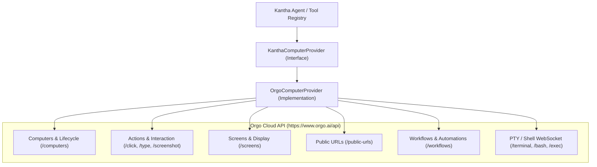

# Specification: Orgo Cloud Computer Provider (`KanthaComputerProvider`)

**Status:** IN_REVIEW  
**Version:** 1.0.0  
**Date:** 2026-11-21  
**Author:** Principal Systems Architect  
**Scope:** Full Lifecycle Management, Desktop Interaction, Shell Commands, Public URLs, Automations, and Multi-OS Normalization for Orgo Cloud Computers  

---

## 1. Overview & Architecture

Kantha manages persistent cloud computers for AI agents via Orgo (API Spec 2.0.0, base URL `https://www.orgo.ai/api`). Each computer is an isolated virtual machine equipped with full desktop environment, browser, shell terminal, and networking.

The integration provides:
1. **Full Lifecycle Management**: Dynamic self-serve provisioning of Linux and Windows instances, managed assignment of macOS, power state transitions (start, stop/frozen, restart, suspend, resume), scaling (resize CPU/RAM/disk), cloning, and termination.
2. **Comprehensive Action Suite**: High-fidelity screen observation (screenshot capture and validation), precise coordinate mouse interactions (click, move, drag, scroll), text entry, raw keyboard navigation with platform modifier keys, and command execution.
3. **Public URLs & Web Previews**: Generating and managing public HTTPS subdomains with optional password protection to expose web applications running inside cloud computers.
4. **Workflows & Automations**: Authoring, triggering, and polling reproducible cloud routines.
5. **Multi-OS Normalization**: Documented behavioral differences and normalization across Linux, Windows, and macOS.



---

## 2. Multi-OS Capability Matrix & Platform Normalization

| Dimension | Linux (Ubuntu Desktop) | Windows (Windows 11 / Server) | macOS (Apple Silicon) |
| :--- | :--- | :--- | :--- |
| **Provisioning Mode** | Self-serve instant dynamic (`POST /computers`) | Self-serve instant dynamic (`POST /computers`) | In-app stock / Pre-assigned ID |
| **Default Shell** | Bash (`/bin/bash`) | PowerShell / CMD (`cmd.exe`) | Zsh (`/bin/zsh`) |
| **Command Execution** | `POST /computers/{id}/bash` or `exec` | `POST /computers/{id}/exec` (PowerShell wrapper) | `POST /computers/{id}/bash` or `exec` |
| **Modifier Keys** | `Control` (`ctrl`), `Alt`, `Shift` | `Control` (`ctrl`), `Alt`, `Shift`, `Windows` | `Meta` (`Command`), `Control`, `Option` |
| **Copy / Paste Shortcut** | `Control+C` / `Control+V` | `Control+C` / `Control+V` | `Meta+C` / `Meta+V` |
| **Application Launcher** | `Super` key / App menu | `Windows` key | `Meta+Space` (Spotlight) |
| **Public URLs (Port Forwarding)** | Supported on all open ports | Supported on all open ports | Supported on all open ports |
| **Interactive Terminal WebSocket** | Full PTY terminal | PTY / ConPTY terminal | Full PTY terminal |
| **Screenshot Formats** | JPEG / PNG (`?screen=`) | JPEG / PNG (`?screen=`) | JPEG / PNG (`?screen=`) |

### Key Normalization Rules
1. **Shortcut Key Mapping**: The agent generates high-level semantic key combinations (e.g. `shortcut: "copy"` or `shortcut: "select-all"`). The adapter translates these based on `computer.os`:
   - On macOS: `['meta', 'c']`
   - On Linux/Windows: `['ctrl', 'c']`
2. **Text Typing**: Text typing uses `POST /computers/{id}/type`. For non-printable keys (Enter, Tab, Backspace, Arrows, Esc), the adapter routes to `POST /computers/{id}/key`.

---

## 3. Interface Contract: `IKanthaComputerProvider`

```typescript
export interface ComputerInstance {
  id: string;
  name: string;
  os: 'linux' | 'windows' | 'mac';
  status:
    | 'creating'
    | 'running'
    | 'restarting'
    | 'updating'
    | 'suspending'
    | 'suspended'
    | 'resuming'
    | 'frozen'
    | 'stopped'
    | 'error'
    | 'deleted';
  cpu: number;
  ramGb: number;
  diskGb: number;
  region: string;
  vncUrl?: string;
  publicUrls: Array<{ id: string; port: number; url: string; hasPassword: boolean }>;
  createdAt: string;
}

export interface CreateComputerOptions {
  os: 'linux' | 'windows';
  name?: string;
  cpu?: number; // e.g. 2, 4, 8
  ramGb?: number; // e.g. 4, 8, 16
  diskGb?: number; // e.g. 50, 100
  region?: 'us-east' | 'us-west' | 'eu-central';
  workspaceId?: string;
}

export interface ComputerScreenshot {
  image: Buffer;
  mediaType: 'image/jpeg' | 'image/png';
  width: number;
  height: number;
  screenIndex: number;
}

export type DesktopAction =
  | { action: 'click'; x: number; y: number; button?: 'left' | 'right' | 'middle'; count?: 1 | 2 }
  | { action: 'mouse-move'; x: number; y: number }
  | { action: 'drag'; startX: number; startY: number; endX: number; endY: number }
  | { action: 'type'; text: string }
  | { action: 'key'; key: string; modifiers?: Array<'ctrl' | 'alt' | 'shift' | 'meta'> }
  | { action: 'scroll'; x: number; y: number; deltaX: number; deltaY: number }
  | { action: 'wait'; durationMs: number }
  | { action: 'bash'; command: string; timeoutMs?: number };

export interface PublicUrlOptions {
  port: number;
  password?: string;
  name?: string;
}

export interface WorkflowRunStatus {
  runId: string;
  workflowId: string;
  status: 'pending' | 'running' | 'completed' | 'failed' | 'stopped';
  output?: Record<string, unknown>;
  error?: string;
}

export interface IKanthaComputerProvider {
  // --- Lifecycle Operations ---
  createComputer(options: CreateComputerOptions): Promise<ComputerInstance>;
  getComputer(computerId: string): Promise<ComputerInstance>;
  listComputers(workspaceId?: string): Promise<ComputerInstance[]>;
  startComputer(computerId: string): Promise<void>;
  stopComputer(computerId: string): Promise<void>; // Freezes instance
  restartComputer(computerId: string): Promise<void>;
  suspendComputer(computerId: string): Promise<void>;
  resumeComputer(computerId: string): Promise<void>;
  cloneComputer(computerId: string, name?: string): Promise<ComputerInstance>;
  resizeComputer(computerId: string, options: { cpu?: number; ramGb?: number; diskGb?: number }): Promise<void>;
  deleteComputer(computerId: string): Promise<void>;

  // --- Interaction & Actions ---
  observeScreen(computerId: string, options?: { screenIndex?: number; format?: 'jpeg' | 'png'; quality?: number }): Promise<ComputerScreenshot>;
  dispatchAction(computerId: string, action: DesktopAction, screenIndex?: number): Promise<void>;
  executeCommand(computerId: string, command: string, timeoutMs?: number): Promise<{ stdout: string; stderr: string; exitCode: number }>;

  // --- Public URLs (Port Forwarding & Web Previews) ---
  createPublicUrl(computerId: string, options: PublicUrlOptions): Promise<{ urlId: string; url: string }>;
  listPublicUrls(computerId: string): Promise<Array<{ urlId: string; port: number; url: string; hasPassword: boolean }>>;
  deletePublicUrl(computerId: string, urlId: string): Promise<void>;

  // --- Automations & Workflows ---
  createWorkflow(name: string, definition: Record<string, unknown>): Promise<{ workflowId: string }>;
  startWorkflowRun(workflowId: string, parameters: Record<string, unknown>): Promise<{ runId: string }>;
  getWorkflowRun(workflowId: string, runId: string): Promise<WorkflowRunStatus>;
  stopWorkflowRun(workflowId: string, runId: string): Promise<void>;
}
```

---

## 4. Implementation Details & Safety Controls

1. **Screenshot Validation**:
   - Max image payload bounded at 5MB.
   - Dimensions verified (`1 <= width <= 4096`, `1 <= height <= 4096`).
   - Strict Base64 validation before buffer decoding to protect against memory corruption or decompression bombs.
2. **Coordinate Boundary Guard**:
   - Clicks, drags, and scrolls are checked against the last observed screen dimensions. Out-of-bounds coordinates throw `RangeError` before issuing HTTP dispatch.
3. **Secret Storage**:
   - `ORGO_API_KEY` stored exclusively in Gateway environment/encrypted database. The agent only receives opaque `computerId` references.
4. **Idempotency & Retry**:
   - Mutable actions persist a journal entry before dispatch.
   - Uncertain acknowledgements trigger diagnostic verification rather than naive blind retry.
