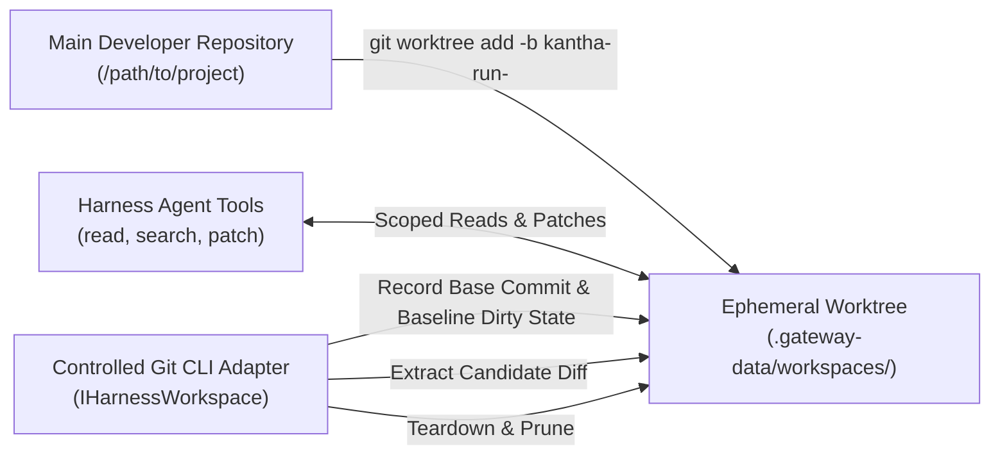

# Execution Sandbox & Workspace Isolation Specification

**Status:** APPROVED FOR PLANNING — Awaiting Gate 2 Sign-off  
**Version:** 1.0.0  
**Effective Date:** 2026-11-21  
**Document Level:** Level 2 — Technology Specification

---

## 1. Threat Model & Security Objectives

An autonomous coding assistant is fundamentally an engine that generates and runs untrusted, AI-synthesized code and shell commands against source repositories. Without rigorous containment, the system is vulnerable to:
1. **Host Compromise:** Malicious or hallucinated commands modifying host configuration (`rm -rf /`, modifying `~/.bashrc`, downloading remote binaries).
2. **Repository Corruption:** Overwriting uncommitted developer changes, corrupting the `.git` database, or committing incomplete code to upstream branches.
3. **Secret Exfiltration:** Reading local environment files (`.env`), private SSH keys (`~/.ssh/id_rsa`), or cloud credentials (`~/.aws/credentials`).
4. **Denial of Service (DoS):** Runaway fork bombs, infinite compiler loops, or disk exhaustion filling the host filesystem with gigabytes of logs.

---

## 2. Multi-Tiered Sandboxing Architecture

Kantha implements a progressive three-tier isolation strategy across development milestones:

| Isolation Tier | Applicable Milestones | Mechanism | Network Access | Filesystem Scope |
|---|---|---|---|---|
| **Tier 0: Fixture Stubs** | H0–H2 | In-memory mock filesystem | None | In-memory object store |
| **Tier 1: Worktree Containment** | H1–H3 (Local Dev) | Controlled Git CLI + Path Canonicalization | Unrestricted Host | Granted repository directory only |
| **Tier 2: Rootless Container Sandbox** | H4–H5 (Staging / Prod)| Rootless Docker / Podman container / MicroVM | Blocked by default (Allowlist for package registries) | Ephemeral container volume mounting worktree |

---

## 3. Tier 1: Controlled Git CLI Adapter & Worktree Strategy

In local development (Milestones H1–H3), isolation is achieved via a dedicated Git worktree adapter wrapping the native system `git` CLI:



### 3.1 Worktree Lifecycle Operations
1. **Workspace Preparation (`prepare()`):**
   - Resolves repository root and pins `baseRevision = git rev-parse HEAD`.
   - Records pre-existing dirty files: `git status --porcelain`. Existing user modifications are captured as `baselineEdits` so they are never blamed on the agent.
   - Spawns an isolated worktree in `.gateway-data/workspaces/<runId>` on a fresh local branch `kantha/run-<runId>`.
2. **Patch Application (`recordAction()`):**
   - File edits are applied strictly as unified diffs using `git apply --check` followed by `git apply`.
   - Rejects corrupted diffs or partial matches without touching other files.
3. **Candidate Digest (`candidate()`):**
   - Computes candidate SHA-256 digest of modified files: `git diff <baseRevision>`.
4. **Workspace Cleanup & Teardown:**
   - Upon finalization, removes the worktree: `git worktree remove --force <worktreePath>`.
   - Deletes the temporary branch: `git branch -D kantha/run-<runId>`.

---

## 4. Tier 2: Rootless Container Sandboxing (Production Standard)

For Milestone H4 verification, multi-tenant environments, and production hosting:

```
+--------------------------------------------------------------------------+
| Harness Worker (Host)                                                    |
|                                                                          |
|   +------------------------------------------------------------------+   |
|   | Container Sandbox (Rootless Podman / Docker)                     |   |
|   |                                                                  |   |
|   |   - User: `sandbox` (UID 1000, non-root)                         |   |
|   |   - Network: `none` (default) or restricted outbound proxy       |   |
|   |   - Capabilities: `DROP ALL` (no CAP_SYS_ADMIN, no ptrace)       |   |
|   |   - Root FS: Read-only overlay                                   |   |
|   |   - Worktree Mount: `/workspace` (rw, nosuid, nodev, noexec*)    |   |
|   |   - Memory Limit: 2GB                                            |   |
|   |   - CPU Limit: 2.0 Cores                                         |   |
|   |   - PIDs Limit: 256 (fork bomb defense)                          |   |
|   |                                                                  |   |
|   |   [Build & Test Commands] -----> [Read-Only Verification Subshell]   |   |
|   +------------------------------------------------------------------+   |
+--------------------------------------------------------------------------+
```

---

## 5. Security & Path Containment Invariants

All filesystem operations executed by the Harness must enforce the following invariants:

1. **Path Canonicalization:**
   ```typescript
   function validateScopedPath(workspaceRoot: string, targetPath: string): string {
     const resolved = path.resolve(workspaceRoot, targetPath);
     const canonicalRoot = fs.realpathSync(workspaceRoot);
     // Prevent symlink traversal out of the workspace
     const canonicalTarget = fs.existsSync(resolved) ? fs.realpathSync(resolved) : resolved;
     
     if (!canonicalTarget.startsWith(canonicalRoot + path.sep)) {
       throw new HarnessError('denied', `Path traversal attempt detected: ${targetPath}`);
     }
     return canonicalTarget;
   }
   ```
2. **Blacklisted Files & Directories:**
   The following targets are rejected unconditionally:
   - `.git/` (protects git database integrity)
   - `.env`, `.env.*` (protects application secrets)
   - `~/.ssh`, `~/.aws`, `~/.gnupg` (protects host identity)
   - `/etc`, `/var`, `C:\Windows` (protects OS infrastructure)
3. **Subprocess Group Management & Process Kill:**
   When invoking build or test commands:
   - Spawn child processes in an isolated process group: `{ detached: true }`.
   - On cancellation or timeout: send `SIGTERM` to the process group (`-child.pid`), wait 3 seconds, and escalate to `SIGKILL`.
   - Hard execution timeout: 30s for search tools, 180s for build/test runners.
4. **Output Bounding:**
   - Standard output and error streams are truncated at **8,192 bytes**.
   - If output exceeds 8,192 bytes, the head and tail are retained, the middle is summarized (`... [42,100 bytes truncated] ...`), and the full output is written to `.gateway-data/artifacts/<runId>/<actionId>.log`.
