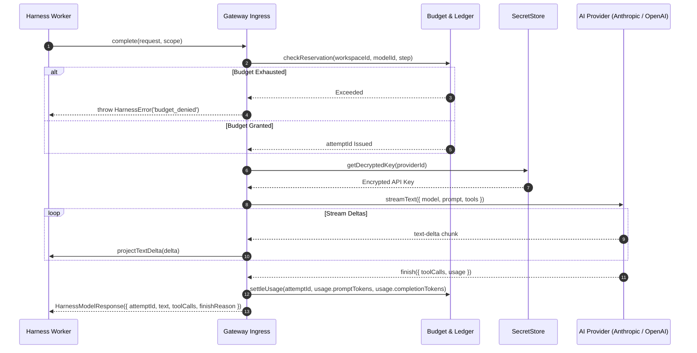

# Provider Integration & Model Egress Specification

**Status:** APPROVED FOR PLANNING — Awaiting Gate 2 Sign-off  
**Version:** 1.0.0  
**Effective Date:** 2026-11-21  
**Document Level:** Level 2 — Technology Specification

---

## 1. Role of Vercel AI SDK 7 in Kantha

Kantha leverages **Vercel AI SDK 7** as its foundation model abstraction and streaming driver. This eliminates the need to maintain custom API clients for each model vendor while ensuring first-class TypeScript typing and streaming standards.

### What the AI SDK Handles vs. What Kantha Harness Owns

| Responsibility Area | Handled by AI SDK 7 | Owned by Kantha Harness |
|---|---|---|
| **Model Transport & Wire Protocols** | Provider HTTP endpoints, streaming chunk framing, auth headers. | **None** (Delegated to AI SDK). |
| **Provider Drivers** | Anthropic, OpenAI, Google Gemini, Ollama, OpenAI-compatible. | **None** (Delegated to AI SDK). |
| **Tool Call Schema Validation** | Translating Zod schemas into provider function JSON definitions. | Validating tool arguments against security policies. |
| **Streaming Text Deltas** | Emitting raw text chunks from provider streams. | Batching text deltas into `HarnessJournal` and SSE projections. |
| **Token Budget & Admission** | Extracting raw token counts from completion metadata. | **Authoritative Admission:** Pre-attempt reservation & hard settlement in `usage_ledger`. |
| **Execution State & Leases** | **None** (SDK has no concept of persistent jobs). | **Authoritative Ownership:** Single-writer generation leases & split-brain fencing. |
| **Action Sandboxing & Intent** | **None** (SDK tool execution is in-process and uncheckpointed).| **Authoritative Ownership:** `action_${runId}_${callId}` persisted before dispatch. |
| **Crash Recovery & Reconciliation**| **None** (SDK execution is memory-only). | **Authoritative Ownership:** Reconciling pending actions from `HarnessCheckpoint`. |
| **Verification & Quality Gates** | **None** (SDK model loops stop on model assertion). | **Authoritative Ownership:** Deterministic subshell test verifier. |

---

## 2. Gateway-Mediated Egress Architecture

To prevent API key leakage and enforce hard budget ceilings, the Harness runtime never communicates with AI providers directly. All model completions route through the Gateway's `IHarnessInference` boundary:

---

## 3. Secret Management & Credential Protection Invariants

1. **At-Rest Encryption:** Provider API keys are stored in `gateway_documents.secrets` encrypted using **AES-256-GCM** with a master key derived from the server environment (`GATEWAY_SECRET_KEY`).
2. **Zero In-Memory Leakage:** Keys are decrypted in ephemeral Node.js memory only during the active HTTP dispatch to the provider.
3. **Zero Telemetry / Prompt Exposure:**
   - Keys are stripped from OpenTelemetry span attributes.
   - Keys are never serialized into `HarnessJournal` or `HarnessCheckpoint`.
   - Keys are never injected into LLM system prompts or agent instruction context.
4. **Sandboxed Worker Isolation:** Tool sandbox containers have no access to the host network interface or the Gateway's `SecretStore`.

---

## 4. Model Selection & Fallback Matrix

Kantha qualifies foundation models across three primary tiers:

| Tier | Reference Model | Provider Driver | Primary Use Case |
|---|---|---|---|
| **Tier 1 (Flagship / Coding)** | **Claude 3.5 Sonnet** (`claude-3-5-sonnet-latest`) | `@ai-sdk/anthropic` | Primary autonomous coding agent. Superior multi-file diffing, instruction following, and tool precision. |
| **Tier 2 (Secondary Flagship)** | **GPT-4o** (`gpt-4o`) | `@ai-sdk/openai` | High-speed planning, initial task decomposition, and fallback coding. |
| **Tier 3 (Fast / Compaction)** | **Claude 3.5 Haiku** / **GPT-4o-mini** | `@ai-sdk/anthropic` / `@ai-sdk/openai` | Context compaction, progress summarization, and lightweight classification. |
| **Tier 4 (Local / Offline)** | **DeepSeek-Coder-V2** / **Qwen2.5-Coder** | `@ai-sdk/openai-compatible` | Local execution via Ollama or vLLM endpoints. |
