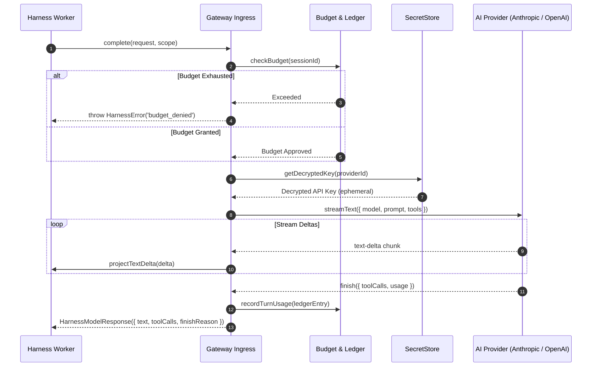

# Provider Integration & Model Egress Specification

**Status:** APPROVED ARCHITECTURE — Gateway Core Defined ([Design Spec](../superpowers/specs/2026-11-22-gateway-core-design.md) · [Implementation Plan](../superpowers/plans/2026-11-22-gateway-core.md))  
**Version:** 2.0.0  
**Effective Date:** 2026-11-22  
**Document Level:** Level 2 — Technology Specification

---

## 1. Role of @kantha/gateway & Foundation Drivers in Kantha

Model egress and provider lifecycle are encapsulated within **`@kantha/gateway`** (`packages/gateway`), an isolated Effect-TS package. It preserves native frontier model capabilities (Anthropic thinking signatures, OpenAI reasoning items, prompt-cache breakpoints) without lossy cross-protocol translation. Concrete SQLite/Drizzle storage ports are implemented in `apps/daemon`.

### What the AI SDK Handles vs. What Kantha Harness Owns

| Responsibility Area | Handled by AI SDK 7 | Owned by Kantha Harness |
|---|---|---|
| **Model Transport & Wire Protocols** | Provider HTTP endpoints, streaming chunk framing, auth headers. | **None** (Delegated to AI SDK). |
| **Provider Drivers** | Anthropic, OpenAI, Google Gemini, Ollama, OpenAI-compatible. | **None** (Delegated to AI SDK). |
| **Tool Call Schema Validation** | Translating Zod schemas into provider function JSON definitions. | Validating tool arguments against security policies. |
| **Streaming Text Deltas** | Emitting raw text chunks from provider streams. | Batching text deltas into `HarnessJournal` and SSE projections. |
| **Token Budget & Admission** | Extracting raw token counts from completion metadata. | **Authoritative Admission:** Pre-attempt reservation & hard settlement in `usage_ledger`. |
| **Execution State & Leases** | **None** (SDK has no concept of persistent jobs). | **Authoritative Ownership:** Single-writer generation leases & split-brain fencing. |
| **Action Sandboxing & Intent** | **None** (SDK tool execution is in-process and uncheckpointed).| **Authoritative Ownership:** `action_${runId}_${callId}` persisted before dispatch. |
| **Crash Recovery & Reconciliation**| **None** (SDK execution is memory-only). | **Authoritative Ownership:** Reconciling pending actions from `HarnessCheckpoint`. |
| **Verification & Quality Gates** | **None** (SDK model loops stop on model assertion). | **Authoritative Ownership:** Deterministic subshell test verifier. |

---

## 2. Gateway-Mediated Egress Architecture

To prevent API key leakage and enforce hard budget ceilings, the Harness runtime never communicates with AI providers directly. All model completions route through the Gateway's `IHarnessInference` boundary:

---

## 3. Secret Management & Credential Protection Invariants

1. **At-Rest Encryption:** Provider API keys are stored in the SQLite `gateway_secrets` table encrypted using **AES-256-GCM** with a fresh 96-bit IV and AAD (`v1:<iv>:<tag>:<ciphertext>`). The master key is loaded via `MasterKeyProvider` from `~/.kantha/gateway.key` (enforced `0600` on POSIX / restricted ACLs on Windows) or overridden by `KANTHA_GATEWAY_MASTER_KEY`.
2. **Zero In-Memory Leakage:** Keys are decrypted in ephemeral memory only during the active HTTP dispatch to the provider.
3. **Zero Telemetry / Prompt Exposure:**
   - Keys are stripped from OpenTelemetry span attributes.
   - Keys are never serialized into `HarnessJournal` or `HarnessCheckpoint`.
   - Keys are never injected into LLM system prompts or agent instruction context.
4. **Sandboxed Worker Isolation:** Tool sandbox containers have no access to the host network interface or the Gateway's `VaultStore`.

---

## 4. Model Selection & Dynamic Capability-Driven Tiers

Rather than maintaining fragile hardcoded model lists, Kantha dynamically classifies foundation models across four capability and pricing tiers as defined in [Gateway Core Spec §5.6](../superpowers/specs/2026-11-22-gateway-core-design.md):

- **Tier 1 (Frontier BYOK):** High reasoning, multi-file code editing, verified reliable tool calling (cost >= $2.00/1M or benchmark override). Permitted for all autonomous harness roles.
- **Tier 2 (General Purpose BYOK):** Fast coding, instruction following (standard paid models with tools).
- **Tier 3 (Compaction & Utility):** Low-cost utility models (input price < $0.50/1M, e.g. Flash, Haiku, GPT-4o-mini).
- **Tier 4 (Local / Free / Small):** Free or unverified local models (Ollama, small local weights). Autonomous multi-tool coding runs warn and require explicit policy override.
