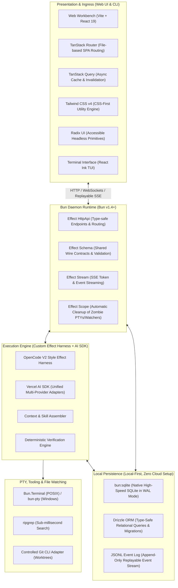

# Technology Stack Specification

**Status:** APPROVED FOR PLANNING  
**Version:** 2.0.0  
**Effective Date:** 2026-11-21  
**Architectural Scope:** Universal Kantha Platform  
**Governance:** Level 2 Technology Architecture (SDD System)

---

## 1. Executive Summary

Kantha is standardizing on a high-concurrency, local-first, daemon-centric architecture. By transitioning from a monolithic Next.js/serverless structure to a **Turborepo + Bun** monorepo with an independent **Bun v1.4+ Daemon** powered by **Effect-TS (`effect` + `HttpApi` + `Schema`)**, the platform achieves sub-millisecond startup times, deterministic resource lifecycle safety (`Scope` / `acquireRelease`), native SQLite performance, and zero-latency PTY terminal sessions.

The user interface transitions to a pure **Vite + React 19 + TanStack Router + TanStack Query + Tailwind CSS v4 + Radix UI** Single Page Application (SPA), accompanied by a companion **React Ink** CLI/TUI. The desktop shell (Tauri v2) is deliberately deferred to a subsequent milestone, keeping the core web and CLI experiences streamlined and decoupled.

Classification key:
- **`CANONICAL`**: The definitive standard for all active and future development.
- **`VERIFIED`**: Proven by existing tests or working prototypes.
- **`PROPOSED`**: Architectural target being scaffolded into the monorepo.
- **`DEFERRED`**: Intentionally scheduled for a future milestone (e.g., Desktop Shell).

---

## 2. Master Technology Stack Map

---

## 3. Technology Breakdown by Architectural Domain

### 3.1 Monorepo & Tooling
| Technology | Version | Purpose | Architectural Scope | Status |
|---|---|---|---|---|
| **Turborepo** | `^2.4` | Monorepo task pipeline orchestration, caching, and dependency graphs | Root workspace | `CANONICAL` |
| **Bun Workspaces** | `v1.4+` | Package management, lockfile resolution, script execution | Root workspace | `CANONICAL` |
| **TypeScript** | `^5.7` | Static typing, strict mode compiler, shared types | System-wide | `CANONICAL` |

### 3.2 Daemon Runtime & API Layer
| Technology | Version | Purpose | Architectural Scope | Status |
|---|---|---|---|---|
| **Bun Runtime** | `v1.4+` | Fast execution runtime, native SQLite, native WebSockets | `apps/daemon` | `CANONICAL` |
| **Effect-TS (`effect`)** | `^3.13` | Fiber-based concurrency, typed error channels, resource management | `apps/daemon`, `packages/protocol` | `CANONICAL` |
| **Effect HttpApi** | `@effect/platform` | Type-safe HTTP router, request validation, middleware | `apps/daemon` | `CANONICAL` |
| **Effect Schema** | `@effect/schema` | Bidirectional serialization, parsing, runtime contract enforcement | `packages/protocol` | `CANONICAL` |
| **Effect Stream** | `effect/Stream` | Server-Sent Events (SSE) token and event streaming to clients | `apps/daemon` | `CANONICAL` |

### 3.3 Coding Harness & AI Integration
| Technology | Version | Purpose | Architectural Scope | Status |
|---|---|---|---|---|
| **Custom Effect Harness** | In-house (OpenCode V2) | Generation-fenced agent execution loop, approval gates, checkpoints | `apps/daemon` | `CANONICAL` |
| **Vercel AI SDK Core** | `^4.1` / `ai` | Model provider abstractions (`streamText`, `generateObject`, tools) | `apps/daemon` | `CANONICAL` |
| **@ai-sdk/anthropic** | Latest | Claude 3.5 Sonnet / Haiku integration | `apps/daemon` | `CANONICAL` |
| **@ai-sdk/openai** | Latest | GPT-4o / o1 / mini integration | `apps/daemon` | `CANONICAL` |
| **@ai-sdk/openai-compatible** | Latest | Ollama, vLLM, Gemini, and local model inference | `apps/daemon` | `CANONICAL` |

### 3.4 PTY, File Watching & Execution Sandbox
| Technology | Version | Purpose | Architectural Scope | Status |
|---|---|---|---|---|
| **Bun.Terminal / bun-pty**| Native / `^0.2` | Interactive terminal sessions (`xterm.js` in UI) cross-platform | `apps/daemon` | `CANONICAL` |
| **ripgrep** | System binary | Instant regex code search and symbol indexing | `apps/daemon` | `CANONICAL` |
| **Git CLI Adapter** | `child_process` / Bun | Worktree, branch, diff, and candidate commit isolation | `apps/daemon` | `CANONICAL` |

### 3.5 Local Persistence (Zero-Cloud Setup)
| Technology | Version | Purpose | Architectural Scope | Status |
|---|---|---|---|---|
| **bun:sqlite** | Built-in (Bun) | High-speed embedded database engine in WAL mode | `packages/db`, `apps/daemon` | `CANONICAL` |
| **Drizzle ORM** | `^0.39` | Type-safe SQL schema definitions, migrations, and relational queries | `packages/db` | `CANONICAL` |
| **JSONL Event Log** | Append-only files | Gap-free chronological event logs for session replay and diagnostics | `apps/daemon` | `CANONICAL` |

### 3.6 Web Workbench UI (Pure SPA)
| Technology | Version | Purpose | Architectural Scope | Status |
|---|---|---|---|---|
| **Vite** | `^6.2` | Lightning-fast development server and production static bundler | `apps/web` | `CANONICAL` |
| **React** | `19.3.0` | UI rendering, concurrency, useTransition | `apps/web` | `CANONICAL` |
| **TanStack Router** | `^1.110` | 100% type-safe file-based client routing with search param validation | `apps/web` | `CANONICAL` |
| **TanStack Query** | `^5.66` | Server state management, auto-refetching, and cache invalidation | `apps/web` | `CANONICAL` |
| **Tailwind CSS** | `v4.0+` | High-performance CSS-first atomic layout and styling | `apps/web` | `CANONICAL` |
| **Radix UI** | `^1.2`–`^2.2` | Headless, accessible primitives (dialogs, dropdowns, tabs, popovers) | `apps/web`, `packages/ui` | `CANONICAL` |
| **@xterm/xterm** | `^5.5` | Web-based terminal emulator for interactive PTY sessions | `apps/web` | `CANONICAL` |
| **Lucide Icons** | `^1.72` | Icon glyph suite | `apps/web` | `CANONICAL` |

### 3.7 Terminal Interface (CLI / TUI)
| Technology | Version | Purpose | Architectural Scope | Status |
|---|---|---|---|---|
| **React Ink** | `^5.1` | Rich interactive terminal UI communicating with daemon API | `apps/cli` | `CANONICAL` |

### 3.8 Deferred Components
| Technology | Reason for Deferral | Target Milestone |
|---|---|---|
| **Tauri v2 Desktop Shell** | Focusing first on rock-solid Daemon API, Web Workbench SPA, and Ink CLI. Web SPA is statically packaged to embed directly into Tauri later without code changes. | Post-Foundation / Desktop Phase |
