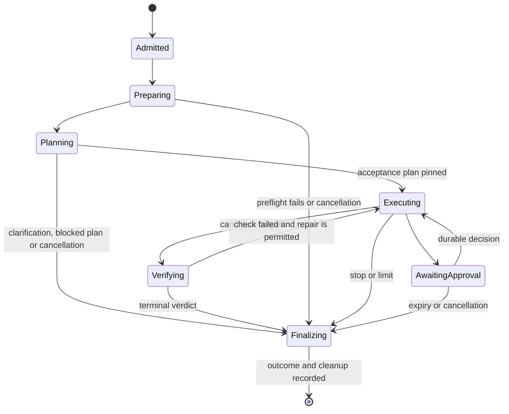

---
# FILE: C:\Users\bharg\OneDrive\Desktop\kantha-agent\docs\harness\features\APPROVALS.md
---

# Permissions, approvals and action recovery

Proposed feature contract. Qualify enforced policy before repository effects in H3. H4 completes durable approval and recovery. See A4, A5 and A8 in the [implementation plan](../IMPLEMENTATION-PLAN.md).

## Ownership and contract

The gateway owns authenticated repository grants, action decisions and business audit. A decision is allow, ask or deny for the exact normalized action. The harness pauses and resumes the same pending call. The executor requires a current authorized claim and an action ID before dispatch.

The durable sequence is proposed → waiting for approval or authorized → intent recorded → dispatch → terminal result. Denial, expiry, cancellation and revocation can end work before dispatch. An uncertain effect enters reconciliation. A matching authoritative receipt can settle it. Otherwise stop dependent work and surface interruption. Approval binds the actor, scope, run, action ID, arguments, tool version and expiry. A changed action requires a fresh decision.

The action policy and executor derive the operation label, target, parameters, expected effect and patch preview from the exact normalized action and expected workspace state. Bind the preview digest and baseline identity to the decision when preview bytes are involved. A changed target, arguments, or expected state invalidates the old decision. Render agent rationale as optional context clearly attributed to the agent. Only present **Approve once** when the actor can inspect the entire required decision material.

## Unresolved effects

When the executor lacks a conclusive receipt, persist an unresolved action and an interrupted handoff. The gateway fences dependent work on the affected target. V1 exposes the handoff in Chat and an operator-only command against the original run and action. The command takes a stable decision ID, expected action version, disposition, evidence reference, and reason. The gateway derives the actor and scope from authenticated context.

Supported dispositions establish applied, establish no effect, or retain unresolved. The executor or workspace authority verifies the evidence against the target before the gateway records a conclusive disposition. Atomically record the decision, resulting effect state and whether the fence can be released. Replay the same decision idempotently and reject conflicting versions or payloads. Preserve the original verdict and audit entry. Subsequent dependent work requires fresh admission. User acknowledgement alone cannot reconcile the effect.

## Build order and integration

1. Characterize [ingress](../../../src/lib/gateway/server/ingress.ts), the [approval service](../../../src/lib/gateway/server/approval-service.ts) and [approval contract](../../../src/lib/gateway/contracts/approval.ts) using the inert fixture.
2. Add a single normalized action policy shared across executors. Persist pending approval with a stable ID, expiry and version. Authorize the deciding actor and apply the decision idempotently.
3. Persist dispatch intent before the executor can start. Recheck current scope and claim at the executors’ enforcement boundary. Recover the same intent and reconcile before repetition.
4. Connect the runtime to the approval row in the originating Chat turn and its review section in Run details through the [browser contract](PROJECTION-CONTRACT.md). Use the legacy approval panel as fixture evidence for the gateway decision boundary. Log actor and action identity, decision and outcome in the appropriate audit record.

## Acceptance scenarios

- Approve a scoped fixture action through the normal UI. Restart before decision and after decision. Observe one durable decision and one effect with the same action ID.
- Submit denial, expiry, a stale version, wrong scope and duplicate decisions. Prove all refusal cases produce zero dispatch and duplicate approval returns the recorded outcome.
- Terminate the process between intent, dispatch and receipt. Recover known outcomes and stop dependent work for unknown effects. Exhibit the same result when cancellation races with a decision at the dispatch boundary.

Use the [gateway route tests](../../../scripts/test-gateway-routes.mjs) as the existing baseline. Add process interruption and browser approval scenarios with instrumented execution counts.


---
# FILE: C:\Users\bharg\OneDrive\Desktop\kantha-agent\docs\harness\features\CHAT-EVENTS.md
---

# Chat integration, events and run recovery

Proposed harness integration. The gateway APIs and ordinary chat are the current baseline. See A1, A6 and A8 in the [implementation plan](../IMPLEMENTATION-PLAN.md).

## Ownership and contract

The browser submits task intent and observes execution. The gateway authorizes all commands, projections and artifact reads. The harness journal supplies durable run state. Ordinary Chat keeps the existing AI SDK UI-message response. Repository tasks return a JSON admission receipt and use the authorized gateway SSE feed for assistant text and progress. The timeline and run snapshots hydrate the committed text under stable message and part IDs.

Publish safe run, approval, tool, verification and terminal states. Deduplicate projected runtime events by stable source identity, and order public events by the gateway cursor. Recover expired cursors from a fresh snapshot and its watermark. Stop is a command against the same public run and needs server acknowledgement.

Use the [repository task browser contract](PROJECTION-CONTRACT.md) for discovery, the durable link between a run and its Chat turn, history status, and the versioned snapshot and event semantics. Resolve action review in that turn and the Run details surface described in the [UX](../UX.md).

## Build order and integration

1. Map existing [chat](../../../src/app/chat/page.tsx), [chat API](../../../src/app/api/chat/route.ts), [event API](../../../src/app/api/gateway/events/route.ts), [event feed](../../../src/lib/gateway/runs/event-feed.ts) and [client contracts](../../../src/lib/gateway/client.ts).
2. Add projected runtime state while preserving ordinary chat, model selection and streaming. Feed durable session changes from [sessions](SESSIONS.md) into the gateway projection with stable run and event identities.
3. Present in-progress, pending approval, failed verification, interrupted and completed states, including permission-safe tool details and evidence. Read the [frontend reuse plan](../../frontend/README.md) before changing a screen.
4. Validate staging through the browser and monitor bounded subscriber delivery, reconnect and runtime shutdown. Correlate public run, step and action IDs while keeping raw tool payloads out of default telemetry.

## Acceptance scenarios

- Submit a harness task via the authorized Chat flow. Observe skill/tool progress, approve an exact action when prompted and open the final scoped evidence. Run ordinary chat through the same existing entry point as a regression.
- Reload during an active run and during approval. Test valid, duplicate and expired cursors. Observe one logical turn and one coherent terminal status after resync.
- Stop during execution, then reconnect. Verify acknowledgement and the server’s final outcome. Using another workspace’s run or artifact ID yields no protected data.
- Slow an event subscriber and verify bounded stream behavior while the run progresses and another client stays current.

Use the existing [chat stream](../../../scripts/test-chat-stream.mjs) and [route](../../../scripts/test-gateway-routes.mjs) tests as baselines. Add browser acceptance fixtures for the runtime states above.


---
# FILE: C:\Users\bharg\OneDrive\Desktop\kantha-agent\docs\harness\features\CONTEXT-AND-SKILLS.md
---

# Agent definitions, context and skills

Proposed feature contract. H3 implements this area. See acceptance checks A4 and A6 in the [implementation plan](../IMPLEMENTATION-PLAN.md).

## Ownership and contract

An agent definition supplies versioned instructions and a run profile, including limits and eligible capabilities. The gateway determines authority. The context builder assembles one request from the authorized task, pinned instructions, selected skill bodies, model-visible journal window, unresolved work and tool snapshot. The runner consumes the context builder output.

For a new repository task, use the current input and explicitly linked context. For a qualified `clarifiesRunId`, resolve the exact prior request and question within the same authorized conversation and repository and pin them with the answer before planning. Recheck current access on recovery and treat the linked text as task context. A new run builds its plan from current scope and verifier policy. Ordinary Chat includes authorized summaries from the newest terminal repository tasks in the same conversation within its context budget, with verified and unresolved outcomes labeled. Keep protected artifacts, raw tool output, action arguments and incomplete assistant text outside automatic cross-mode context. See the [browser admission contract](PROJECTION-CONTRACT.md#conversation-and-history).

Skill discovery returns ID, description, applicability, source and version or digest from eligible bundles. Loading resolves a selected version and permitted references and returns bounded text with provenance. A skill can instruct use of a tool. Every invocation still goes through the tool and action contracts.

Persist the agent version, instruction sources and selected skill digests with the run. Preserve the original journal through compaction. Checkpoint derived summary coverage, retain unresolved calls and criteria, and include only journal entries past the summary watermark on replay.

Pin a context profile per selected model. Reserve output and any provider-specific reasoning allowance before budgeting input. Count tool schemas and message framing with the pinned tokenizer or a conservative documented estimator. Preserve task scope, required criteria, applicable mandatory instructions, current tool schemas, and unresolved call/result pairs. Trim optional references and inactive skill detail first, then compact the oldest complete exchanges when the next request would exceed its input budget. Persist summary coverage and keep the original events. If the mandatory set cannot fit, end with a typed context limit and name the unavailable capacity. Provider-private reasoning stays out of the portable journal and UI. Qualify model-specific limits and the trigger during H2–H3.

## Build order and integration

1. Define fixture agent profiles and skill bundles, including duplicate IDs, conflicting instructions, an unavailable version and references outside the eligible source.
2. Resolve repository guidance at the pinned revision. Read root `AGENTS.md`, follow its applicable references and add nested instructions as the task enters their scope. Record the scope and source used.
3. Expose metadata-first skill discovery and scoped load through the [tool registry](TOOLS.md). Assemble a request with the [session journal](SESSIONS.md) and a deterministic context budget.
4. Exercise compaction and restart on the same run. Surface safe skill and context progress through [Chat and events](CHAT-EVENTS.md) where useful.

## Acceptance scenarios

- Run a fixture task spanning two directories. Assert applicable root and scoped instructions enter the right requests, eligible skill metadata is available, and only selected skill text is loaded.
- Change the skill catalog during a run. The current run retains pinned versions. A revoked grant blocks protected loads. Unavailable required content yields a concrete blocked reason.
- Compact after a complete tool exchange with a second action pending. Restart and compare reconstructed context with the checkpoint, retaining approval, correct ordering and verification criteria.

Add focused resolver and compaction fixtures plus one scripted run test. Read the [OpenCode agent schema and skill sources](../SOURCES.md#useful-source-documents) alongside the [Kantha context rules](../HARNESS.md#skills-and-repository-instructions).


---
# FILE: C:\Users\bharg\OneDrive\Desktop\kantha-agent\docs\harness\features\INFERENCE.md
---

# Model inference and tool continuation

Proposed feature contract. Start with H0–H2 and release check A3 in the [implementation plan](../IMPLEMENTATION-PLAN.md).

## Ownership and contract

The gateway resolves the authorized connection, model, credentials, egress and durable usage. The harness owns logical steps and their conversation history. It calls a gateway-mediated inference interface with a scoped run and step, selected model, ordered messages, eligible tool definitions and cancellation signal.

A normalized response carries text deltas, complete tool calls with stable IDs, terminal state and permitted usage metadata. Argument fragments stay in the model stream buffer until the call is complete. The next request includes the correlated assistant tool calls and recorded tool results. Each physical provider attempt reserves usage before dispatch and reconciles once, including cancellation or unknown usage. Provider retries remain bounded by gateway policy.

For v1, persist the complete ordered call list before scheduling, then process one call at a time in provider order. A pending decision blocks all later calls in that batch, including reads. On policy denial, expiry or a tool failure that requires replanning, record a terminal result for the affected call and a correlated skipped result for each unstarted sibling if the run will make another inference request. Stop, revocation and unresolved effects end continuation and record which calls were skipped. Recovery resumes the same ordered list and reuses committed results. The next provider request carries one correlated result per call in the preceding batch.

## Build order and integration

1. Use a scripted provider to establish a full fixture exchange with text, a complete call, a matching tool result and a final response. Include a cancelled and malformed stream.
2. Trace the current [chat service](../../../src/lib/gateway/server/chat-service.ts), [model adapter](../../../src/lib/gateway/providers/language-model.ts), [egress](../../../src/lib/gateway/providers/egress.ts) and [usage service](../../../src/lib/gateway/server/usage-service.ts). Establish a gateway-mediated seam that preserves ordinary chat.
3. Qualify one actual gateway model with tool continuation and restart handling. If deployment needs a separate service endpoint, specify service authentication and wire conformance before use. Keep provider credentials within the gateway.
4. Publish progress through [Chat and events](CHAT-EVENTS.md). The [session runner](SESSIONS.md) decides whether a typed provider failure can terminate or continue under its pinned plan.

## Acceptance scenarios

- Send one logical step with a successful tool call. Verify the exact ID and result appear in the next provider request and that the final response projects to the same public run.
- Force budget refusal, pre-output transient failure, partial output and Stop. Assert zero dispatch when denied, distinct attempt IDs on permitted retry, no automatic repetition of visible output or effects, and one settlement per attempt.
- Terminate the worker while an attempt is outstanding. Recover an existing receipt or record unknown usage and surface a typed outcome under the gateway accounting contract.

Run the existing [chat stream tests](../../../scripts/test-chat-stream.mjs) for regression. Run provider contract fixtures and a real selected-model smoke as separate evidence. See the [pinned OpenCode provider and runner source map](../../gateway/OPENCODE-HARNESS.md#from-submission-to-model-and-tool-execution).


---
# FILE: C:\Users\bharg\OneDrive\Desktop\kantha-agent\docs\harness\features\OPERATIONS.md
---

# Harness observability and evaluation

Proposed contract. H0–H1 establish repeatable fixtures and operation correlation. H5 qualifies the [release checks](../IMPLEMENTATION-PLAN.md#acceptance-matrix) A8 and A9. The [verification contract](VERIFICATION.md) governs completion of an individual run.

## Observability decision

Use OpenTelemetry (OTel) in the gateway and harness, export via OTLP through an OpenTelemetry Collector, and use **SigNoz** as the hosted observability backend. A single view of traces, metrics and logs supports diagnosis across Chat, inference, workspace tools, verification and recovery. Keep structured JSON logs available for local development. Evaluation cases, scores and release decisions live in the repository runner and CI. SigNoz can display aggregate results when useful. [OpenTelemetry JavaScript](https://opentelemetry.io/docs/languages/js/) · [SigNoz OTLP ingestion](https://signoz.io/docs/ingestion/signoz-cloud/overview/)

| Boundary | Capture |
| --- | --- |
| Submission and runner | Admission outcome, run duration, queue age, phase, preflight outcome, cancellation latency and recovery disposition. Link a recovered execution to the original run. |
| Model and context | Provider/model, logical step and attempt IDs, outcome, latency, reported usage, context size, compaction outcome and retry reason. Cost and usage totals come from the gateway ledger with explicit unknowns. |
| Policy and executor | Decision class, tool ID, side-effect class, approval wait, execution result, bounded output sizes and reconciliation outcome. Link attempts to the stable action ID. |
| Verification and operations | Check outcome, repair count, cleanup disposition, worker saturation, exporter drops and projection lag. Use bounded dimensions for metrics. Keep opaque run and action IDs in spans and structured logs. |

Use an attribute allowlist before export and filter again at the Collector. Default fields exclude prompts, completions, source code, diffs, filesystem paths, raw tool arguments/results, credentials and raw exception messages. Confirm export and access controls with synthetic canaries. Use authorized artifact references for detailed evidence. Bound exporter queues and timeouts. Disable or drop telemetry under failure or saturation while runs, approvals, settlement, evidence and SSE continue. Keep audit in application storage.

## Repository evaluation suite

Run deterministic state and policy tests, scripted integration and restart scenarios, isolated repository episodes and staging smoke. Add an independent reviewer for criteria that require judgment. A required failed or blocked deterministic check always vetoes success. Use sanitized, deterministic scripted responses or replay fixtures for routine CI, and keep live-model episodes as a separately labeled qualification lane.

Each case pins task text, baseline commit, dirty-state setup where relevant, tool and environment profiles, model settings, acceptance criteria and verifier version. Each episode gets a fresh workspace, session and budget. Take required check instructions from the trusted scenario definition and run them against the candidate state. Assert the required behavior, protected changes, stop/recovery outcome and side effects. Keep the verifier and case expectations outside the candidate's write scope.

| Scenario family | Required observation |
| --- | --- |
| Localized behavior change | Repair the existing formatter example and preserve unrelated dirty work. |
| Ambiguous or incomplete request | Resolve a routine assumption from repository evidence. In a separate episode, leave a material behavior choice unresolved and verify that affected writes are blocked with a concrete handoff. |
| Cross-module change | Update a caller and its implementation across instruction scopes. Assert compatibility and leave an unrelated module untouched. |
| End-to-end behavior | Exercise a task whose isolated component checks pass while its public entry point fails. Verify that the final verdict follows the public behavior. |
| Premature completion | Script a success claim after one of several required outcomes passes. Verify the grader detects the omitted outcome even if the candidate changes its own test expectations. |
| Inconclusive baseline | Run with a known pre-existing failure and an unavailable required check in separate episodes. Attribute the baseline failure and report blocked when required evidence is missing. |
| Interrupted operation | Restart around a pending approval, a recorded result and an ambiguous action outcome in separate episodes. Preserve identities, deduplicate known results and halt dependent work on uncertainty. |
| Scope and progress | Deny an out-of-scope write and force repeated failed repair attempts. Verify zero denied dispatches, bounded retries, useful handoff and usable workspace state. |
| Context continuity | Resume a deliberately long task after compaction in a fresh worker. Preserve acceptance criteria, current scope and unresolved action identity. |

Use at least two independent pinned repositories for release qualification, with a real task through staged Chat. Include distinct task shapes such as a localized bug fix, a cross-module compatibility change and a feature with multiple observable outcomes. Run the same harness entry points and lifecycle for each, changing only the task, repository profile and check definitions. For a live model or harness comparison, run at least three fresh episodes per task and candidate with the same settings and report the per-case outcomes and sample size. Record task success, false completion, unauthorized dispatch, duplicate effects, recovery, intervention, elapsed time and billed usage or unknown usage. Version the scenario set, accepted baseline and performance tolerances before comparing candidates. Any false completion, unauthorized dispatch, duplicate effect or failed required release scenario blocks qualification. Review quality, cost and duration against the pinned tolerances.

Turn recurring failures into sanitized regression cases. Classify each by scope, context, environment, state or feedback, reproduce it where possible, then compare the candidate with the pinned baseline. Promote reusable guidance only through a reviewed, versioned change with regression evidence. A run's notes remain scoped to its authorized task and carry source provenance.

## Acceptance

- Slow or stop the collector in staging. Run Chat, settle provider attempts, reconnect and read evidence. Confirm bounded export and unchanged authoritative outcomes. Inspect captured metadata for absence of the synthetic sensitive fields.
- Execute the suite twice with fixed fixtures and verify consistent verdicts. Make a required check fail while a reviewer approves the patch and observe a failed verdict. Change the candidate after a pass and verify the prior result is stale.
- Publish the case versions, candidate versions, episode outcomes and authorized evidence references with the H5 release record.


---
# FILE: C:\Users\bharg\OneDrive\Desktop\kantha-agent\docs\harness\features\PERSISTENCE.md
---

# Harness persistence and transcript portability

Proposed storage contract. The current gateway and H0–H1 fixture composition use SQLite. Read the [implementation handoff](../HANDOFF-H0-H1.md) for evidence and the [session contract](SESSIONS.md) for runtime ownership. H1 exercises the persistence boundaries. Qualify any shared deployment under A2, A5, A6 and A8 before routing live traffic to it.

## Storage decision

Use **Neon managed PostgreSQL** for the shared deployment in place of Supabase. Kantha already owns authentication and application authorization, so the immediate requirement is a managed relational database with transactional constraints, pooled connections and a restore path. Use server-side roles, explicit scope checks and a direct connection for migrations that require session state. Keep pooled authorization and locking assumptions transaction-scoped. Choose the region, restore window and compute settings at qualification. Measure wake latency and keep compute available if readiness and tail-latency targets require it. [Neon connection pooling](https://neon.com/docs/connect/connection-pooling) · [Neon point-in-time restore](https://neon.com/docs/introduction/point-in-time-restore)

Use the Claude Code-inspired append-only session history pattern with a Kantha-owned versioned format. In shared deployments the harness journal is stored as ordered PostgreSQL events plus checkpoints and exported as JSONL. This gives recovery one transactional source and makes transcripts portable. Keep SQLite for the existing single-process profile and local fixture runs. A disposable executor may hold a working copy, and durable workspace snapshots or Git checkpoints belong to the workspace owner. See [Claude Code's session guidance](https://code.claude.com/docs/en/how-claude-code-works).

| Record | Owner and durability |
| --- | --- |
| Identity, grants, credentials, submission mapping, approvals, action intent, usage and business audit | Gateway-owned transactional state. Public mappings commit before runtime delivery. Credential material uses the existing encryption boundary. |
| Conversation, execution journal and checkpoints | Harness-owned, append-only canonical events and a persisted checkpoint. PostgreSQL for the shared Kantha storage profile. An external runtime must qualify its authoritative journal and integration before selection. |
| Chat snapshots, SSE and transcript exports | Derived views of committed state. Persist a publication cursor or transactional outbox where crossing stores. Consume by stable source identity and rebuild safely after interruption. |
| Large evidence and immutable archives | Authorized artifact references backed by private S3-compatible object storage in the shared deployment. Record checksum, scope and retention. Publish a reference only after the object is durable and validated. Keep referenced object versions recoverable for the supported database restore window, subject to the deletion policy. Sweep orphaned uploads according to retention policy. |

## Journal and recovery contract

- Order by session sequence under a storage-enforced writer generation. Use unique session sequence and event IDs. A retry with identical identity and payload reuses the record. Conflicting payloads and stale generations fail. Reserve a stable event identity before crossing an adapter when redelivery is possible.
- Commit the relevant journal events and checkpoint in one transaction. A checkpoint pins input, phase, workspace identity, model/tool assets, compaction watermark, pending approval/action and verifier state. Release the transaction before external calls. At dispatch, recheck the fence and current grants and use the durable action intent. Reconcile a lost acknowledgement by reading committed identities and executor receipts before retrying.
- Export authorized committed events through a fixed high-water mark in sequence order. Each UTF-8 JSONL record carries `schemaVersion`, `eventId`, `sessionId`, `runId`, `sequence`, `occurredAt`, `type`, a typed `payload` and optional step or parent references. Validate payloads per type and preserve original event identities. Large outputs use references. Keep the format independent of Claude Code internals.
- Write finalized local exports via a temporary file and atomic publication. A reader can report a trailing partial line in an interrupted local export and recover only its complete prefix for inspection. A finalized archive with invalid records or checksum mismatch must fail validation. A JSONL export cannot authorize a resume. Resume uses the canonical journal, current grants and a verified workspace checkpoint.
- Enforce workspace-scoped reads and exports, retention, deletion and restore behavior for events, artifacts and backups. Keep ordinary chat's transcript subject to its existing application contract. Treat authorized transcript content as sensitive and exclude it from default telemetry.

## Evidence artifacts

Use versioned manifests with opaque artifact ID, kind, run ID, candidate digest, producing check or action ID, media type, checksum, stored byte size, truncation flag, creation time and retention expiry. The gateway returns authorized references. The first supported formats are a scoped UTF-8 unified patch, a bounded plain-text check log, and structured check evidence that references its output and exit outcome. A bounded output carries a visible truncation indicator. Snapshot check status and elapsed progress are sufficient for v1. Live log streaming requires its own authorized delivery contract.

Normalize control sequences and enforce output bounds. Scrub configured secrets from captured logs and withhold evidence that fails its publication policy. Run redaction before durable publication and test it with synthetic canaries. Repository patches are scoped sensitive content. Apply the artifact policy and artifact-specific access checks before preview or download. Shared deployments use the private object store. A supported local artifact profile uses a dedicated private directory outside served roots, atomic publication and the same scoped reference and checksum rules. The H1 fixture uses synthetic evidence labels.

## Qualification and migration

1. Replay the scripted SQLite scenarios against the PostgreSQL adapter with production-like roles and pooling. Race submissions and competing writers. Inject disconnects before and after commit, then prove no duplicate results, ledger settlements or resumed effects. Exercise unauthorized reads and tampered or truncated exports.
2. Restore the shared database and representative artifacts in staging. Verify cross-scope access denial, checkpoint recovery and reconciliation of pending actions and attempts. Measure and record recovery time, recoverable data window, readiness and connection saturation against the deployment targets.
3. Before moving any live SQLite deployment, quiesce writes and reconcile active work. Verify a consistent backup and tested import with scoped counts, identifiers, checksums for exports and ledger totals. Keep one authoritative writer during cutover. Roll back before admitting writes to the target, or use a tested reverse migration or forward recovery after target writes begin.


---
# FILE: C:\Users\bharg\OneDrive\Desktop\kantha-agent\docs\harness\features\PROJECTION-CONTRACT.md
---

# Repository task browser contract

Proposed for the production Chat integration. The H1 fixture uses an earlier snapshot and event shape. Ordinary Chat streams through the existing AI SDK response on `POST /api/chat`. Repository task submission returns a JSON receipt. Its assistant text and durable progress arrive through the authorized gateway SSE feed and hydrate from snapshots. Both render in the same Chat timeline. See the [UX](../UX.md) and [Chat integration](CHAT-EVENTS.md).

## Discovery and admission

Use `GET /api/gateway/harness/options` for authorized task options. Return `schemaVersion: 1`, deployment availability, eligible models, accessible repository options and `settingsLinks: { providers, access, usage }` booleans derived from the current actor's permissions. Each model has a gateway connection ID, model ID and display label.

Each repository option has an opaque ID, display name, permitted relative roots and supported operation labels. A target preview can include a ref name and revision. Include an authorized blocker with `code: target_fenced`, affected relative scope when disclosable, a safe reason, and the blocking run ID only if the actor can read it. A partial fence applies only to dependent work in its scope. When retained-candidate selection is enabled, list eligible candidates with opaque ID, display label, and candidate identity. The UI can show unavailable targets with explanations when the actor has permission to see them.

Submit through `POST /api/gateway/harness/runs` with `sessionId`, `inputId`, task text, repository ID, connection ID and model ID. Accept optional `clarifiesRunId` and, when enabled, `priorCandidateId`. The gateway revalidates authority, fences and selections and resolves the actual grant, revision, runtime profile and check policy. Return the public run ID, originating user message ID and current status as JSON. Return the same identity for an identical replay and a conflict for a changed payload. Typed blockers include `target_fenced`, `no_eligible_model`, `budget_exceeded`, `candidate_unavailable` and `clarification_unavailable`. Return an allowed Settings destination key only when the actor can use it and the destination addresses the blocker. Refresh options when the server rejects a stale selection.

Keep an unresolved submission in actor- and workspace-scoped browser storage with the original normalized payload and stable identity. Clear it after a confirmed receipt or definitive rejection, and clear it on sign-out. Restore it on reload and replay the same request when the user checks the submission. A lost acknowledgement keeps the task in the checking state. Retain server deduplication records for the supported replay window and give older unresolved requests an explicit expired result before allowing a fresh task. A lookup-only endpoint is optional.

## Conversation and history

Use the gateway session as the conversation identity and link each run to its originating user message and its assistant message IDs. The authorized session projection assigns a stable increasing turn sequence at admission or ordinary message commit. Display messages and run references in that order. Streaming updates replace parts of the existing message. Restore stable identities after reload, and keep each run attached to the original turn across terminal state and recovery.

Read `GET /api/gateway/sessions/:sessionId/timeline?before=<turnCursor>&limit=<pageSize>`. Return `schemaVersion: 1`, `sessionId`, `watermark`, `nextBefore` when older data exists, and `turns` in increasing `turnSequence` order. Each turn carries `turnSequence`, mode (`chat` or `repository_task`), ordered authorized UI messages and, for repository tasks, a run summary with `runId`, repository label, status, phase and outcome reason code when present. The default page includes the latest turns. The opaque cursor anchors earlier pages to a turn sequence. Merge pages by turn identity. Fetch run details separately by run ID. The watermark covers the durable state in the returned page, including in-progress assistant text.

For a clarification task, `clarifiesRunId` must refer to an authorized terminal run in the same session and repository with reason `clarification_required`. The new task text carries the answer. Pin the original request, structured question and answer as inputs to a fresh plan. A regular repository task uses its current request and explicitly linked context. Ordinary Chat includes bounded, read-only summaries from the newest authorized terminal repository turns in the same conversation, as space permits. Those summaries carry task intent, outcome and verified or unresolved status. Keep raw tool logs, artifacts, incomplete assistant text and action arguments outside automatic cross-mode context. See [context assembly](CONTEXT-AND-SKILLS.md).

Backfill only sessions already mapped to the current actor and workspace. Keep browser-only history available through its existing read path until it has a server mapping. Read history as a paginated summary of authorized conversations with title, last activity time, latest repository task and status. Refresh on opening history, focus, and local run updates. Refresh while history is visible if background status can change. A workspace summary feed can replace polling when qualified. Subscribing to the active session is sufficient for its live detail.

## Snapshot and events

Read the run by public ID. An authorized v1 snapshot carries the following fields. Optional data is absent until confirmed or permitted to read.

| Field | Contract |
| --- | --- |
| Identity and cursor | `schemaVersion: 1`, `sessionId`, `runId`, `userMessageId`, `watermark`, `updatedAt`. The watermark is the last gateway cursor covered by this projection. |
| Run state | Existing gateway `status` plus `phase` of `admitted\|preparing\|planning\|executing\|awaiting_approval\|verifying\|finalizing\|recovering`. `awaiting_approval` maps to `waiting_for_approval`. A projected `recovering` phase may carry `resumePhase`. Optional `substage: repairing` carries the affected criterion ID. `currentSummary` is the short safe live detail. A durable Stop acknowledgement carries `stopRequestedAt`. |
| Scope and handoff | Repository label, pinned base revision and model, optional candidate digest, and terminal `reasonCode`, remaining work, cleanup disposition and next action. Typed reasons include `clarification_required`, `check_unavailable` and `unresolved_effect`. `clarification_required` uses gateway status `failed` and carries an exact user-facing `clarificationQuestion`. Chat renders **Clarification needed**. |
| Assistant messages | `assistantMessages` contains ordered messages with `assistantMessageId`, optional `stepId`, `state` of `in_progress\|complete\|partial`, and ordered text parts with `partId`, committed text and `lastDeltaSequence`. This is the same repository assistant message representation used in the timeline. |
| Activity | Ordered rows with stable ID, event time, optional step ID, kind, safe summary, status and a `routine` flag for groupable rows. Allowed kinds cover workspace, skill, tool, approval, check and recovery. Keep large evidence behind refs. |
| Action | At most one pending approval with `approvalId`, action ID, approval version, expiry, trusted render data and optional attributed `agentRationale`. `canDecide` and `decisionMaterialComplete` are server-derived booleans. Approve requires both. Deny requires current decision permission. Previously resolved decisions carry their decision and time. Independent dispatch status is `pending\|dispatched\|settled\|uncertain\|ended_before_dispatch`. |
| Changes | `candidatePatchRef` points to the authorized full isolated patch when available. `baselinePreserved` is `confirmed\|unknown\|violated`. Each changed file carries a relative path, safe summary, `verificationState` of `verified\|partial\|unverified`, and an optional evidence ref, tied to the candidate digest. |
| Checks | Each criterion carries ID, title or behavior, required flag, check or command profile ID and version when resolved, expected and observed behavior when available, `pending\|passed\|failed\|blocked\|stale`, candidate digest where evaluated, safe reason and optional evidence ref. `baselineIssues` lists authorized baseline failures or unavailable checks separately. `activeCheck` carries criterion ID and `startedAt` for elapsed progress. |
| Usage | Gateway-ledger usage marked `reported` with values and units, or `unknown`. Omit while unavailable. |
| Transcript | `canExportTranscript` indicates current actor access and deployment capability. Export captures committed records through a fixed watermark. |

Use `GET /api/gateway/events?sessionId=:sessionId&cursor=:cursor` with the existing gateway event envelope. A reconnect may use `Last-Event-ID`, which takes precedence over the query cursor. Within the envelope, use these v1 harness payloads:

- `harness.message_delta` carries `schemaVersion: 1`, `sourceEventId`, `runId`, `assistantMessageId`, `partId`, optional `stepId`, `deltaSequence` and string `delta`. Sequence starts at 1 per part and increases by one. Persist the text and replay identity before publication. Batch adjacent text within bounded chunks and publish only authorized assistant text. Deltas can resume after approval, worker restart or reconnection under the same turn identity. A new part or message keeps its own stable identity.
- `harness.projection_changed` carries `schemaVersion: 1`, `sourceEventId`, `runId` and `sections`. Allowed section names are `state`, `handoff`, `messages`, `activity`, `approval`, `changes`, `checks`, `usage` and `transcript`. Notify message completion and partial termination through `messages`. Publish through the gateway cursor after the corresponding projection is durable.

Hydrate the active timeline and open run snapshot before subscribing. Replay from the oldest watermark of the surfaces being hydrated and use each surface's watermark and each part's sequence to ignore covered events. Apply contiguous text deltas directly. On a gap or expired cursor, refresh the affected snapshots and open a new subscription from the appropriate snapshot watermark. Keep any buffered events beyond the new watermarks. An older response cannot overwrite newer text or state. Deduplicate by source event ID and part sequence. Keep partial text after a terminal failure or Stop and preserve the last confirmed run state while reconnecting.

For ordinary invalidations, use one in-flight snapshot request per run and allow at most one routine refresh per 250 ms. Merge section names and retain a dirty flag during the request. Fetch a trailing snapshot if a newer relevant cursor remains uncovered. Approval, Stop, terminal updates and gap recovery can bypass the delay but share the in-flight request and schedule a trailing fetch if necessary. Never fetch a full snapshot for each contiguous text delta. Use bounded fallback polling while disconnected.

## Authorized routes and replay

| Route | Contract |
| --- | --- |
| `GET /api/gateway/harness/runs/:runId` | Return the versioned run snapshot. Verify current actor access and include a projection watermark. |
| `POST /api/gateway/approvals/:approvalId` | Submit `runId`, `actionId`, `expectedVersion`, stable `decisionId`, and `decision` of `approve\|deny`. Bind the decision to the displayed action and authenticated actor. Recheck authority, version, expiry and decision material before approval. Replay the same payload under the original decision ID and reject conflicts. |
| `POST /api/gateway/harness/runs/:runId/cancel` | Submit a stable `stopRequestId` and optional reason. Replays return the same acknowledgement for the same run and actor. Reject changed payloads for the same identity. Concurrent Stop requests converge on one recorded stop intent. If the run has already settled, return its outcome. The durable verdict arrives through the snapshot. |
| `GET /api/gateway/harness/runs/:runId/artifacts/:artifactId` | Read the authorized artifact manifest and bytes through the scoped reference. Recheck current access and retention on each read. Return a generic unavailable response for foreign or expired refs. |
| `GET /api/gateway/harness/runs/:runId/transcript?through=<watermark>` | When enabled, stream a versioned JSONL export through the specified committed watermark or a captured server watermark. Apply transcript authorization and the export rules in [persistence](PERSISTENCE.md). |

After a command conflict or an unknown response, refetch the run before presenting decision controls again. Display expiry, decision, Stop and dispatch independently from persisted state.

## Acceptance

Exercise mixed ordinary and repository turns, clarification with an answer-only submission, background task status refresh, lost response plus reload, and authorized transcript and artifact reads. Reconnect mid-message, around an approval pause and after restart. Inject duplicate, missing and expired cursors, and check exact assistant text plus one logical turn. Verify bounded refetch under tool bursts, changed approvals and Stop races. A browser reopening an interrupted task can read its authorized handoff before taking any action. Run these alongside the [release acceptance matrix](../IMPLEMENTATION-PLAN.md#acceptance-matrix).


---
# FILE: C:\Users\bharg\OneDrive\Desktop\kantha-agent\docs\harness\features\README.md
---

# Harness feature map

Start here from [AGENTS.md](../../../AGENTS.md). The [harness specification](../HARNESS.md) defines shared behavior. The [implementation plan](../IMPLEMENTATION-PLAN.md) defines milestone order and release acceptance. The feature documents define contracts, integration paths and acceptance scenarios. The [H0–H1 handoff](../HANDOFF-H0-H1.md) records current fixture evidence.

Use the [repository task UX](../UX.md) for the Chat flow, wireframes and browser acceptance scenarios.

## Feature documents

| Feature | Primary responsibility | First slice and release checks |
| --- | --- | --- |
| [Sessions and execution](SESSIONS.md) | Input admission and delivery, writer claims, checkpointing, cancellation and recovery | H0–H1 · A2, A5, A6 |
| [Model inference and tool continuation](INFERENCE.md) | Gateway-mediated provider calls, normalized tool conversation and attempt accounting | H0–H2 · A3 |
| [Workspace preparation and repository access](WORKSPACE.md) | Preflight, scoped workspace, repository operations and cleanup | H0, H3 · A4, A7, A8 |
| [Agent definitions, context and skills](CONTEXT-AND-SKILLS.md) | Versioned instructions, skill discovery and load, context assembly and compaction | H3 · A4, A6 |
| [Tool registration, invocation and results](TOOLS.md) | Advertised definitions, schema validation and correlated results | H1, H3 · A3–A5 |
| [Permissions, approvals and action recovery](APPROVALS.md) | Action authorization, durable approval, intent and reconciliation | H3–H4 · A4, A5, A8 |
| [Verification, evidence and handoff](VERIFICATION.md) | Acceptance criteria, check results, bounded repair and completion verdict | H0, H4–H5 · A7, A8 |
| [Chat integration, events and run recovery](CHAT-EVENTS.md) | Authorized commands, streaming, projections and browser recovery | H1, H5 · A1, A6, A8 |
| [Repository task browser contract](PROJECTION-CONTRACT.md) | Discovery, task submission, conversation history, snapshots and event replay | H3, H5 · A1, A2, A6, A8 |
| [Persistence and transcript portability](PERSISTENCE.md) | Transactional journal, PostgreSQL deployment, JSONL export and backup recovery | H1, H5 · A2, A5, A6, A8 |
| [Observability and evaluation](OPERATIONS.md) | OTel signals, SigNoz diagnostics and repository qualification suite | H0–H1, H5 · A8, A9 |

H0–H5 and A1–A9 refer to the [implementation sequence](../IMPLEMENTATION-PLAN.md#implementation-sequence) and [release acceptance matrix](../IMPLEMENTATION-PLAN.md#acceptance-matrix).

## Build the first task end to end

The first fixture uses a display formatter that drops a valid zero value, a known failing check and an unrelated dirty file. The requested outcome is a scoped patch that preserves the zero value and passes the repository check while retaining the unrelated edit. Qualify the same lifecycle on the [independent scenario families](OPERATIONS.md#repository-evaluation-suite) before release.

The [required lifecycle](../HARNESS.md#required-lifecycle-for-every-repository-task) defines the gates that apply to every task. Repository profiles supply workload-specific setup and checks. A fixture's repair behavior serves as test data for the runner and verifier contracts.

1. **H0 · Define the fixture and baseline.** Declare the allowed repository, expected behavior and exact verification profile. Check startup, baseline state and ordinary gateway chat.
2. **H1 · Prove the execution path.** Send the task through the normal submission boundary with a scripted model and an inert tool. Exercise duplicate delivery, Stop and worker restart before adding repository effects.
3. **H2 · Prove the model boundary.** Replace scripted inference for a controlled staging run with one authorized, tool-capable model. Verify the complete call/result conversation and per-attempt ledger entries.
4. **H3 · Prove scoped coding work.** Initialize the fixture workspace, load applicable instructions and an eligible skill, inspect the target, then apply the expected patch using qualified scope checks and a reconcilable action record. Restrict fixture effects to the supported policy.
5. **H4 · Prove approvals and completion.** Use a policy that requires approval for the fixture patch. Resolve the exact action, run the declared check in the qualified executor and record the verdict against the resulting repository state. Repeat with denial, cancellation and a failing check.
6. **H5 · Prove the real entry point.** Run the full workflow from staging Chat. Reload mid-run, reopen the same outcome, inspect the authorized evidence and confirm the baseline dirty file remains. Record what ran, where it ran and what each check established.

Use the [H0–H1 handoff](../HANDOFF-H0-H1.md) for the current implementation entry point, the [documentation authoring guide](../SOURCES.md#how-to-write-the-next-feature-document) when adding another feature spec, and [the architecture release sequence](../../../architecture.md#release-sequence) for orchestrator, plugin and automation prerequisites.


---
# FILE: C:\Users\bharg\OneDrive\Desktop\kantha-agent\docs\harness\features\SESSIONS.md
---

# Sessions and execution

Proposed feature contract. Start with [the harness lifecycle](../HARNESS.md#session-and-recovery-contract), [H0–H1](../IMPLEMENTATION-PLAN.md#implementation-sequence) and release checks A2, A5 and A6.

## Ownership and contract

The gateway owns caller authorization, public session and run IDs, submission mapping and public status. The session inbox owns admission and delivery eligibility. The harness runner owns step execution and asks the inbox for eligible input. The journal is the authoritative ordered record for harness conversation and workflow state. The existing gateway-only transcript has its own lifecycle.

The [persistence contract](PERSISTENCE.md) defines journal atomicity, canonical storage and portable JSONL exports.

| Operation | Input and observable result |
| --- | --- |
| Admit | Given a gateway scope, stable input ID and payload digest, return the original receipt on an identical submission. Return conflict for a changed payload or distinct input while the session is busy. |
| Claim and deliver | Claim a generation and commit input promotion before constructing context. A stale generation cannot advance the journal or dispatch a capability. |
| Checkpoint | Commit input position, phase, step, pending approval/action IDs, completed results and workspace reference. Advance the projection with stable source event IDs. |
| Cancel or recover | Stop new dispatch on cancellation. Signal active operations, reconcile unresolved intents and settle the final status. Recovery starts from the last safe checkpoint under a new qualified claim. |

Persist the canonical input and its digest with the public run mapping, or use a transactional outbox when the stores differ. The runner can claim durable inputs whose journal admission or first writer claim was interrupted. An identical replay or recovery scan can deliver the pending input. A payload change conflicts even before journal admission. A terminal gateway run is observed as terminal. H2 hosting must qualify delayed restart and define how an undispatched durable input stays eligible across its supported outage window. Use the [browser contract](PROJECTION-CONTRACT.md#discovery-and-admission) for reload-safe client replay.

The authorized Chat timeline joins the gateway-only transcript and harness turns through stable IDs and turn sequence. Each retains its own durable owner. Carry context across modes using the [context contract](CONTEXT-AND-SKILLS.md), including the explicit prior-run link on clarification.

## Build order and integration

1. Characterize the current [session service](../../../src/lib/gateway/runs/session-service.ts), [run contract](../../../src/lib/gateway/contracts/run.ts) and [adapter interfaces](../../../src/lib/gateway/contracts/adapters.ts).
2. Persist the gateway mapping before handoff. Implement a journal with idempotent admission and a storage-backed single-writer claim. Redeliver a pending mapping with the original identity after failure.
3. Run a scripted model step and inert tool through the runner. Append one terminal tool result before building a dependent step. Save the evidence needed to resume without rerunning a completed step.
4. Connect [Chat and events](CHAT-EVENTS.md) for Stop and reconnect. Apply the [approval and action rules](APPROVALS.md) to dispatch and recovery.

## Acceptance scenarios

- Submit twice on separate connections with the same key and payload. Both responses identify one run and one model execution. Submit a different payload with that key and observe conflict.
- Kill the worker after public mapping and before harness admission. Redelivery starts exactly one logical run. Race two workers and prove a reclaimed generation cannot append or dispatch after the replacement claim.
- Stop with an in-flight action and recover with an expired claim. Preserve the same run ID and credit recorded tool results once. Where reconciliation is inconclusive, publish interruption and leave the affected action traceable.

Start from the existing [gateway route checks](../../../scripts/test-gateway-routes.mjs). Add harness process fixtures for the failure boundaries above. Use the [OpenCode session and event references](../SOURCES.md#useful-source-documents) for lifecycle comparison.


---
# FILE: C:\Users\bharg\OneDrive\Desktop\kantha-agent\docs\harness\features\TOOLS.md
---

# Tool registration, invocation and results

Proposed feature contract. H1 exercises the inert tool and H3 introduces scoped repository capabilities. See A3–A5 in the [implementation plan](../IMPLEMENTATION-PLAN.md).

## Ownership and contract

The registry owns tool registration and lookup. Tool invocation owns schema validation and normalization. The action policy decides authorization and approval. The executor enforces scope and owns effects and receipts. The session runner waits for durable tool results before using them in another model request.

| Artifact | Required fields and guarantees |
| --- | --- |
| Definition | Stable ID and implementation version, input schema, optional machine output schema, required capability, effect class, timeout and output limits. |
| Advertised snapshot | Exact versions and schemas visible to the model for the request. Successive requests may receive new snapshots. Current grants apply on dispatch. |
| Invocation | Stable call and action identities, pinned definition, normalized arguments, workspace reference and execution claim. Evaluate authority before dispatch. |
| Result | One terminal outcome correlated to the call ID, bounded model-facing content, optional validated machine output and compact safe UI metadata. Larger artifacts use authorized references. |

The [inference contract](INFERENCE.md) owns batch ordering and skipped siblings. The [approval contract](APPROVALS.md) owns the authoritative rendering of a proposed effect. Project tool summaries from an allowlisted UI representation and use the [evidence contract](PERSISTENCE.md#evidence-artifacts) for detailed output.

## Build order and integration

1. Define the first registry and wire an inert tool to the scripted [session runner](SESSIONS.md). Use the [existing inert fixture](../../../src/lib/gateway/server/approval-service.ts) for gateway behavior evidence.
2. Capture the advertised snapshot when [inference](INFERENCE.md) builds a request. Resolve only complete calls against that snapshot. Reject unknown IDs and invalid inputs before effects.
3. Route repository operations through [workspace execution](WORKSPACE.md) and the [action policy](APPROVALS.md). Commit intent before dispatch and a terminal result before continuation.
4. Publish safe tool status to [Chat and events](CHAT-EVENTS.md). Give the model and UI their respective result representations.

## Acceptance scenarios

- Advertise V1, register V2, then execute a valid call from the original request. It uses V1 only while its grant is valid. A revoked grant yields zero dispatch.
- Send incomplete arguments, an invalid schema and an unknown tool. Assert zero dispatch and safe typed outcomes for completed invalid calls.
- Bound oversized results independently for model and UI. Verify machine output against its schema and deny artifact reads outside authorized scope.
- Replay a completed action and deliver its existing result once. Interrupt an uncertain effect and follow the reconciliation contract before another step.

See the [pinned OpenCode tool specification and implementation map](../../gateway/OPENCODE-HARNESS.md#how-the-tools-are-built). Use registration contract checks, scripted model integration and executor failure fixtures.


---
# FILE: C:\Users\bharg\OneDrive\Desktop\kantha-agent\docs\harness\features\VERIFICATION.md
---

# Verification, evidence and handoff

Proposed feature contract. H0 defines checks and H4–H5 integrate and qualify verification. See A7 and A8 in the [implementation plan](../IMPLEMENTATION-PLAN.md).

## Ownership and contract

The task plan owns observable acceptance criteria and the declared check references. The verification service determines pass, fail or blocked from evidence for the candidate workspace state. The runner can request bounded repairs based on check results. It treats the verifier’s verdict as authoritative.

Each criterion has a stable ID, behavior, check reference and required status. Each result records run, criterion, command or review identity, workspace revision or diff digest, status and evidence reference. A changed candidate invalidates affected prior evidence. A required unavailable check blocks success. Judgment-based review uses task requirements, the diff and check evidence independently of the implementer’s reasoning.

After preflight, the `planning` phase proposes observable outcomes using task intent, repository guidance and policy-allowed read-only discovery. Planning inference uses normal gateway budget admission and settlement. The gateway-selected repository profile supplies the eligible check and review definitions. The verification boundary validates the mapping, pins the plan and approved check versions before `executing`, and persists required versus optional criteria. The model may suggest scenarios. It cannot authorize commands or weaken required checks. Show the pinned criteria in Run details as soon as they are available.

For v1, unresolved material choices end the run before affected writes with gateway status `failed`, reason `clarification_required` and `clarificationQuestion`. The user submits an answer with a fresh input ID and `clarifiesRunId`. The planner uses the authorized prior request and question with the new answer to pin a fresh plan. A change to required outcomes after pinning also requires fresh admission. Keep evidence tied to the original candidate and plan. An unavailable required check produces a blocked criterion and a failed run with a concrete next action.

## Completion and repair decisions

- The runner's request to finish starts verification. Only the verification service can produce a passing verdict. Record an explicit result for every required criterion, including criteria that could not be evaluated. Check the supported entry point when the user requested a behavior that spans components.
- Pin the required criteria and verifier inputs before candidate edits. Evaluate changes to test files, fixtures or check configuration as candidate work. Required independent checks remain under verifier control so a patch that weakens its own checks cannot establish success. Material changes to acceptance criteria require authorization through the task boundary and invalidate affected verdicts.
- Record each failed criterion with the candidate identity, expected and observed outcomes, evidence reference and failure category when known. Send the runner the actionable findings and remaining repair budget. Repeated identical findings against unchanged relevant state stop the repair loop unless a known transient failure permits a bounded retry. Preserve repair counts and prior findings across restart.
- Generate the handoff from durable records. Include the requested outcome, what passed and against which candidate, what remains incomplete, baseline failures, unresolved effects, cleanup and the next safe action. Validate it by reopening the run without the prior model context.

## Build order and integration

1. Write a fixture task with known passing and failing inputs. Pin the acceptance plan and approved check profiles during [workspace preparation](WORKSPACE.md).
2. Execute checks through the qualified executor. Apply time and output bounds and capture exit status and authorized evidence. Feed failed criteria back to the runner under the pinned repair limit.
3. Recheck the final candidate and independently determine completion. Persist verdict, remaining criteria, final repository identity, artifact references and cleanup disposition before projecting a terminal outcome.
4. Produce a human-readable handoff from durable evidence. Include scope, changes, check results, blocked items, unresolved effects and the next step.

## Acceptance scenarios

- Start from a failing fixture, repair it and prove the required check passes against the final candidate. Change the candidate after a green result and confirm the stale result cannot advance completion.
- Exercise a skipped or missing check, a timeout and exhausted repair limits. Surface evidence and remaining work. Keep the outcome short of completed while required criteria remain unresolved.
- Script an assistant that claims success after satisfying just one of two required outcomes, then edits its own test expectations to hide the second. Keep the independent check authoritative and report the unfinished criterion. Repeat the same failed candidate after a restart and verify the repair budget and stop condition survive.
- Run staged acceptance through the normal Chat flow. Reopen the staged run in a fresh session and verify that its authorized evidence and cleanup status support continuation.

Use the [release acceptance matrix](../IMPLEMENTATION-PLAN.md#acceptance-matrix) for cross-feature gates, the [repository evaluation suite](OPERATIONS.md#repository-evaluation-suite) for repeatable quality checks across runs, and the [WalkingLabs verification and handoff references](../SOURCES.md#course-concepts-in-kantha) for patterns.


---
# FILE: C:\Users\bharg\OneDrive\Desktop\kantha-agent\docs\harness\features\WORKSPACE.md
---

# Workspace preparation and repository access

Proposed feature contract. H0 establishes the fixture and H3 qualifies repository operations. See A4, A7 and A8 in the [implementation plan](../IMPLEMENTATION-PLAN.md).

## Ownership and contract

The gateway grants repository access. The workspace service turns that grant into an opaque workspace reference with repository identity, base revision, baseline changes and environment profile. The executor enforces repository roots and the permitted operation at execution time. The runner consumes workspace metadata and typed outcomes.

Preflight records startup and check availability before edits. Read and search return bounded results. Patch accepts expected file state and a bounded change. It returns changed paths and a receipt or a stale-state outcome. Preparation and cleanup record ownership of workspace resources. Use a separate qualified execution boundary for repository-provided code. A worktree alone shares host privileges.

## First production workspace profile

Run approved checks in a disposable Linux VM with a pinned image, an unprivileged account, bounded resources and a default-deny network policy. The VM receives a staged repository snapshot and designated output storage. Keep provider credentials, host home directories, host sockets and the user's live checkout outside the guest. Restrict reads and patch writes to the granted relative roots, reject symlink and junction traversal during capture and execution, and qualify Stop, timeout, cleanup and recovery before enabling effects. The deployment must supply and qualify the VM implementation.

The workspace owner captures the pinned base and a manifest of authorized staged, unstaged and untracked changes, including deletions and modes where supported. Exclude ignored content unless the repository profile explicitly includes it. Verify the manifest is stable across capture and abort if files changed during capture. Materialize the captured bytes into the isolated workspace. Preserve baseline edits by requiring each patch to match expected file state and by checking the final candidate against the baseline, including when a file contains both user and candidate edits. Block ambiguous overlap. Persist a revision and snapshot digest so recovery can check the same baseline or fail safely.

V1 accepts one existing regular file per patch action. Validate scope, expected pre-change digest and baseline protection under the current writer claim. Stage candidate bytes on the same filesystem, record the intended pre- and post-change digests, then atomically replace the file and durably record its outcome. Reject a multi-file request before dispatch. Runs can change several files through separate actions, each with its own intent and receipt. After an interrupted replacement, compare the authorized target against the recorded pre- and post-change identity under the workspace fence. Resolve only when that evidence is conclusive. Otherwise mark the effect unresolved and follow [operator disposition](APPROVALS.md#unresolved-effects).

The first release delivers an authorized patch relative to the captured baseline and a candidate identity. If the workspace owner retains a snapshot, show that disposition in the handoff. Changes in this profile are produced in the isolated candidate. Applying, committing, publishing or discarding a live target requires a separately qualified workflow. A follow-up task captures a fresh baseline from its authorized repository target. It inherits prior candidate changes only if the user explicitly selects a supported retained candidate and the gateway revalidates its grant and identity.

## Preflight decisions

Record which entry points and verification commands are available, their relevant baseline outcomes, and the revision and environment used. Classify each baseline check as passing, known failing or unavailable, with evidence. An expected failing regression check can establish the need for the task. A missing prerequisite blocks edits that depend on it. A known unrelated failure may allow scoped work to proceed if the acceptance plan supports independent verification and reports the baseline failure. Required final criteria still need valid passing evidence. Revalidate workspace identity and protected changes after recovery and before the final verdict.

## Build order and integration

1. Build a controlled repository fixture with pre-existing edits, a small expected patch and a known verification command. Record baseline revision and status.
2. Prepare the workspace under the grant from [gateway ingress](../../../src/lib/gateway/server/ingress.ts). Pass an opaque reference to [sessions](SESSIONS.md), [tools](TOOLS.md) and the [verifier](VERIFICATION.md).
3. Implement scoped repository operations and single-file patch actions. Detect stale files and reject escapes, including symlink or junction traversal. Verify atomic replacement and recovery between replacement and receipt.
4. Finalize with a scoped diff or artifact and a cleanup disposition. Preserve the user’s baseline edits and record the status of owned temporary resources.

## Acceptance scenarios

- Prepare from a fresh and a dirty checkout. Patch only intended paths, retain baseline edits and validate output against the recorded base.
- Remove a required environment prerequisite and verify that dependent repository mutations are never dispatched. Run a separate case with an attributable unrelated baseline failure and prove the scoped outcome using the approved checks.
- Reject a foreign grant, revoked grant, root escape and stale expected state. Assert unchanged target state after rejection.
- Reject a multi-file patch as one action. Interrupt a run between two valid single-file actions and verify the handoff reports the first confirmed change separately from the second.
- Interrupt a patch after dispatch and reconcile the actual file state by action identity. Verify the next session can initialize and that owned files or processes are released or explicitly retained with a reason.

Add filesystem and execution-boundary integration fixtures for the target platform. Use the [harness tool rules](../HARNESS.md#tools-and-permissions) and [gateway contracts](../../gateway/CONTRACTS.md).


---
# FILE: C:\Users\bharg\OneDrive\Desktop\kantha-agent\docs\harness\GLOSSARY.md
---

## Glossary
This glossary uses the terminology in the [harness specification](HARNESS.md) and [feature contracts](features/README.md).

### Core Concepts

* **Harness**: The complete infrastructure surrounding an AI model that enables reliable execution, comprising five subsystems: Instructions, Tools, Environment, State, and Feedback.
* **Capability Gap**: The difference between an AI model's benchmark performance and its real-world engineering performance.
* **Verification Gap**: The difference between an agent claiming a task is complete and its actual correctness.
* **Harness-Induced Failure**: A system failure caused by inadequate infrastructure (e.g., poor state management, lack of verification) rather than model limitations.
* **Diagnostic Loop**: The cycle of execute, observe, identify the cause, fix the harness, and execute again.
* **Definition of Done**: Explicit, testable conditions required to mark a task as completed.
* **Knowledge Visibility Gap**: The disconnection between knowledge discussed in chat sessions and the authoritative information available in the repository.
* **Bootstrap (Initialization) Phase**: The phase at the start of a session where the agent understands the working environment before modifying code.
* **Overreach**: The failure mode where an agent does more than requested, modifying unrelated functionality.
* **Under-finish**: The failure mode where an agent stops before the feature is actually complete and reports success prematurely.
* **System of Record**: The principle that the repository must contain the authoritative information required to build the product.


---
# FILE: C:\Users\bharg\OneDrive\Desktop\kantha-agent\docs\harness\HANDOFF-H0-H1.md
---

# H0 + H1 implementation handoff

Status: H0 baseline and H1 durable single-session runner are implemented in code. Slices H2–H5 remain proposed. This is fixture and in-process evidence, not staging qualification.

## Scope delivered

- **H0 fixture:** scripted model scenarios (`pass`, `fail`, `cancel`, `malformed`), a controlled repository fixture with a dropped zero value and one unrelated dirty file, an acceptance plan with two required checks, and a deterministic verifier. `src/lib/harness/fixture.ts`, `src/lib/harness/scenario.ts`.
- **H1 backend:** domain contracts, durable admission and checkpoint with stable source event IDs, storage-enforced single-writer claims with generation fencing, a pinned tool registry with one inert tool, and a bounded runner that persists a terminal tool result before a dependent step. `src/lib/harness/`.
- **Gateway wiring:** harness store/projection adapters over `GatewayDatabase` and `GatewayRunService`; composition in `GatewayRegistry`; versioned `harness.*` events in the existing SSE feed; API routes for submit, snapshot, cancel and restart recovery.
- **Frontend connection:** browser client, an SSE/reconnect hook that deduplicates by `sourceEventId`, and a Chat collapsible panel using Astryx public subpaths. Ordinary chat and its transport are unchanged.
- **Checks:** `scripts/test-harness-fixtures.mjs` (`npm run test:harness`).

## Checks run

- `node scripts/test-harness-fixtures.mjs` — 9 assertions passed, including a real `GatewayDatabase(':memory:')` + `GatewayRunService` integration proving replay, conflict, streamed deltas, terminal status, Stop and event projection. Fault injection after the mapping commits and before journal admission verifies request replay and durable recovery while the gateway run lease is active. Both deliver the original input and record one inert tool result.
- `node scripts/test-gateway-fixtures.mjs` — 54 baseline assertions passed.
- `npx eslint` on all harness files — clean.
- TypeScript: no errors in files touched by this handoff (full-repo `tsc`/`next build` type check is blocked by pre-existing errors in the untracked `packages/ui` tests and missing local `@/components/ui/*` modules in this worktree). Webpack production compile succeeds.

## Fixture limits

| Bound | H0–H1 implementation |
| --- | --- |
| Service defaults | 6 model steps, 0 repair rounds, 30 seconds elapsed limit and a 15-second writer lease. The elapsed check runs between model steps. |
| Chat fixture overrides | 4 model steps, 0 repair rounds and a 20-second elapsed limit. |
| Tool dispatch | One call at a time. The inert tool definition caps model-facing result text at 8,192 UTF-8 bytes. |
| UI evidence | The fixture snapshot returns up to 128 recent journal entries. The fixture panel previews the first 240 UTF-16 code units of serialized entry data. The snapshot has no separate UI byte cap. |
| Approval expiry | The gateway's inert approval expires after 5 minutes. The harness runner fixture has no durable approval pause. |

These values describe fixture behavior. Production staging starts with the [proposed run profile](HARNESS.md#proposed-v1-run-profile).

## Unresolved work

- Browser E2E and staging smoke (A1, A6, A8) are not yet run; they require a complete production build and a qualified environment.
- H2 real provider inference and per-attempt accounting, H3 workspace/skill tooling, H4 approvals and bounded repair, and H5 release qualification remain unimplemented.
- The fixture gateway still expires a run when its lease elapses. Delayed restart and redelivery after that window require qualification and a durable hosting lifecycle under H2.
- The full build's type check fails on unrelated existing files; restore or replace the deleted local UI modules and install the `@astryxdesign/*` test dependencies before treating the build as green.

## Next action

Resolve the pre-existing build blockers, run the browser flow for submit → reconnect → Stop → evidence, then begin H2 by replacing `ScriptedInference` with the gateway-mediated inference seam while keeping the journal and projection contracts unchanged.


---
# FILE: C:\Users\bharg\OneDrive\Desktop\kantha-agent\docs\harness\HARNESS.md
---

# Kantha harness specification

**Status:** Proposed. Read the [system architecture](../../architecture.md) for cross-component ownership, the [feature map](features/README.md) for subsystem contracts and the [implementation plan](IMPLEMENTATION-PLAN.md) for release gates. Existing gateway behavior is defined in the [gateway contracts](../gateway/CONTRACTS.md).

## Product outcome

A user assigns a bounded coding task against a granted repository. Kantha initializes a reproducible workspace, reads applicable instructions, uses authorized tools and skills, verifies the requested behavior and returns evidence tied to the resulting repository state. The user can stop execution, resolve an approval and reconnect to the same run. After a failure, the harness can resume from a safe boundary or explain what remains unresolved.

The initial release supports one active task per session. Separate sessions can run within deployment capacity. A second distinct submission to a busy session receives a conflict. Steer, queued follow-ups and child runs can build on the same admission boundary when their semantics are specified.

## Required lifecycle for every repository task

The runner applies this lifecycle to each task admitted against a repository. Task-specific checks come from the acceptance plan and repository profile. The formatter fixture supplies one acceptance plan for exercising the lifecycle.

| Gate | Condition for advancing | If the condition is unmet |
| --- | --- | --- |
| Define the task | Persist the requested outcomes, allowed targets, protected existing work, material assumptions and a criterion for each required outcome. Use read-only discovery to resolve repository questions and record evidence for assumptions. | Block affected changes when unresolved ambiguity would change user-visible behavior, authorized scope or the definition of success. Report the decision or evidence needed to proceed. |
| Prepare the workspace | Pin revision, dirty state, applicable instructions, environment and approved check profile. Record the baseline results needed to attribute later failures. | Diagnose unavailable prerequisites and distinguish known baseline failures from missing evidence. Gate edits using the [workspace contract](features/WORKSPACE.md). |
| Execute and checkpoint | Each action is permitted for the task and current grant. Persist consequential results and the next eligible step before dependent work. | Deny prohibited actions, wait for a durable approval when required, and reconcile uncertain effects before continuing. |
| Verify and repair | Evaluate every required criterion against the final candidate through its supported entry point. Verify task scope and preservation of baseline work alongside the requested behavior. | Feed actionable findings into bounded repair, or record the incomplete criteria and why work stopped. [Verification contract](features/VERIFICATION.md) |
| Finalize and hand off | Persist the verdict, evidence, remaining work and cleanup disposition. A fresh authorized worker can find the next safe action from the durable records. | Surface unresolved effects and the last verified state. A pending effect that can change the result blocks success. |

## Failure modes the harness must handle

These are failure modes to test in Kantha. The [scenario suite](features/OPERATIONS.md#repository-evaluation-suite) exercises them across tasks and repositories.

| Failure mode | Harness behavior and observable outcome |
| --- | --- |
| Scope drifts or a request is partly fulfilled | Pin the bounded goal and acceptance criteria. Check the final diff against authorized scope and report each incomplete criterion. |
| An ambiguous request leads to a wrong implementation | Resolve existing behavior from contracts, entry points and reproducible checks. Record consequential assumptions and pause affected mutations when the outcome depends on missing input. |
| Relevant instructions are buried, stale or lost during compaction | Resolve repository and path guidance at the pinned revision. Record provenance and reconstruct the active constraints and unresolved work after restart. |
| Edits begin in an invalid environment or overwrite existing work | Preflight the workspace and declared checks, capture existing failures and dirty state, and reconcile final changes against that baseline. |
| Interruptions lose progress or repeat side effects | Resume from the fenced journal and durable intent. Reconcile existing results and report interruption if an effect remains unknown. |
| A passing command or confident summary hides unfinished behavior | Verify the final candidate against required behavior through its normal entry point. Missing, failed and stale evidence prevents completion. |
| Repair loops consume budget or leave a broken handoff | Bound retries and execution time. Record check evidence, cleanup disposition and the next eligible action. Turn repeated failures into reviewed regression cases. |

## Module map

These are responsibilities for the first implementation. Group closely related behavior around stable interfaces and split modules only where each can own its policy independently.

| Module | Owns | Public behavior |
| --- | --- | --- |
| Session | Durable input admission and delivery, ordering, session claim, journal and recovery. | Submit or find an input by stable identity, provide the next eligible input, checkpoint, recover and project state. The runner asks for eligible input through this interface. |
| Agent definition and context | Versioned instructions, scoped skill selection, model context construction, token budget and compaction. | Resolve a pinned run definition and construct each model request from instructions, current input and durable history. |
| Runner | One session’s model and tool loop, continuation, stop conditions and progression to verification. | Run or cancel the claimed submission and publish typed state transitions. |
| Tool registry and invocation | Versioned definitions, advertised snapshots, input validation, dispatch coordination and normalized results. | Advertise eligible definitions, resolve an invocation against its snapshot and return safe results. |
| Workspace and executors | Preparation, source identity, capability enforcement, bounded execution, evidence and cleanup. | Prepare a scoped workspace, perform an authorized operation, reconcile it by action ID and release owned resources. |
| Verification | Acceptance criteria, check selection, execution evidence and completion verdict. | Evaluate declared checks against an immutable reference to the final task state. |

The gateway supplies scope, policy, inference and audit through server-controlled interfaces. Repository text, model output and skill instructions provide task context. They carry no authority to grant access or dispatch tools.

## Session and recovery contract

The harness accepts a scoped submission containing the public session and run IDs, a stable input identity, task scope and pinned run assets. It returns the same admission receipt on redelivery and exposes cancellation and approval decisions as separate commands. The gateway derives scope before issuing any command and owns its public response.



Project the durable phases as `admitted`, `preparing`, `planning`, `executing`, `awaiting_approval`, `verifying` and `finalizing`. Admission can be gateway `queued`; active phases use `running` and approval wait uses `waiting_for_approval`. Project `recovering` while reestablishing authority, then resume the last durable phase or finalize as `interrupted`. Planning follows workspace preflight and may use gateway-metered inference and policy-allowed read-only tools. Candidate writes start only after the verifier pins the acceptance plan.

The [browser projection](features/PROJECTION-CONTRACT.md#snapshot-and-events) carries the phase alongside gateway status. A required check that cannot run produces a blocked criterion and a failed run with a typed reason. A material question produces a terminal `failed` run with `clarification_required` and a structured question. The UI labels it **Clarification needed**. An answer starts a new task linked to the original run under the [verification contract](features/VERIFICATION.md). Unresolved effects follow the [operator disposition contract](features/APPROVALS.md#unresolved-effects).

| Boundary | Required behavior |
| --- | --- |
| Admit, prepare and plan | Persist stable submission identity and input digest before delivery. Same key and payload return the same run, and a different payload conflicts. Pin workspace/repository identity, base revision, environment profile, agent and skill versions, model selection and tool configuration. Record baseline changes and check availability in preflight, then pin the acceptance plan before edits. |
| Claim and run | Fence claims with a monotonically increasing generation or equivalent storage-enforced mechanism. Check ownership at journal mutations and at action dispatch. Serialize delivery through the session owner. Keep durable state transitions distinct from live text and progress updates. |
| Step and continue | Logical step, provider attempt and tool call have distinct stable identifiers. Persist completed calls and results in order before continuation. Enforce step, elapsed time, context, action and budget limits. Use the gateway policy for provider retries, with a separate reservation and settlement for each attempt. |
| Wait and cancel | Persist exact pending action and expiry before releasing active execution. Resume on the same action identity and decision. Cancellation stops new dispatch, signals active operations and records acknowledged terminal state or unresolved work after reconciliation. |
| Recover | Reclaim expired execution only when the former generation can no longer mutate state or dispatch. Reconcile in-flight provider usage and tool intent, reuse recorded results and verify current repository grants. Continue from a safe checkpoint. If execution cannot be reconciled, surface interruption with evidence and require explicit disposition before further dependent actions. |
| Observe | Publish authorized status through gateway projections and SSE. Replay from a cursor without duplicating results. Expired cursors recover through a snapshot and watermark. A browser reconnect observes the same run. |

The durable checkpoint records input position, current step and pending calls, attempt/action identities, pinned assets, workspace reference, verification evidence, outcome and remaining work. Persist the checkpoint with its journal changes or use a recoverable publication mechanism. Context compaction produces a derived summary with a journal watermark. Preserve the original transcript and keep unresolved tool calls, approval/action records and acceptance criteria in the active working context.

## Tools and permissions

| Capability | Release behavior |
| --- | --- |
| Repository inspect | Enumerate, search and read within a granted workspace. Bound files, bytes, time and output, and constrain path resolution at the executor boundary. |
| Repository edit | Apply bounded patches with expected file state and preserve pre-existing user changes. Review the resulting diff and record a receipt or reconcile against repository state after interruption. |
| Verification commands | Run repository checks in a qualified isolated environment with approved command profiles, bounded resources and restricted egress. Record command identity, exit result and artifact reference. |
| Skill discovery and load | Resolve eligible versioned instruction bundles and load only the selected skill content. Use the skill contract below. |
| Approval and cancellation | Surface exact pending action and expiry through the gateway. Stop capability dispatch when permission, lease or deadline expires. |

Each tool declares an ID and implementation version, input and result schemas, required permission scope, side-effect class, timeout and output bounds. The runner advertises a snapshot per model request. On execution it checks current grants, so a pinned definition remains reproducible while a revoked grant takes effect.

1. Accept a complete, validated call and resolve it against the advertised snapshot. Preparation can inspect necessary safe metadata to determine the scoped operation.
2. Evaluate allow, ask or deny against authenticated scope, capability and exact target. Approvals bind actor, workspace, run, action ID, normalized arguments, tool version and expiry. A change to the action requires a new decision.
3. Persist intent before dispatch. Pass the same action ID across recovery and retries. An executor can only repeat an operation with a proven reconciliation or idempotency contract. A worktree is useful for checkout separation and requires a separate isolation boundary for execution.
4. Persist one terminal tool result. Return bounded model-visible content, optional schema-validated machine output and separate safe UI metadata. Large outputs remain access-controlled artifact references. Use typed errors for invalid input, denied action, tool failure and uncertain execution.

General shell access, unrestricted network access, remote MCP and third-party tool loading require separate qualification before enablement. The first release can meet its coding workflow with scoped reads, patches and predefined verification commands.

## Skills and repository instructions

A skill is a versioned instruction bundle with a stable ID, description, applicability, source, digest and entry document such as `SKILL.md`. Discover metadata first. Load selected content and approved supporting references on demand. Resolve conflicts deterministically within the configured instruction hierarchy and record sources used. Pin the resolved bundle for the run. Recheck repository access before every protected load.

The context builder loads the root `AGENTS.md` as the repository map and applicable nested instructions for the paths in scope. Re-evaluate path coverage when work moves into a new subtree. Read product contracts and verification instructions at the pinned source revision. A skill can guide tool selection and checks. Executable or network actions suggested by its content go through ordinary tool policy. Record provenance of repository guidance and contextual artifacts so a reviewer can reconstruct the run.

## Verification and handoff

Define observable task criteria during initialization. Store their IDs, checks and pass/fail/blocked status outside model context. A deterministic verifier evaluates required results from the declared checks. A separate review step can assess requirements that need judgment using the task, diff and evidence. The implementer's completion claim is informational.

Capture the task and workspace revision or diff digest, checks and results, scoped artifact references, known baseline failures, incomplete criteria and next action. Revoke leases and stop owned processes on exit. Preserve useful authorized changes and pending reconciliation. Mark the run complete only when the required checks pass against the current output and cleanup has a recorded disposition.

Pin maximum model steps, repair rounds, elapsed run time, concurrent actions and tool output sizes in the run profile. Choose and verify their values in H0 and stage qualification. Stop on exhausted limits, cancellation, or an unresolved effect. Return the last verified state and the next required action.

### Proposed v1 run profile

Use 24 total logical model steps, including planning and repair, a maximum of 2 repair rounds, and one in-flight tool action per run. Start qualification with a 20-minute wall-clock deadline from admission and a 5-minute approval TTL capped by the run deadline. Approval wait counts toward the deadline. Persist both timestamps so recovery preserves the original limits. The wall deadline stops further dispatch and signals active operations. Reconcile in-flight effects before publishing a terminal outcome.

Cap model-facing text per tool result at 8,192 UTF-8 bytes and each projected UI activity summary at 1,024 UTF-8 bytes. Link separate bounded evidence when authorized. These proposed defaults require qualification under the chosen model and deployment profiles. The [fixture handoff](HANDOFF-H0-H1.md#fixture-limits) records the implemented values.

Use the [acceptance matrix](IMPLEMENTATION-PLAN.md#acceptance-matrix) and [repository evaluation suite](features/OPERATIONS.md#repository-evaluation-suite) to verify this specification. The [persistence contract](features/PERSISTENCE.md) defines transactional recovery and transcript portability. The [source guide](SOURCES.md) traces design decisions.


---
# FILE: C:\Users\bharg\OneDrive\Desktop\kantha-agent\docs\harness\HARNESS_AUDIT.md
---

# Harness implementation status

| Area | Evidence and remaining gate |
| --- | --- |
| H0–H1 | SQLite fixtures cover the bounded runner, one inert tool, verification, writer fencing, replay, Stop and admission redelivery. See the [fixture handoff](HANDOFF-H0-H1.md). |
| H2 | Qualify a real provider tool conversation, per-attempt accounting, and recovery on the chosen hosting topology. |
| H3 | Qualify repository grants, instruction and skill loading, bounded context, and scoped changes in the isolated workspace profile. |
| H4 | Qualify durable action decisions, evidence, repairs, and operator disposition of uncertain effects. |
| H5 | Qualify production Chat, authorized history and evidence, storage restore, and the repository evaluation suite. |

The [implementation plan](IMPLEMENTATION-PLAN.md) owns release acceptance. The [feature map](features/README.md) leads to the active contracts, and the [source guide](SOURCES.md) records their design inputs.


---
# FILE: C:\Users\bharg\OneDrive\Desktop\kantha-agent\docs\harness\harnessfile.md
---

Learn Harness Engineering — Complete Course Explanation
The central idea: A capable AI model is not enough to build reliable software. You need an engineered environment that controls how the agent understands, plans, executes, verifies, and remembers its work.

The weakest approach to AI coding is giving an agent a large prompt, pointing it at a repository, and expecting it to build production-quality software.

That approach fails because:
- The agent loses context during long tasks.
- It misunderstands existing architecture.
- It changes unrelated functionality.
- It marks incomplete work as completed.
- It does not consistently test its changes.
- A new session may repeat previous mistakes.
- There is no reliable record of what has actually been completed.
The Learn Harness Engineering course addresses these problems through environment design, state management, execution controls, verification, and observability.

The course is organized into four major learning areas:
1. Lectures: Understand why agents fail and the engineering principles behind reliable agents.
2. Projects: Build a harness incrementally through practical exercises.
3. Resource library: Reusable files such as AGENTS.md, feature_list.json, and progress documents.
4. Frontier harness breakdowns: Study how systems such as Pi, Claude Code, Codex, and DeepSeek approach harness design.
I'll explain the concepts as an engineering curriculum, then connect them to your OpenWorker/coding-assistant architecture.

Part 1. The 14 lectures explained
1. Why capable AI agents still fail
Fundamental concept
Source: Lecture 01

A model's intelligence and its ability to complete real engineering work are two different things.

Consider this request:
Build authentication for my application.

The agent must figure out:
- Which authentication system already exists?
- Where are the user models?
- Which database is being used?
- How are sessions managed?
- What security rules apply?
- Which files should be modified?
- How will authentication be tested?
The request doesn't answer these questions.

The agent fills the gaps using assumptions. Those assumptions can produce code that compiles but does not work with your actual application.
The five major failure categories
Failure	What happens
Task specification	Requirements are ambiguous
Context	Important architecture information is missing
Environment	Dependencies or runtime are misconfigured
Verification	Agent cannot prove its implementation works
State management	Agent forgets previous work

Important terminology
- Capability gap: Difference between benchmark performance and real-world performance.
- Verification gap: Difference between the agent claiming success and actual correctness.
- Harness-induced failure: A failure caused by poor infrastructure around the model.
- Diagnostic loop: Execute → observe → identify the cause → fix the harness → execute again.
- Definition of Done: Explicit, testable conditions required for completion.
What you should implement
Instead of:
Build a user authentication system.


Use:
Build the user authentication system.

Requirements:
- Email OTP authentication.
- Secure HTTP-only cookie sessions.
- Existing Supabase authentication integration.
- Role-based authorization.
- Existing API conventions must be preserved.

Verification:
- Authentication integration tests pass.
- Unauthorized requests return 401.
- Expired sessions are rejected.
- Existing functionality remains operational.
- Type checking and production build pass.


The second task reduces ambiguity and gives the agent measurable completion criteria.

My takeaway: Before upgrading the model, investigate whether your instructions, context, environment, verification, or state management are inadequate.

2. What a harness actually is
Core architecture
Source: Lecture 02

This is probably the most important lecture in the course.

A harness is not an AGENTS.md file, a system prompt, or a collection of Markdown documents.

It is the complete infrastructure surrounding an AI model that enables reliable execution.

The course identifies five subsystems.
The five-subsystem harness
AI MODEL

Reasoning and decision-making

1. Instructions

Rules, architecture, constraints, task requirements


2. Tools

Terminal, filesystem, browser, APIs, MCP


3. Environment

Runtime, dependencies, containers, workspaces


4. State

Memory, progress, checkpoints, handoffs


5. Feedback

Tests, lint, type checks, execution results, evaluation

Closed-loop execution

Observe results, correct failures and retry


Let's understand each subsystem.

A. Instructions subsystem

Defines what the agent should do and what it must not do.

Examples:
- AGENTS.md
- ARCHITECTURE.md
- CONVENTIONS.md
- Feature specifications
- Security rules
B. Tools subsystem

Gives the agent the ability to perform work.

Examples:
- Read and write files.
- Run shell commands.
- Execute tests.
- Search the codebase.
- Access browser automation.
- Call MCP tools.
- Interact with Git.
The important principle is least privilege: give agents the tools necessary for their task, not unrestricted access to everything.

C. Environment subsystem

Makes execution predictable.

Examples:
- Node.js version.
- Package manager and lockfile.
- Docker containers.
- Environment variables.
- Database connections.
- Development and testing environments.
If one agent uses Node 22 and another uses Node 20, inconsistent results can occur.

D. State subsystem

Maintains continuity.

Examples:
- PROGRESS.md
- feature_list.json
- Session handoff.
- Checkpoints.
- Persistent project memory.
E. Feedback subsystem

Determines whether the agent's work is actually correct.

Examples:
- Unit tests.
- Integration tests.
- End-to-end tests.
- ESLint.
- TypeScript checks.
- Build validation.
- Independent evaluator.
The course highlights feedback as particularly valuable because an agent needs concrete evidence, not its own confidence.
Important engineering principle
The course recommends removing one subsystem at a time in controlled experiments.

For example, run the same task with:
1. Full harness.
2. No persistent state.
3. No explicit verification.
4. No architecture instructions.
Compare the results.

This tells you which components actually improve performance in your environment.

3. Why the repository must become the system of record
Source: Lecture 03

This lesson is directly relevant to your Spec-Driven Development approach.

Imagine that you have discussed your application architecture across 100 ChatGPT conversations.

You have also discussed:
- Database decisions.
- API conventions.
- Authentication rules.
- Feature requirements.
- UI standards.
- Performance requirements.
But none of this is available inside the repository.

A coding agent opening your project cannot automatically access those conversations.

The course calls this the Knowledge Visibility Gap.
The solution: Repository as the source of truth
Your repository should contain the authoritative information required to build the product.

For example:
my-project/
│
├── AGENTS.md
│
├── docs/
│   ├── PRODUCT.md
│   ├── ARCHITECTURE.md
│   ├── SECURITY.md
│   └── decisions/
│       ├── 001-database.md
│       └── 002-authentication.md
│
├── specs/
│   ├── authentication/
│   ├── conversations/
│   └── agent-execution/
│
├── src/
│
├── tests/
│
└── PROGRESS.md


The key idea is not to put everything into one document.

Put information where it belongs and make it discoverable.
Four important principles
1. Knowledge lives near code: Database constraints should be close to database modules.
2. Standardized entry file: AGENTS.md tells the agent where to start.
3. Minimal but complete: Avoid documentation that does not affect decisions.
4. Documentation changes with code: If architecture changes, update the relevant documentation.
The Fresh Session Test
This is an especially useful exercise.

Start a completely new coding-agent session. Give it access only to the repository.

Ask these five questions:
1. What does this application do?
2. How is the architecture organized?
3. How do I run the application?
4. How do I verify changes?
5. What is the current development status?
If the agent cannot answer, your repository has missing information.
ACID principles applied to agent state
The course applies database transaction concepts to agent work:
Principle	Meaning in agent engineering
Atomicity	Complete a logical task as a unit
Consistency	Preserve project invariants
Isolation	Prevent concurrent agents from conflicting
Durability	Store important decisions in version-controlled files

For example, two agents should not simultaneously modify the same progress file without coordination.

4. Why one giant instruction file fails
Source: Lecture 04

A common mistake is creating an enormous AGENTS.md containing every project requirement.

It looks comprehensive, but it creates problems:
- Every task receives irrelevant instructions.
- Important constraints become difficult to find.
- Context windows get consumed unnecessarily.
- Different rules may contradict each other.
- Updating the document becomes difficult.
Better approach: Progressive disclosure
Use a small root instruction file that acts as an index.

For example:
AGENTS.md
    |
    ├── docs/ARCHITECTURE.md
    ├── docs/SECURITY.md
    ├── docs/TESTING.md
    │
    └── src/features/
          ├── auth/AGENTS.md
          ├── chat/AGENTS.md
          └── agents/AGENTS.md


The agent loads general instructions first and specialized instructions when entering a particular domain.

This is closely related to Just-in-Time Context Loading.

Instead of loading all knowledge at once, retrieve the relevant knowledge when needed.
Example
An agent implementing authentication should load:
- Root project rules.
- Authentication specification.
- Authentication architecture.
- Security requirements.
- Relevant test instructions.
It does not need the entire event-management specification.

My recommendation: Keep root AGENTS.md short. Treat it as a navigation index, not a complete technical manual.

5. Why long-running tasks lose continuity
Source: Lecture 05

An AI agent does not have unlimited context.

Suppose you ask it to build an entire coding assistant.

It works for three hours.

During that time it:
- Explores the repository.
- Implements chat.
- Builds tool execution.
- Fixes streaming.
- Encounters errors.
- Changes architecture.
- Updates dependencies.
Eventually, the session ends or the context window fills.

A new session begins.

Without persistent state, the new agent must rediscover everything.
The solution: Externalized state
Persist information outside the model's temporary conversation context.

For example:

# PROGRESS.md

## Current objective
Implement agent execution and tool orchestration.

## Completed
- [x] Chat message persistence
- [x] Streaming response handler
- [x] Tool registry

## In progress
- [ ] Tool execution lifecycle

## Blocked
- [ ] Browser execution integration
  Reason: Runtime sandbox configuration incomplete.

## Architecture decisions
- Tool execution is server-side.
- Each execution has a unique run ID.
- Tool results are persisted.

## Last verification
- Unit tests: PASS
- TypeScript: PASS
- E2E: NOT RUN

## Next action
Complete tool execution lifecycle and run integration tests.


The next session reads this file and resumes.
Important distinction
There are different types of memory:
Memory	Purpose
Working memory	Current reasoning and context
Session state	What happened during the current execution
Project memory	Long-term architecture and decisions
Execution state	Current task, checkpoints and tool results
Learned knowledge	Reusable improvements discovered through experience

Do not confuse a conversation history with reliable project state.

A conversation can contain thousands of messages but still fail to tell the next agent exactly what remains unfinished.

6. Why initialization needs its own phase
Source: Lecture 06

This lesson introduces a critical concept: Bootstrap or Initialization Phase.

An agent should not immediately start modifying code when a session begins.

It should first understand the current working environment.
Recommended initialization sequence
1. Load global instructions
   
   Read AGENTS.md and project-level constraints.
2. Inspect Git state
   
   Check branch, uncommitted changes and recent commits.
3. Load current progress
   
   Read PROGRESS.md and feature tracking.
4. Inspect environment
   
   Check runtime versions, dependencies and available services.
5. Validate the baseline
   
   Run appropriate tests or health checks.
6. Build the task context
   
   Read the relevant specification, architecture and files.
7. Begin execution
   
   Only now should the agent modify the code.

Why is this important?

Imagine an agent starts working on a project where the previous session left 15 uncommitted changes.

If it immediately starts editing, it might overwrite unfinished work or mistake existing defects for newly introduced defects.

Initialization establishes a known starting state.

For OpenWorker, this should be a first-class lifecycle operation, not just an instruction buried in the system prompt.

7. Why agents overreach and under-finish
Source: Lecture 07

This lesson addresses two opposite problems.

Overreach: The agent does more than requested.

Example:

You request a new chat feature.

The agent:
- Rewrites the authentication system.
- Changes the database schema.
- Replaces the UI component library.
- Modifies unrelated API routes.
Under-finish: The agent stops before the feature is actually complete.

Example:

You request a complete chat system.

The agent:
- Builds the UI.
- Adds a message API.
- Does not implement persistence.
- Does not implement streaming.
- Does not test error handling.
The agent reports success anyway.
Solution: Explicit task boundaries
Every task needs:
- Objective.
- Allowed scope.
- Forbidden scope.
- Dependencies.
- Acceptance criteria.
- Verification requirements.
Example:
# Task: Implement Chat Streaming

## Objective
Implement streaming responses for conversations.

## Allowed scope
- Chat API
- Streaming service
- Message persistence
- Related tests

## Forbidden scope
- Authentication redesign
- Database replacement
- Unrelated UI redesign
- Changes to existing tool contracts

## Acceptance criteria
- Streaming begins correctly.
- Tokens arrive incrementally.
- Completed messages are persisted.
- Cancellation works.
- Network errors are handled.
- Existing chat history remains compatible.

## Verification
- Unit tests
- Integration tests
- E2E streaming test
- Production build


This is how you prevent an autonomous agent from turning a small task into an uncontrolled rewrite.

8. Why feature lists are harness primitives
Source: Lecture 08

A feature list is not just a project-management checklist.

It is a machine-readable representation of the product's implementation state.

Consider a coding assistant with these features:
{
  "features": [
    {
      "id": "CHAT-001",
      "name": "Conversation Creation",
      "status": "completed",
      "acceptance_criteria": [
        "Create a conversation",
        "Persist conversation metadata",
        "Display conversation in sidebar"
      ]
    },
    {
      "id": "CHAT-002",
      "name": "Message Streaming",
      "status": "in_progress",
      "acceptance_criteria": [
        "Stream model output",
        "Support cancellation",
        "Persist final assistant response"
      ]
    },
    {
      "id": "TOOL-001",
      "name": "Tool Execution",
      "status": "pending",
      "acceptance_criteria": [
        "Register tools",
        "Execute authorized tools",
        "Persist execution results"
      ]
    }
  ]
}


The agent can inspect the feature list and understand what is complete and what remains.
Why this matters
Without structured feature tracking, an agent can interpret a partially implemented feature as completed.

A feature should only become completed when its acceptance criteria have been verified.

For larger products, I recommend tracking:
- Feature ID.
- Requirement.
- Implementation status.
- Dependencies.
- Acceptance criteria.
- Verification evidence.
- Known limitations.
One important distinction: a feature list records state; it does not replace detailed feature specifications.

9. Why agents declare victory too early
Source: Lecture 09

This is one of the biggest problems in autonomous coding.

The agent writes code, looks at it, and concludes that the implementation is complete.

But writing code is not the same as verifying code.

Example:

The agent implements a payment endpoint.

It may confirm:
- The file exists.
- The function is implemented.
- The code looks correct.
But it may never verify:
- Payment provider integration.
- Invalid payment handling.
- Duplicate payment protection.
- Database consistency.
- Webhook verification.
- Actual end-to-end behavior.
Solution: Independent evaluation
Separate the implementation process from the verification process.
Maker Agent

Implements the feature and produces evidence.


Checker / Evaluator

Independently checks requirements, tests, implementation and regressions.


PASS

Accept implementation


FAIL

Return actionable defects


The evaluator should produce evidence, not merely an opinion.

For example:
Evaluation Result: FAILED

Requirement: Message cancellation

Evidence:
- Cancellation button appears.
- API cancellation request is sent.
- Backend execution continues.
- Streaming connection is not terminated.

Required correction:
Implement execution cancellation and verify
that the run reaches the cancelled state.


This is far more useful than asking another AI to say whether the code looks good.

10. Why end-to-end testing changes results
Source: Lecture 10

Unit tests alone cannot establish that a complete product workflow works.

Consider a chat application:
User types message
      ↓
Frontend sends request
      ↓
Backend receives request
      ↓
Conversation is loaded
      ↓
LLM provider is called
      ↓
Tokens are streamed
      ↓
Message is persisted
      ↓
Frontend renders response


Every individual component can pass its unit tests while the complete workflow still fails.

For example:
- Frontend sends the wrong request payload.
- Backend expects a different field.
- LLM response is not correctly streamed.
- Persistence happens before streaming finishes.
- The UI never receives the final completion event.
Three testing layers
Layer	What it verifies
Unit	Individual functions and modules
Integration	Interaction between components
E2E	Complete user workflows

What I recommend for your coding assistant
Build E2E scenarios for:
1. Create a conversation.
2. Send a user message.
3. Receive a streamed response.
4. Execute a tool call.
5. Display tool execution results.
6. Cancel an active execution.
7. Resume a conversation.
8. Recover after a server restart.
Your acceptance criteria should cover the actual user journey, not just the existence of individual APIs.

11. Why observability belongs inside the harness
Source: Lecture 11

An agent without observability is effectively a black box.

Suppose the agent repeatedly fails to execute a tool.

Without observability, you only see that the tool failed.

With observability, you can inspect:
- Which tool was selected.
- Which arguments were generated.
- Whether validation passed.
- Which permissions were checked.
- Whether execution started.
- What the tool returned.
- How much time it consumed.
- Why it failed.
Recommended observability architecture
Agent Execution

Logs

Events and errors


Traces

Execution path


Metrics

Latency and cost


Evaluation and Debugging


For your architecture, this connects directly with Langfuse.

I would track:
Data	Example
Run ID	run_123
Session ID	session_456
Agent	frontend-agent
Model	glm-5.3-flash
Tool	filesystem.write
Duration	2.4 seconds
Token usage	Input/output tokens
Cost	Provider-reported usage cost
Outcome	Success/failure
Error	Tool timeout

One important distinction: observability is not just logging errors. You need to reconstruct the complete execution path.

12. Why every session must leave a clean state
Source: Lecture 12

Initialization handles the beginning of a session.

Clean-state management handles the end.

An agent must not simply stop when it runs out of time or finishes generating a response.

It should leave behind a recoverable state.
End-of-session checklist
- Update feature status.
- Record completed work.
- Record incomplete work.
- Record known defects.
- Save important architecture decisions.
- Run final verification.
- Record test results.
- Save the next recommended action.
- Ensure uncommitted changes are understood.
Example:
# Session Handoff

## Completed
- Implemented tool registry.
- Added tool argument validation.

## Incomplete
- Browser execution timeout handling.

## Verification
- Unit tests: PASS
- Integration tests: FAIL

## Remaining defect
Browser execution does not terminate
after the configured timeout.

## Next session
Fix timeout cancellation and rerun
tool execution integration tests.


The next agent should be able to resume without asking you to explain the entire previous session.

13. From manual prompting to autonomous loops
Important for OpenWorker
Source: Lecture 13

This is where the course moves beyond ordinary AI coding assistants.

Instead of repeatedly prompting an agent manually, you create a controlled execution loop.

The basic pattern:
Goal

What needs to be accomplished?

Plan

Break work into executable tasks

Execute

Implement using available tools

Verify

Run tests and evaluate the result

Update State

Persist progress and evidence

Repeat until the completion condition is satisfied

Three loop types
The lecture develops three progressive experiments.

A. Goal loop

The agent repeatedly works toward a defined goal.

Example:
Goal: Complete authentication feature.

Repeat:
1. Inspect incomplete requirements.
2. Implement the next requirement.
3. Run tests.
4. Fix failures.
5. Update feature status.

Stop when all acceptance criteria pass.


B. Timer loop

The agent operates within a defined time budget.

For example:
- Work for 20 minutes.
- Save progress.
- Evaluate results.
- Continue in another execution window.
This is useful for long-running tasks and scheduled agent operations.

C. Maker-checker loop

One agent creates; another independently evaluates.
Maker
  ↓
Implementation
  ↓
Checker
  ↓
Evaluation
  ↓
Pass → Complete
Fail → Maker receives defects


Critical distinction
An autonomous loop must have:
- A clear stopping condition.
- A maximum iteration count.
- A time budget.
- A failure threshold.
- Persistent state.
- A way to detect repeated failures.
- Human approval for risky actions.
Otherwise, you have an uncontrolled loop that can waste tokens, repeat mistakes, or make destructive changes.

14. From single loops to graph engineering
Advanced architecture
Source: Lecture 14

This lecture is especially relevant to the agent architecture you are exploring with LangGraph, Mastra, and other orchestration frameworks.

A simple loop is insufficient when workflows contain multiple specialized stages and conditional paths.

Consider a coding task.

A simple implementation:
Plan → Execute → Verify → Repeat


But a real coding workflow might require:
Requirement Analysis
        ↓
Architecture Inspection
        ↓
Task Planning
        ↓
Implementation
        ↓
Code Review
        ↓
Automated Testing
        ↓
Evaluation


What happens if architecture inspection finds a conflict?

What happens if tests fail?

What happens if security review rejects the implementation?

A graph handles these conditions explicitly.
Example graph
#chatgpt-mermaid-_r_1pf_{font-family:-apple-system-body,ui-sans-serif,-apple-system,system-ui,"Segoe UI",Helvetica,"Apple Color Emoji",Arial,sans-serif,"Segoe UI Emoji","Segoe UI Symbol";font-size:16px;fill:rgb(13, 13, 13);}@keyframes edge-animation-frame{from{stroke-dashoffset:0;}}@keyframes dash{to{stroke-dashoffset:0;}}#chatgpt-mermaid-_r_1pf_ .edge-animation-slow{stroke-dasharray:9,5!important;stroke-dashoffset:900;animation:dash 50s linear infinite;stroke-linecap:round;}#chatgpt-mermaid-_r_1pf_ .edge-animation-fast{stroke-dasharray:9,5!important;stroke-dashoffset:900;animation:dash 20s linear infinite;stroke-linecap:round;}#chatgpt-mermaid-_r_1pf_ .error-icon{fill:rgb(243, 243, 243);}#chatgpt-mermaid-_r_1pf_ .error-text{fill:rgb(13, 13, 13);stroke:rgb(13, 13, 13);}#chatgpt-mermaid-_r_1pf_ .edge-thickness-normal{stroke-width:1px;}#chatgpt-mermaid-_r_1pf_ .edge-thickness-thick{stroke-width:3.5px;}#chatgpt-mermaid-_r_1pf_ .edge-pattern-solid{stroke-dasharray:0;}#chatgpt-mermaid-_r_1pf_ .edge-thickness-invisible{stroke-width:0;fill:none;}#chatgpt-mermaid-_r_1pf_ .edge-pattern-dashed{stroke-dasharray:3;}#chatgpt-mermaid-_r_1pf_ .edge-pattern-dotted{stroke-dasharray:2;}#chatgpt-mermaid-_r_1pf_ .marker{fill:rgb(143, 143, 143);stroke:rgb(143, 143, 143);}#chatgpt-mermaid-_r_1pf_ .marker.cross{stroke:rgb(143, 143, 143);}#chatgpt-mermaid-_r_1pf_ svg{font-family:-apple-system-body,ui-sans-serif,-apple-system,system-ui,"Segoe UI",Helvetica,"Apple Color Emoji",Arial,sans-serif,"Segoe UI Emoji","Segoe UI Symbol";font-size:16px;}#chatgpt-mermaid-_r_1pf_ p{margin:0;}#chatgpt-mermaid-_r_1pf_ .label{font-family:-apple-system-body,ui-sans-serif,-apple-system,system-ui,"Segoe UI",Helvetica,"Apple Color Emoji",Arial,sans-serif,"Segoe UI Emoji","Segoe UI Symbol";color:rgb(13, 13, 13);}#chatgpt-mermaid-_r_1pf_ .cluster-label text{fill:rgb(13, 13, 13);}#chatgpt-mermaid-_r_1pf_ .cluster-label span{color:rgb(13, 13, 13);}#chatgpt-mermaid-_r_1pf_ .cluster-label span p{background-color:transparent;}#chatgpt-mermaid-_r_1pf_ .label text,#chatgpt-mermaid-_r_1pf_ span{fill:rgb(13, 13, 13);color:rgb(13, 13, 13);}#chatgpt-mermaid-_r_1pf_ .node rect,#chatgpt-mermaid-_r_1pf_ .node circle,#chatgpt-mermaid-_r_1pf_ .node ellipse,#chatgpt-mermaid-_r_1pf_ .node polygon,#chatgpt-mermaid-_r_1pf_ .node path{fill:rgb(226, 242, 230);stroke:rgb(107, 198, 127);stroke-width:1px;}#chatgpt-mermaid-_r_1pf_ .rough-node .label text,#chatgpt-mermaid-_r_1pf_ .node .label text,#chatgpt-mermaid-_r_1pf_ .image-shape .label,#chatgpt-mermaid-_r_1pf_ .icon-shape .label{text-anchor:middle;}#chatgpt-mermaid-_r_1pf_ .node .katex path{fill:#000;stroke:#000;stroke-width:1px;}#chatgpt-mermaid-_r_1pf_ .rough-node .label,#chatgpt-mermaid-_r_1pf_ .node .label,#chatgpt-mermaid-_r_1pf_ .image-shape .label,#chatgpt-mermaid-_r_1pf_ .icon-shape .label{text-align:center;}#chatgpt-mermaid-_r_1pf_ .node.clickable{cursor:pointer;}#chatgpt-mermaid-_r_1pf_ .root .anchor path{fill:rgb(143, 143, 143)!important;stroke-width:0;stroke:rgb(143, 143, 143);}#chatgpt-mermaid-_r_1pf_ .arrowheadPath{fill:rgb(143, 143, 143);}#chatgpt-mermaid-_r_1pf_ .edgePath .path{stroke:rgb(143, 143, 143);stroke-width:1px;}#chatgpt-mermaid-_r_1pf_ .flowchart-link{stroke:rgb(143, 143, 143);fill:none;}#chatgpt-mermaid-_r_1pf_ .edgeLabel{background-color:rgb(252, 252, 252);text-align:center;}#chatgpt-mermaid-_r_1pf_ .edgeLabel p{background-color:rgb(252, 252, 252);}#chatgpt-mermaid-_r_1pf_ .edgeLabel rect{opacity:0.5;background-color:rgb(252, 252, 252);fill:rgb(252, 252, 252);}#chatgpt-mermaid-_r_1pf_ .labelBkg{background-color:rgba(252, 252, 252, 0.5);}#chatgpt-mermaid-_r_1pf_ .cluster rect{fill:rgb(243, 243, 243);stroke:rgba(0, 0, 0, 0.1);stroke-width:1px;}#chatgpt-mermaid-_r_1pf_ .cluster text{fill:rgb(13, 13, 13);}#chatgpt-mermaid-_r_1pf_ .cluster span{color:rgb(13, 13, 13);}#chatgpt-mermaid-_r_1pf_ div.mermaidTooltip{position:absolute;text-align:center;max-width:200px;padding:2px;font-family:-apple-system-body,ui-sans-serif,-apple-system,system-ui,"Segoe UI",Helvetica,"Apple Color Emoji",Arial,sans-serif,"Segoe UI Emoji","Segoe UI Symbol";font-size:12px;background:rgb(243, 243, 243);border:1px solid rgba(0, 0, 0, 0.1);border-radius:2px;pointer-events:none;z-index:100;}#chatgpt-mermaid-_r_1pf_ .flowchartTitleText{text-anchor:middle;font-size:18px;fill:rgb(13, 13, 13);}#chatgpt-mermaid-_r_1pf_ rect.text{fill:none;stroke-width:0;}#chatgpt-mermaid-_r_1pf_ .icon-shape,#chatgpt-mermaid-_r_1pf_ .image-shape{background-color:rgb(252, 252, 252);text-align:center;}#chatgpt-mermaid-_r_1pf_ .icon-shape p,#chatgpt-mermaid-_r_1pf_ .image-shape p{background-color:rgb(252, 252, 252);padding:2px;}#chatgpt-mermaid-_r_1pf_ .icon-shape .label rect,#chatgpt-mermaid-_r_1pf_ .image-shape .label rect{opacity:0.5;background-color:rgb(252, 252, 252);fill:rgb(252, 252, 252);}#chatgpt-mermaid-_r_1pf_ .label-icon{display:inline-block;height:1em;overflow:visible;vertical-align:-0.125em;}#chatgpt-mermaid-_r_1pf_ .node .label-icon path{fill:currentColor;stroke:revert;stroke-width:revert;}#chatgpt-mermaid-_r_1pf_ .node .neo-node{stroke:rgb(107, 198, 127);}#chatgpt-mermaid-_r_1pf_ [data-look="neo"].node rect,#chatgpt-mermaid-_r_1pf_ [data-look="neo"].cluster rect,#chatgpt-mermaid-_r_1pf_ [data-look="neo"].node polygon{stroke:url(#chatgpt-mermaid-_r_1pf_-gradient);filter:drop-shadow( 1px 2px 2px rgba(185,185,185,1));}#chatgpt-mermaid-_r_1pf_ [data-look="neo"].swimlane.cluster rect{filter:none;}#chatgpt-mermaid-_r_1pf_ [data-look="neo"].node path{stroke:url(#chatgpt-mermaid-_r_1pf_-gradient);stroke-width:1px;}#chatgpt-mermaid-_r_1pf_ [data-look="neo"].node .outer-path{filter:drop-shadow( 1px 2px 2px rgba(185,185,185,1));}#chatgpt-mermaid-_r_1pf_ [data-look="neo"].node .neo-line path{stroke:rgb(107, 198, 127);filter:none;}#chatgpt-mermaid-_r_1pf_ [data-look="neo"].node circle{stroke:url(#chatgpt-mermaid-_r_1pf_-gradient);filter:drop-shadow( 1px 2px 2px rgba(185,185,185,1));}#chatgpt-mermaid-_r_1pf_ [data-look="neo"].node circle .state-start{fill:#000000;}#chatgpt-mermaid-_r_1pf_ [data-look="neo"].icon-shape .icon{fill:url(#chatgpt-mermaid-_r_1pf_-gradient);filter:drop-shadow( 1px 2px 2px rgba(185,185,185,1));}#chatgpt-mermaid-_r_1pf_ [data-look="neo"].icon-shape .icon-neo path{stroke:url(#chatgpt-mermaid-_r_1pf_-gradient);filter:drop-shadow( 1px 2px 2px rgba(185,185,185,1));}#chatgpt-mermaid-_r_1pf_ .node text{font-size:14px;font-weight:600;letter-spacing:normal;fill:rgb(0, 105, 42);}#chatgpt-mermaid-_r_1pf_ .edgeLabels text{font-size:13px;font-weight:600;letter-spacing:-0.08px;fill:rgb(0, 105, 42);}#chatgpt-mermaid-_r_1pf_ .node tspan[font-weight="normal"],#chatgpt-mermaid-_r_1pf_ .edgeLabels tspan[font-weight="normal"]{font-weight:600;}#chatgpt-mermaid-_r_1pf_ .edgeLabel .label rect{opacity:1;rx:13px;ry:13px;fill:rgb(237, 250, 242);stroke:rgb(166, 211, 184);stroke-width:1px;}#chatgpt-mermaid-_r_1pf_ .node rect,#chatgpt-mermaid-_r_1pf_ .node circle,#chatgpt-mermaid-_r_1pf_ .node ellipse,#chatgpt-mermaid-_r_1pf_ .node polygon,#chatgpt-mermaid-_r_1pf_ .node path{fill:rgb(217, 244, 228);stroke:rgba(0, 0, 0, 0.1);stroke-width:1px;}#chatgpt-mermaid-_r_1pf_ .node rect{rx:16px;ry:16px;}#chatgpt-mermaid-_r_1pf_ .mermaid-decision .label-container{fill:rgb(237, 250, 242);stroke:rgb(195, 220, 205);stroke-dasharray:2,2;}#chatgpt-mermaid-_r_1pf_ .edgePaths .flowchart-link{stroke:rgb(143, 143, 143);stroke-width:1px;stroke-linecap:round;stroke-linejoin:round;}#chatgpt-mermaid-_r_1pf_ .marker{fill:rgb(143, 143, 143);stroke:rgb(143, 143, 143);}#chatgpt-mermaid-_r_1pf_ :root{--mermaid-font-family:-apple-system-body,ui-sans-serif,-apple-system,system-ui,"Segoe UI",Helvetica,"Apple Color Emoji",Arial,sans-serif,"Segoe UI Emoji","Segoe UI Symbol";}Receive TaskAnalyze RequirementsInspect ArchitectureCreate PlanImplementRun TestsTests Passed?Diagnose FailureIndependent ReviewReview Passed?Update Project StateComplete TaskNoYesNoYes


Why graph engineering is better
It provides:
- Explicit execution stages.
- Conditional transitions.
- Retry paths.
- Error handling.
- Specialized agents.
- State checkpoints.
- Human approval gates.
- More predictable execution.
Loop versus graph
Single loop	Graph engineering
One repeated workflow	Multiple connected workflows
Simple execution	Conditional execution
Limited branching	Explicit decision nodes
Basic retries	Specialized recovery paths
Simple state	Structured shared state

My conclusion: A loop is a useful starting point. A graph becomes necessary when your product has multiple agents, tools, evaluators, approval gates, and recovery paths.

Part 2. The seven practical projects
The lectures explain the theory. The projects teach you how to implement it.

The course has seven progressive projects, numbered 01–08 because the automated-loop and graph projects are additional advanced exercises.

Complete Projects section.
Project 01 — Prompt-only vs. Rules-first
Open Project 01Objective: Prove that the same model behaves differently when given a proper harness.

You build a small Electron knowledge-base application.

First run:
- Give the agent only a prompt.
- No architecture instructions.
- No feature tracking.
- No initialization script.
- No verification requirements.
Second run:
- Add AGENTS.md.
- Add init.sh.
- Add feature_list.json.
- Add architecture and product documents.
- Add a progress file.
Then compare:
- Did the application launch?
- Were all features implemented?
- How many retries were needed?
- Did the agent stop prematurely?
- Did the agent follow architectural boundaries?
The experiment requires isolated working directories to avoid contaminating the weak-harness run with files from the strong-harness run.

What you learn: Harness quality should be measured experimentally, not assumed.
Project 02 — Agent-readable workspace
Open Project 02Objective: Make your repository understandable to a completely new agent.

The project introduces:
- Expanded architecture documentation.
- Product documentation.
- Feature tracking.
- Session handoff files.
- Local persistence.
The important experiment is running the same project across two separate agent sessions.

The second session should understand what the first session accomplished without you explaining it.

What you learn: Your repository must be understandable without depending on previous conversation history.
Project 03 — Multi-session continuity
Open Project 03Objective: Ensure agents can resume work without losing progress.

The product work includes:
1. Document chunking.
2. Metadata extraction.
3. Indexing progress display.
4. Citation-based question answering.
The harness introduces:
- feature_list.json
- init.sh
- session-handoff.md
- claude-progress.md
- clean-state-checklist.md
Each feature needs verification evidence before it can be marked as passing.

What you learn: Persistent state must be structured, actionable and verifiable.
Project 04 — Runtime feedback and scope control
Open Project 04Objective: Give the agent enough runtime information to diagnose problems.

The course deliberately introduces a bug in large-file document chunking.

The agent must identify and fix it.

You introduce:
- Structured logging.
- Architecture boundary documentation.
- Architecture checking scripts.
- Runtime diagnostics.
- Clean-state verification.
For example, instead of:
Indexing failed.


Your runtime should report:
event: document.index.failed
document_id: doc_123
stage: chunking
error: maximum_chunk_size_exceeded
duration_ms: 1250


The actual error should include enough information to identify the underlying defect.

What you learn: Agents need runtime feedback to diagnose problems rather than guessing from source code.
Project 05 — Self-verification and role separation
Open Project 05Objective: Prevent agents from approving their own incomplete work.

This project focuses on grounded Q&A and independent verification.

The important architecture is:
- Maker: implements functionality.
- Checker: verifies implementation.
- Evidence: records what was actually tested.
- Acceptance: determines whether the feature is complete.
You should not allow a maker to mark a feature as passing just because it believes the implementation is correct.

What you learn: Completion must be established by independent evidence.
Project 06 — Complete harness (capstone)
Open Project 06Objective: Combine the previous projects into one complete agent environment.

This is where the individual pieces become a working system:
- Instructions.
- Agent-readable repository.
- Persistent state.
- Initialization.
- Feature tracking.
- Runtime feedback.
- Verification.
- Session handoff.
- Clean-state management.
The important part is that these are not independent Markdown files. They must work together as one execution process.
Project 07 — Your first automated loop
Open Project 07Objective: Remove the need for manually prompting the agent after every task.

The project progresses through:
- Goal-based loop.
- Time-budgeted loop.
- Maker-checker loop.
It also introduces important operational considerations:
- Iteration limits.
- Time budgets.
- Stop conditions.
- Failure handling.
- Progress persistence.
This is the first step towards an autonomous coding system.
Project 08 — Draw your workflow as a graph
Open Project 08Objective: Convert a linear workflow into an explicit graph.

You identify:
- Nodes representing execution stages.
- Edges representing transitions.
- Conditions representing decisions.
- Checkpoints representing persistent state.
- Recovery paths representing error handling.
For example, a failed test should not send the agent blindly back to the beginning. It should send it to a diagnosis and correction stage.

This is where graph-based orchestration becomes useful.

Part 3. Resource library — actual files you should use
Immediately applicable
Source: Resource Library.

This section is particularly useful because it gives you actual reusable templates.

The course recommends four files as the minimal harness.
1. AGENTS.md — Instruction entry point
Purpose: Tell the agent how to work inside the repository.

Recommended contents:
# Project Instructions

## Project Overview
What the application does.

## Technology Stack
Frameworks, languages, database and versions.

## Architecture
Major modules and responsibilities.

## Coding Standards
Naming conventions and implementation rules.

## Non-Negotiable Constraints
Rules the agent must never violate.

## Development Commands
Installation, development and build.

## Verification
Tests, lint, typecheck and build.

## Documentation
Links to detailed specifications.


Do not put every feature requirement here.
2. feature_list.json — Machine-readable feature state
Purpose: Tell the agent what exists, what is incomplete and what must be verified.

Example:
{
  "id": "CHAT-001",
  "name": "Message Streaming",
  "status": "in_progress",
  "dependencies": ["CHAT-000"],
  "acceptance_criteria": [
    "Stream responses incrementally",
    "Support cancellation",
    "Persist completed responses"
  ],
  "verification": {
    "unit": "pending",
    "integration": "pending",
    "e2e": "pending"
  },
  "evidence": []
}


This should be validated against a JSON Schema. Define allowed statuses and transitions so an agent cannot arbitrarily change feature state.
3. Progress file — Session continuity
Purpose: Save the current development state.

Recommended information:
# Progress

## Current Objective

## Completed

## In Progress

## Blocked

## Last Verification

## Known Issues

## Next Actions


The course historically calls this claude-progress.md, but it is not Claude-specific. You can use PROGRESS.md for OpenWorker.
4. init.sh — Initialization
Purpose: Establish a known development environment before work begins.

Example:
#!/usr/bin/env bash

set -euo pipefail

echo "Checking runtime..."

node --version
npm --version

echo "Checking dependencies..."

test -f package.json
test -f package-lock.json

echo "Checking repository..."

git status --short

echo "Running baseline checks..."

npm run typecheck
npm run lint


This is only a minimal illustration. Your real script must match your package manager, available services and project-specific baseline checks. It should not modify dependencies or overwrite user changes unexpectedly.
Additional recommended files
File	Responsibility
session-handoff.md	Information passed to the next session
clean-state-checklist.md	End-of-session requirements
evaluator-rubric.md	Independent evaluation criteria
ARCHITECTURE.md	System architecture
PRODUCT.md	Product behavior and requirements

The library also includes an advanced OpenAI-style repository pack for larger projects.

Important: These files are not magic. An agent only uses them if its instructions and runtime explicitly make them part of the workflow.

Part 4. Skills — the reusable harness creator
Source: Skills section.

The course includes a skill called harness-creator.

This is interesting because instead of manually creating every harness, you can give an AI coding agent a specialized skill to assess, create and improve its harness.

Installation command provided by the course:
npx skills add walkinglabs/learn-harness-engineering --skill harness-creator


The skill covers five core subsystems:
1. Instructions.
2. State.
3. Verification.
4. Scope.
5. Session lifecycle.
It also includes seven reference areas:
Reference	Purpose
Memory Persistence	Store knowledge across sessions
Skill Runtime	Package reusable workflows
Context Engineering	Load relevant context efficiently
Tool Registry	Tool safety and concurrency
Multi-Agent Coordination	Coordinate specialized agents
Lifecycle & Bootstrap	Initialization and background execution
Gotchas	Common non-obvious failure modes

It provides templates and Node.js scripts for scaffolding, validation and structural assessment.

This is worth testing against your own repository rather than blindly adopting all its defaults.

Part 5. Frontier harness design breakdowns
This is the section I would study after the lectures because it moves from theory to real coding-agent architecture.

The course includes detailed breakdowns of established systems.


Pi Harness

Minimal, extensible coding-agent architecture
Read Pi breakdown


Claude Code Harness

Agent instructions, tools, hooks and execution lifecycle
Read Claude Code breakdown


Codex Harness

Repository-centered development, isolated execution and verification
Read Codex breakdown


These are architecture breakdowns, not complete source-code audits. Their purpose is to understand design patterns and architectural decisions.

I would compare the three on:
- How instructions are loaded.
- How tools are registered.
- How execution is controlled.
- How context is maintained.
- How permissions work.
- How workspaces are isolated.
- How failures are recovered.
- How verification is performed.
Do not simply copy one agent's implementation. Identify which design decisions solve your actual problems.

Part 6. How I would apply this to your OpenWorker project
This is where the course becomes useful for your actual product.

Your objective is not simply to create another coding chatbot. You want a stateful agent system that can execute substantial work, preserve knowledge, recover from failures and improve workflows over time.

I would translate the course into the following architecture.
1. OpenWorker harness architecture
#chatgpt-mermaid-_r_1s1_{font-family:-apple-system-body,ui-sans-serif,-apple-system,system-ui,"Segoe UI",Helvetica,"Apple Color Emoji",Arial,sans-serif,"Segoe UI Emoji","Segoe UI Symbol";font-size:16px;fill:rgb(13, 13, 13);}@keyframes edge-animation-frame{from{stroke-dashoffset:0;}}@keyframes dash{to{stroke-dashoffset:0;}}#chatgpt-mermaid-_r_1s1_ .edge-animation-slow{stroke-dasharray:9,5!important;stroke-dashoffset:900;animation:dash 50s linear infinite;stroke-linecap:round;}#chatgpt-mermaid-_r_1s1_ .edge-animation-fast{stroke-dasharray:9,5!important;stroke-dashoffset:900;animation:dash 20s linear infinite;stroke-linecap:round;}#chatgpt-mermaid-_r_1s1_ .error-icon{fill:rgb(243, 243, 243);}#chatgpt-mermaid-_r_1s1_ .error-text{fill:rgb(13, 13, 13);stroke:rgb(13, 13, 13);}#chatgpt-mermaid-_r_1s1_ .edge-thickness-normal{stroke-width:1px;}#chatgpt-mermaid-_r_1s1_ .edge-thickness-thick{stroke-width:3.5px;}#chatgpt-mermaid-_r_1s1_ .edge-pattern-solid{stroke-dasharray:0;}#chatgpt-mermaid-_r_1s1_ .edge-thickness-invisible{stroke-width:0;fill:none;}#chatgpt-mermaid-_r_1s1_ .edge-pattern-dashed{stroke-dasharray:3;}#chatgpt-mermaid-_r_1s1_ .edge-pattern-dotted{stroke-dasharray:2;}#chatgpt-mermaid-_r_1s1_ .marker{fill:rgb(143, 143, 143);stroke:rgb(143, 143, 143);}#chatgpt-mermaid-_r_1s1_ .marker.cross{stroke:rgb(143, 143, 143);}#chatgpt-mermaid-_r_1s1_ svg{font-family:-apple-system-body,ui-sans-serif,-apple-system,system-ui,"Segoe UI",Helvetica,"Apple Color Emoji",Arial,sans-serif,"Segoe UI Emoji","Segoe UI Symbol";font-size:16px;}#chatgpt-mermaid-_r_1s1_ p{margin:0;}#chatgpt-mermaid-_r_1s1_ .label{font-family:-apple-system-body,ui-sans-serif,-apple-system,system-ui,"Segoe UI",Helvetica,"Apple Color Emoji",Arial,sans-serif,"Segoe UI Emoji","Segoe UI Symbol";color:rgb(13, 13, 13);}#chatgpt-mermaid-_r_1s1_ .cluster-label text{fill:rgb(13, 13, 13);}#chatgpt-mermaid-_r_1s1_ .cluster-label span{color:rgb(13, 13, 13);}#chatgpt-mermaid-_r_1s1_ .cluster-label span p{background-color:transparent;}#chatgpt-mermaid-_r_1s1_ .label text,#chatgpt-mermaid-_r_1s1_ span{fill:rgb(13, 13, 13);color:rgb(13, 13, 13);}#chatgpt-mermaid-_r_1s1_ .node rect,#chatgpt-mermaid-_r_1s1_ .node circle,#chatgpt-mermaid-_r_1s1_ .node ellipse,#chatgpt-mermaid-_r_1s1_ .node polygon,#chatgpt-mermaid-_r_1s1_ .node path{fill:rgb(226, 242, 230);stroke:rgb(107, 198, 127);stroke-width:1px;}#chatgpt-mermaid-_r_1s1_ .rough-node .label text,#chatgpt-mermaid-_r_1s1_ .node .label text,#chatgpt-mermaid-_r_1s1_ .image-shape .label,#chatgpt-mermaid-_r_1s1_ .icon-shape .label{text-anchor:middle;}#chatgpt-mermaid-_r_1s1_ .node .katex path{fill:#000;stroke:#000;stroke-width:1px;}#chatgpt-mermaid-_r_1s1_ .rough-node .label,#chatgpt-mermaid-_r_1s1_ .node .label,#chatgpt-mermaid-_r_1s1_ .image-shape .label,#chatgpt-mermaid-_r_1s1_ .icon-shape .label{text-align:center;}#chatgpt-mermaid-_r_1s1_ .node.clickable{cursor:pointer;}#chatgpt-mermaid-_r_1s1_ .root .anchor path{fill:rgb(143, 143, 143)!important;stroke-width:0;stroke:rgb(143, 143, 143);}#chatgpt-mermaid-_r_1s1_ .arrowheadPath{fill:rgb(143, 143, 143);}#chatgpt-mermaid-_r_1s1_ .edgePath .path{stroke:rgb(143, 143, 143);stroke-width:1px;}#chatgpt-mermaid-_r_1s1_ .flowchart-link{stroke:rgb(143, 143, 143);fill:none;}#chatgpt-mermaid-_r_1s1_ .edgeLabel{background-color:rgb(252, 252, 252);text-align:center;}#chatgpt-mermaid-_r_1s1_ .edgeLabel p{background-color:rgb(252, 252, 252);}#chatgpt-mermaid-_r_1s1_ .edgeLabel rect{opacity:0.5;background-color:rgb(252, 252, 252);fill:rgb(252, 252, 252);}#chatgpt-mermaid-_r_1s1_ .labelBkg{background-color:rgba(252, 252, 252, 0.5);}#chatgpt-mermaid-_r_1s1_ .cluster rect{fill:rgb(243, 243, 243);stroke:rgba(0, 0, 0, 0.1);stroke-width:1px;}#chatgpt-mermaid-_r_1s1_ .cluster text{fill:rgb(13, 13, 13);}#chatgpt-mermaid-_r_1s1_ .cluster span{color:rgb(13, 13, 13);}#chatgpt-mermaid-_r_1s1_ div.mermaidTooltip{position:absolute;text-align:center;max-width:200px;padding:2px;font-family:-apple-system-body,ui-sans-serif,-apple-system,system-ui,"Segoe UI",Helvetica,"Apple Color Emoji",Arial,sans-serif,"Segoe UI Emoji","Segoe UI Symbol";font-size:12px;background:rgb(243, 243, 243);border:1px solid rgba(0, 0, 0, 0.1);border-radius:2px;pointer-events:none;z-index:100;}#chatgpt-mermaid-_r_1s1_ .flowchartTitleText{text-anchor:middle;font-size:18px;fill:rgb(13, 13, 13);}#chatgpt-mermaid-_r_1s1_ rect.text{fill:none;stroke-width:0;}#chatgpt-mermaid-_r_1s1_ .icon-shape,#chatgpt-mermaid-_r_1s1_ .image-shape{background-color:rgb(252, 252, 252);text-align:center;}#chatgpt-mermaid-_r_1s1_ .icon-shape p,#chatgpt-mermaid-_r_1s1_ .image-shape p{background-color:rgb(252, 252, 252);padding:2px;}#chatgpt-mermaid-_r_1s1_ .icon-shape .label rect,#chatgpt-mermaid-_r_1s1_ .image-shape .label rect{opacity:0.5;background-color:rgb(252, 252, 252);fill:rgb(252, 252, 252);}#chatgpt-mermaid-_r_1s1_ .label-icon{display:inline-block;height:1em;overflow:visible;vertical-align:-0.125em;}#chatgpt-mermaid-_r_1s1_ .node .label-icon path{fill:currentColor;stroke:revert;stroke-width:revert;}#chatgpt-mermaid-_r_1s1_ .node .neo-node{stroke:rgb(107, 198, 127);}#chatgpt-mermaid-_r_1s1_ [data-look="neo"].node rect,#chatgpt-mermaid-_r_1s1_ [data-look="neo"].cluster rect,#chatgpt-mermaid-_r_1s1_ [data-look="neo"].node polygon{stroke:url(#chatgpt-mermaid-_r_1s1_-gradient);filter:drop-shadow( 1px 2px 2px rgba(185,185,185,1));}#chatgpt-mermaid-_r_1s1_ [data-look="neo"].swimlane.cluster rect{filter:none;}#chatgpt-mermaid-_r_1s1_ [data-look="neo"].node path{stroke:url(#chatgpt-mermaid-_r_1s1_-gradient);stroke-width:1px;}#chatgpt-mermaid-_r_1s1_ [data-look="neo"].node .outer-path{filter:drop-shadow( 1px 2px 2px rgba(185,185,185,1));}#chatgpt-mermaid-_r_1s1_ [data-look="neo"].node .neo-line path{stroke:rgb(107, 198, 127);filter:none;}#chatgpt-mermaid-_r_1s1_ [data-look="neo"].node circle{stroke:url(#chatgpt-mermaid-_r_1s1_-gradient);filter:drop-shadow( 1px 2px 2px rgba(185,185,185,1));}#chatgpt-mermaid-_r_1s1_ [data-look="neo"].node circle .state-start{fill:#000000;}#chatgpt-mermaid-_r_1s1_ [data-look="neo"].icon-shape .icon{fill:url(#chatgpt-mermaid-_r_1s1_-gradient);filter:drop-shadow( 1px 2px 2px rgba(185,185,185,1));}#chatgpt-mermaid-_r_1s1_ [data-look="neo"].icon-shape .icon-neo path{stroke:url(#chatgpt-mermaid-_r_1s1_-gradient);filter:drop-shadow( 1px 2px 2px rgba(185,185,185,1));}#chatgpt-mermaid-_r_1s1_ .node text{font-size:14px;font-weight:600;letter-spacing:normal;fill:rgb(0, 105, 42);}#chatgpt-mermaid-_r_1s1_ .edgeLabels text{font-size:13px;font-weight:600;letter-spacing:-0.08px;fill:rgb(0, 105, 42);}#chatgpt-mermaid-_r_1s1_ .node tspan[font-weight="normal"],#chatgpt-mermaid-_r_1s1_ .edgeLabels tspan[font-weight="normal"]{font-weight:600;}#chatgpt-mermaid-_r_1s1_ .edgeLabel .label rect{opacity:1;rx:13px;ry:13px;fill:rgb(237, 250, 242);stroke:rgb(166, 211, 184);stroke-width:1px;}#chatgpt-mermaid-_r_1s1_ .node rect,#chatgpt-mermaid-_r_1s1_ .node circle,#chatgpt-mermaid-_r_1s1_ .node ellipse,#chatgpt-mermaid-_r_1s1_ .node polygon,#chatgpt-mermaid-_r_1s1_ .node path{fill:rgb(217, 244, 228);stroke:rgba(0, 0, 0, 0.1);stroke-width:1px;}#chatgpt-mermaid-_r_1s1_ .node rect{rx:16px;ry:16px;}#chatgpt-mermaid-_r_1s1_ .mermaid-decision .label-container{fill:rgb(237, 250, 242);stroke:rgb(195, 220, 205);stroke-dasharray:2,2;}#chatgpt-mermaid-_r_1s1_ .edgePaths .flowchart-link{stroke:rgb(143, 143, 143);stroke-width:1px;stroke-linecap:round;stroke-linejoin:round;}#chatgpt-mermaid-_r_1s1_ .marker{fill:rgb(143, 143, 143);stroke:rgb(143, 143, 143);}#chatgpt-mermaid-_r_1s1_ :root{--mermaid-font-family:-apple-system-body,ui-sans-serif,-apple-system,system-ui,"Segoe UI",Helvetica,"Apple Color Emoji",Arial,sans-serif,"Segoe UI Emoji","Segoe UI Symbol";}User RequestOrchestratorContext EngineeringSpecification and Task PlannerExecution GraphAgent RuntimeTool RegistryExecution EnvironmentFeedback and VerificationFailure DiagnosisIndependent EvaluatorPersistent StateMemory and KnowledgeSession HandoffObservabilityFailedPassedRejectedApproved


Here is how I would divide the system.
Subsystem	OpenWorker responsibility
Instruction engine	AGENTS.md, project rules, task constraints
Context engine	Relevant files, architecture, history, specifications
Planner	Requirements decomposition and task planning
Agent runtime	Model execution and agent lifecycle
Tool registry	Filesystem, terminal, browser, MCP
Environment manager	Workspaces, dependencies, isolation
State manager	Runs, checkpoints, feature progress
Feedback engine	Tests, builds, runtime diagnostics
Evaluator	Independent implementation review
Observability	Logs, traces, metrics, token usage
Memory system	Persistent project knowledge and reusable learnings
Graph orchestrator	Conditional workflows, retries and approvals

Notice that the harness is larger than the orchestration framework.

LangGraph, Mastra or another framework can manage graph execution, but they do not automatically provide all the repository intelligence, environment isolation, verification policies and persistent engineering state you need.
2. How your technology choices fit
Technology	Recommended responsibility
Next.js	Frontend
Node.js + TypeScript	Backend and agent runtime
Zod	Runtime schema validation
LangGraph or Mastra	Graph orchestration
Supabase	Application persistence
Redis	Queues, coordination and transient state
Langfuse	Observability and evaluations
MCP	External tool integration
Browser-use	Browser automation
Docker	Isolated execution environments

One important architectural distinction:
- Gateway: Handles model-provider connectivity, authentication, routing and related request policies.
- Harness: Controls how an agent performs work.
- Orchestrator: Coordinates execution stages and agents.
- Runtime: Executes model turns and tools.
- Memory: Preserves information between execution sessions.
- Evaluator: Determines whether the result satisfies requirements.
These should have explicit responsibilities rather than being merged into one giant service.
3. What the actual execution lifecycle should look like
I would implement this lifecycle:
#chatgpt-mermaid-_r_1s8_{font-family:-apple-system-body,ui-sans-serif,-apple-system,system-ui,"Segoe UI",Helvetica,"Apple Color Emoji",Arial,sans-serif,"Segoe UI Emoji","Segoe UI Symbol";font-size:16px;fill:rgb(13, 13, 13);}@keyframes edge-animation-frame{from{stroke-dashoffset:0;}}@keyframes dash{to{stroke-dashoffset:0;}}#chatgpt-mermaid-_r_1s8_ .edge-animation-slow{stroke-dasharray:9,5!important;stroke-dashoffset:900;animation:dash 50s linear infinite;stroke-linecap:round;}#chatgpt-mermaid-_r_1s8_ .edge-animation-fast{stroke-dasharray:9,5!important;stroke-dashoffset:900;animation:dash 20s linear infinite;stroke-linecap:round;}#chatgpt-mermaid-_r_1s8_ .error-icon{fill:rgb(243, 243, 243);}#chatgpt-mermaid-_r_1s8_ .error-text{fill:rgb(13, 13, 13);stroke:rgb(13, 13, 13);}#chatgpt-mermaid-_r_1s8_ .edge-thickness-normal{stroke-width:1px;}#chatgpt-mermaid-_r_1s8_ .edge-thickness-thick{stroke-width:3.5px;}#chatgpt-mermaid-_r_1s8_ .edge-pattern-solid{stroke-dasharray:0;}#chatgpt-mermaid-_r_1s8_ .edge-thickness-invisible{stroke-width:0;fill:none;}#chatgpt-mermaid-_r_1s8_ .edge-pattern-dashed{stroke-dasharray:3;}#chatgpt-mermaid-_r_1s8_ .edge-pattern-dotted{stroke-dasharray:2;}#chatgpt-mermaid-_r_1s8_ .marker{fill:rgb(143, 143, 143);stroke:rgb(143, 143, 143);}#chatgpt-mermaid-_r_1s8_ .marker.cross{stroke:rgb(143, 143, 143);}#chatgpt-mermaid-_r_1s8_ svg{font-family:-apple-system-body,ui-sans-serif,-apple-system,system-ui,"Segoe UI",Helvetica,"Apple Color Emoji",Arial,sans-serif,"Segoe UI Emoji","Segoe UI Symbol";font-size:16px;}#chatgpt-mermaid-_r_1s8_ p{margin:0;}#chatgpt-mermaid-_r_1s8_ .label{font-family:-apple-system-body,ui-sans-serif,-apple-system,system-ui,"Segoe UI",Helvetica,"Apple Color Emoji",Arial,sans-serif,"Segoe UI Emoji","Segoe UI Symbol";color:rgb(13, 13, 13);}#chatgpt-mermaid-_r_1s8_ .cluster-label text{fill:rgb(13, 13, 13);}#chatgpt-mermaid-_r_1s8_ .cluster-label span{color:rgb(13, 13, 13);}#chatgpt-mermaid-_r_1s8_ .cluster-label span p{background-color:transparent;}#chatgpt-mermaid-_r_1s8_ .label text,#chatgpt-mermaid-_r_1s8_ span{fill:rgb(13, 13, 13);color:rgb(13, 13, 13);}#chatgpt-mermaid-_r_1s8_ .node rect,#chatgpt-mermaid-_r_1s8_ .node circle,#chatgpt-mermaid-_r_1s8_ .node ellipse,#chatgpt-mermaid-_r_1s8_ .node polygon,#chatgpt-mermaid-_r_1s8_ .node path{fill:rgb(226, 242, 230);stroke:rgb(107, 198, 127);stroke-width:1px;}#chatgpt-mermaid-_r_1s8_ .rough-node .label text,#chatgpt-mermaid-_r_1s8_ .node .label text,#chatgpt-mermaid-_r_1s8_ .image-shape .label,#chatgpt-mermaid-_r_1s8_ .icon-shape .label{text-anchor:middle;}#chatgpt-mermaid-_r_1s8_ .node .katex path{fill:#000;stroke:#000;stroke-width:1px;}#chatgpt-mermaid-_r_1s8_ .rough-node .label,#chatgpt-mermaid-_r_1s8_ .node .label,#chatgpt-mermaid-_r_1s8_ .image-shape .label,#chatgpt-mermaid-_r_1s8_ .icon-shape .label{text-align:center;}#chatgpt-mermaid-_r_1s8_ .node.clickable{cursor:pointer;}#chatgpt-mermaid-_r_1s8_ .root .anchor path{fill:rgb(143, 143, 143)!important;stroke-width:0;stroke:rgb(143, 143, 143);}#chatgpt-mermaid-_r_1s8_ .arrowheadPath{fill:rgb(143, 143, 143);}#chatgpt-mermaid-_r_1s8_ .edgePath .path{stroke:rgb(143, 143, 143);stroke-width:1px;}#chatgpt-mermaid-_r_1s8_ .flowchart-link{stroke:rgb(143, 143, 143);fill:none;}#chatgpt-mermaid-_r_1s8_ .edgeLabel{background-color:rgb(252, 252, 252);text-align:center;}#chatgpt-mermaid-_r_1s8_ .edgeLabel p{background-color:rgb(252, 252, 252);}#chatgpt-mermaid-_r_1s8_ .edgeLabel rect{opacity:0.5;background-color:rgb(252, 252, 252);fill:rgb(252, 252, 252);}#chatgpt-mermaid-_r_1s8_ .labelBkg{background-color:rgba(252, 252, 252, 0.5);}#chatgpt-mermaid-_r_1s8_ .cluster rect{fill:rgb(243, 243, 243);stroke:rgba(0, 0, 0, 0.1);stroke-width:1px;}#chatgpt-mermaid-_r_1s8_ .cluster text{fill:rgb(13, 13, 13);}#chatgpt-mermaid-_r_1s8_ .cluster span{color:rgb(13, 13, 13);}#chatgpt-mermaid-_r_1s8_ div.mermaidTooltip{position:absolute;text-align:center;max-width:200px;padding:2px;font-family:-apple-system-body,ui-sans-serif,-apple-system,system-ui,"Segoe UI",Helvetica,"Apple Color Emoji",Arial,sans-serif,"Segoe UI Emoji","Segoe UI Symbol";font-size:12px;background:rgb(243, 243, 243);border:1px solid rgba(0, 0, 0, 0.1);border-radius:2px;pointer-events:none;z-index:100;}#chatgpt-mermaid-_r_1s8_ .flowchartTitleText{text-anchor:middle;font-size:18px;fill:rgb(13, 13, 13);}#chatgpt-mermaid-_r_1s8_ rect.text{fill:none;stroke-width:0;}#chatgpt-mermaid-_r_1s8_ .icon-shape,#chatgpt-mermaid-_r_1s8_ .image-shape{background-color:rgb(252, 252, 252);text-align:center;}#chatgpt-mermaid-_r_1s8_ .icon-shape p,#chatgpt-mermaid-_r_1s8_ .image-shape p{background-color:rgb(252, 252, 252);padding:2px;}#chatgpt-mermaid-_r_1s8_ .icon-shape .label rect,#chatgpt-mermaid-_r_1s8_ .image-shape .label rect{opacity:0.5;background-color:rgb(252, 252, 252);fill:rgb(252, 252, 252);}#chatgpt-mermaid-_r_1s8_ .label-icon{display:inline-block;height:1em;overflow:visible;vertical-align:-0.125em;}#chatgpt-mermaid-_r_1s8_ .node .label-icon path{fill:currentColor;stroke:revert;stroke-width:revert;}#chatgpt-mermaid-_r_1s8_ .node .neo-node{stroke:rgb(107, 198, 127);}#chatgpt-mermaid-_r_1s8_ [data-look="neo"].node rect,#chatgpt-mermaid-_r_1s8_ [data-look="neo"].cluster rect,#chatgpt-mermaid-_r_1s8_ [data-look="neo"].node polygon{stroke:url(#chatgpt-mermaid-_r_1s8_-gradient);filter:drop-shadow( 1px 2px 2px rgba(185,185,185,1));}#chatgpt-mermaid-_r_1s8_ [data-look="neo"].swimlane.cluster rect{filter:none;}#chatgpt-mermaid-_r_1s8_ [data-look="neo"].node path{stroke:url(#chatgpt-mermaid-_r_1s8_-gradient);stroke-width:1px;}#chatgpt-mermaid-_r_1s8_ [data-look="neo"].node .outer-path{filter:drop-shadow( 1px 2px 2px rgba(185,185,185,1));}#chatgpt-mermaid-_r_1s8_ [data-look="neo"].node .neo-line path{stroke:rgb(107, 198, 127);filter:none;}#chatgpt-mermaid-_r_1s8_ [data-look="neo"].node circle{stroke:url(#chatgpt-mermaid-_r_1s8_-gradient);filter:drop-shadow( 1px 2px 2px rgba(185,185,185,1));}#chatgpt-mermaid-_r_1s8_ [data-look="neo"].node circle .state-start{fill:#000000;}#chatgpt-mermaid-_r_1s8_ [data-look="neo"].icon-shape .icon{fill:url(#chatgpt-mermaid-_r_1s8_-gradient);filter:drop-shadow( 1px 2px 2px rgba(185,185,185,1));}#chatgpt-mermaid-_r_1s8_ [data-look="neo"].icon-shape .icon-neo path{stroke:url(#chatgpt-mermaid-_r_1s8_-gradient);filter:drop-shadow( 1px 2px 2px rgba(185,185,185,1));}#chatgpt-mermaid-_r_1s8_ .node text{font-size:14px;font-weight:600;letter-spacing:normal;fill:rgb(0, 105, 42);}#chatgpt-mermaid-_r_1s8_ .edgeLabels text{font-size:13px;font-weight:600;letter-spacing:-0.08px;fill:rgb(0, 105, 42);}#chatgpt-mermaid-_r_1s8_ .node tspan[font-weight="normal"],#chatgpt-mermaid-_r_1s8_ .edgeLabels tspan[font-weight="normal"]{font-weight:600;}#chatgpt-mermaid-_r_1s8_ .edgeLabel .label rect{opacity:1;rx:13px;ry:13px;fill:rgb(237, 250, 242);stroke:rgb(166, 211, 184);stroke-width:1px;}#chatgpt-mermaid-_r_1s8_ .node rect,#chatgpt-mermaid-_r_1s8_ .node circle,#chatgpt-mermaid-_r_1s8_ .node ellipse,#chatgpt-mermaid-_r_1s8_ .node polygon,#chatgpt-mermaid-_r_1s8_ .node path{fill:rgb(217, 244, 228);stroke:rgba(0, 0, 0, 0.1);stroke-width:1px;}#chatgpt-mermaid-_r_1s8_ .node rect{rx:16px;ry:16px;}#chatgpt-mermaid-_r_1s8_ .mermaid-decision .label-container{fill:rgb(237, 250, 242);stroke:rgb(195, 220, 205);stroke-dasharray:2,2;}#chatgpt-mermaid-_r_1s8_ .edgePaths .flowchart-link{stroke:rgb(143, 143, 143);stroke-width:1px;stroke-linecap:round;stroke-linejoin:round;}#chatgpt-mermaid-_r_1s8_ .marker{fill:rgb(143, 143, 143);stroke:rgb(143, 143, 143);}#chatgpt-mermaid-_r_1s8_ :root{--mermaid-font-family:-apple-system-body,ui-sans-serif,-apple-system,system-ui,"Segoe UI",Helvetica,"Apple Color Emoji",Arial,sans-serif,"Segoe UI Emoji","Segoe UI Symbol";}New User TaskInitialize SessionLoad Project InstructionsInspect Repository and GitLoad Relevant MemoryAnalyze RequirementsCreate Task SpecificationPlan and Create FeatureRecordsExecute TaskRun VerificationPassed?Diagnose and RepairIndependent EvaluationApproved?Persist Evidence and StateUpdate Reusable KnowledgeClean Session and HandoffNoYesNoYes


I would also add:
- Maximum retries.
- Maximum execution time.
- Budget limits.
- Tool permission checks.
- Human approval for destructive operations.
- Cancellation and recovery.
- Idempotent state updates.
This makes the execution predictable and recoverable.

Part 7. What the course gets right and what it does not cover sufficiently
The course is a useful foundation, but it is not a complete production architecture specification.

Here is my assessment.
Area	Assessment
Repository instructions	Strong
Feature tracking	Strong
Session continuity	Strong
Initialization	Strong
Independent verification	Strong
Runtime feedback	Strong
Autonomous loops	Good foundation
Graph orchestration	Good foundation
Multi-agent concurrency	Needs deeper engineering
Distributed execution	Needs deeper engineering
Memory quality and retrieval	Needs deeper engineering
Security and sandboxing	Needs deeper engineering
Evaluation datasets and regression benchmarks	Needs deeper engineering
Self-improvement governance	Needs deeper engineering

Five additional concepts I would implement
1. Harness regression testing

Every time you change the harness, run a standard set of coding tasks and compare:
- Completion rate.
- Defect rate.
- Cost per completed task.
- Time to completion.
- Number of retries.
- Verification failures.
Otherwise, changing the harness could make it worse without you noticing.

2. Failure classification

Every failed execution should have a classified cause:
TASK_AMBIGUITY
CONTEXT_MISSING
TOOL_FAILURE
ENVIRONMENT_FAILURE
MODEL_FAILURE
STATE_CORRUPTION
VERIFICATION_FAILURE
PERMISSION_DENIED


Use these records to decide what to improve.

3. Memory quality control

Do not automatically save every agent observation as permanent knowledge.

Store candidate learnings, validate them, deduplicate them and promote only useful information.

4. Multi-agent isolation

Agents need independent workspaces, execution ownership, file conflict detection and controlled merging.

Otherwise, parallel agents can corrupt each other's work.

5. Self-improvement evaluation

An agent should not be allowed to modify its own system instructions or tools and declare itself improved.

A proposed improvement must pass regression tests against the previous version.

Part 8. My recommended implementation order
Do not attempt to implement all of this simultaneously.

Build it incrementally.
OpenWorker harness roadmap
1. Phase 1 — Foundation
   Start here
   - AGENTS.md instruction system
   - Repository scanner
   - Architecture documentation
   - Feature specifications
   - Feature state tracking
   - Definition of Done
2. Phase 2 — Session continuity
   - Initialization lifecycle
   - Progress persistence
   - Session handoff
   - Checkpoints
   - Git state inspection
   - Recovery after restart
3. Phase 3 — Execution environment
   - Tool registry
   - Permission system
   - Workspace isolation
   - Terminal execution
   - Runtime configuration
   - Cancellation and timeouts
4. Phase 4 — Verification
   - Unit and integration tests
   - E2E testing
   - Independent evaluator
   - Evidence-based completion
   - Regression checks
5. Phase 5 — Observability
   - Structured logs
   - Execution traces
   - Token usage
   - Latency and cost
   - Failure classification
6. Phase 6 — Autonomous execution
   - Goal loops
   - Time-budgeted loops
   - Maker-checker
   - Retry policies
   - Human approval gates
7. Phase 7 — Advanced graph engineering
   - Conditional workflows
   - Multi-agent coordination
   - Parallel execution
   - Checkpoint recovery
   - Dynamic task routing
8. Phase 8 — Self-improving harness
   - Failure analysis
   - Learning extraction
   - Reusable skill generation
   - Harness optimization
   - Automated regression evaluation


Part 9. What you should study next
I recommend studying these resources in this order:
Priority	Resource	Why
1	Harness resource library	Actual templates
2	Harness creator skill	Automated harness creation
3	Claude Code breakdown	Practical coding-agent design
4	Codex breakdown	Repository-centric engineering
5		Autonomous execution
6		Advanced orchestration

The last two lecture references are the actual lecture pages linked earlier in this course; you can also navigate to them through the lecture index.
Final verdict
The most important lesson from this entire course is:

Don't build an AI agent that merely knows how to write code. Build an engineering environment in which the agent is forced to understand the project, execute within boundaries, verify its work, preserve its state and learn from failures.

For OpenWorker, I would prioritize three things above everything else:
1. Reliable stateful execution: Every task must be resumable.
2. Evidence-based verification: No feature is complete without proof.
3. Controlled self-improvement: Every learned improvement must be evaluated before becoming part of the production harness.
That is the foundation of a reliable, self-improving coding-agent system.


---
# FILE: C:\Users\bharg\OneDrive\Desktop\kantha-agent\docs\harness\IMPLEMENTATION-PLAN.md
---

# Kantha harness implementation plan

**Status:** Proposed. Implement one vertical slice at a time. Use the [harness specification](HARNESS.md) for shared behavior, the [feature map](features/README.md) for feature-level steps and the [system architecture](../../architecture.md) for component boundaries. This plan starts from the current gateway. The release requires evidence from the target deployment.

## Implementation sequence

| Slice | Scope and likely touchpoints | Exit evidence |
| --- | --- | --- |
| H0 · Baseline and contracts | Inventory existing browser routes and gateway interfaces. Establish a small repository fixture, a scripted model and one real task with a known acceptance check. Agree on normalized model and tool continuation, run and action identities, state transitions and gateway-to-harness delivery. | Capture existing chat, cancellation, snapshot, usage and inert approval checks. Demonstrate successful and failing verification in the fixture, document baseline failures, and show that a fresh checkout can start and run the checks. |
| H1 · Durable single-session runner | Add the harness session journal and checkpoint, a fenced writer, mapped submission handoff and bounded runner. Use scripted inference and an inert tool. Keep browser projection compatible. | One submitted run streams, accepts an inert result and continues to completion. Duplicate delivery, reconnect, Stop and restart preserve identity. A competing writer cannot append or dispatch with an old claim. |
| H2 · Gateway inference integration | Qualify one gateway-mediated selected model and real tool-capable round trip. Confirm full tool call/result history and streaming semantics. Qualify persistent hosting and shutdown on the selected topology. | A real provider completes a tool turn. Every physical attempt has an independent reservation and settlement. Denied admission yields zero upstream calls. Verify cancellation, partial response, transport failure and available usage across restart. |
| H3 · Context, skills and repository tools | Prepare repository workspaces with scoped read, search and patch tools. Resolve repository instructions and allowlisted skill bundles. Enforce pinned definitions and bounded context. | One repository task loads a relevant skill and proposes an attributable patch while preserving baseline edits. Wrong scope, stale input, revoked authority and unapproved side effects are rejected. Exercise compaction, path boundaries and restart after a tool dispatch. |
| H4 · Verification and approval | Add isolated predefined checks, external verdicts, durable approval, bounded repair and evidence. Run real execution only after qualifying the executor and the approval lifecycle. | Check failure feeds back into a bounded repair attempt. Refused or expired approval causes zero dispatch. Restart retains pending approval and reconciles interrupted execution. A missing required check produces a blocked outcome and a concrete handoff. |
| H5 · Release qualification | Run the full Chat → authorized repository → model → skill → tool → approval when required → verification → result path in staging. Exercise observability, clean exit, rollback and ordinary chat regression. Qualify the selected [persistence profile](features/PERSISTENCE.md#qualification-and-migration) and run the [repository evaluation suite](features/OPERATIONS.md#repository-evaluation-suite). | Publish terminal states, actual check output references, before/after repository identity, recovery evidence, usage reconciliation and staging smoke results. All required rows below pass for the enabled deployment and capabilities. |

H0 and H1 use the current application composition and scripted fixtures to validate the contract. The [handoff](HANDOFF-H0-H1.md) records implementation and evidence. Evaluate an OpenWorker adapter against the same journal, cancellation, isolated execution and gateway-accounting requirements before selecting it. Scope any runtime-facing native inference contract separately and demonstrate complete tool conversation round trips before using it. Choose the runtime adapter and topology after the qualification evidence is available.

For H2, verify delayed redelivery on the selected hosting topology and complete ordered call/result continuation, including denied and skipped siblings. For H3, qualify the [workspace profile](features/WORKSPACE.md#first-production-workspace-profile) and context budget before repository effects. For H4, implement free-text acceptance planning, trusted action review, evidence artifacts and operator disposition. For H5, qualify the [browser contract](features/PROJECTION-CONTRACT.md) and [UX](UX.md) with production-shaped snapshots, mixed history and reload-safe submissions.

## Acceptance matrix

| ID | Scenario | Required result | Level |
| --- | --- | --- | --- |
| A1 | Ordinary chat and repository tasks | Ordinary Chat keeps its AI SDK stream, models and Stop. Repository tasks stream assistant text and progress through the gateway SSE feed and hydrate from authorized snapshots. Both appear in the same ordered timeline after reload. | Route and browser E2E |
| A2 | Duplicate and competing submissions | Identical resubmission returns the same run and conflicting payload returns a conflict. A busy session rejects distinct work and stale writers fail. Simulate a crash between public mapping and runtime admission to prove redelivery. | Contract and process integration |
| A3 | Model continuation and spend | Tool call/result IDs survive the real provider round trip. Budget denial never dispatches. Successful, failed, cancelled and unknown outcomes reconcile per attempt. | Provider contract and staging |
| A4 | Capability and instruction boundaries | Reject invalid input and access beyond authorized repository or scope. Confirm tools remain pinned across registration changes and revocation blocks dispatch. Skills and repository instructions cannot expand grants. | Contract and executor integration |
| A5 | Approval, cancellation and uncertainty | Cover allow, deny, replay, expiry and stale decisions. Kill the process at intent, dispatch and result boundaries. Recover with an existing receipt or halt affected work on unresolved outcomes. | Failure injection |
| A6 | Continuity and replay | Restart with partial output, compacted context or a pending approval. The user sees the same run and authorized snapshot. A reconnect or expired cursor produces no duplicate results. | Process integration and browser E2E |
| A7 | Verified completion and clean exit | A real patch passes required checks against the final diff. Failing, skipped, weakened or stale evidence cannot advance completion. Stop a repeated repair with no progress across restart. Preserve baseline edits, reconcile owned resources, attach incomplete criteria if applicable and demonstrate initialization for the next task. | Independent fixture and staging E2E |
| A8 | Operations and privacy | Correlate session, run, step, provider attempt and action. Verify bounded execution and progress delivery, redaction, authorized artifact reads, exporter outage, rollout disablement and recovery after shutdown. Demonstrate restore of the storage profile used for release. | Deployment and failure injection |
| A9 | Cross-repository reliability | Pass the required independent scenario families and distinct task shapes on at least two pinned repositories through the same lifecycle. Repeat scripted episodes, retain verdicts and report known live-model variance. Reject false completion, unauthorized dispatch and duplicate effects. | Repository evaluation suite and staging |

Use existing repo commands from `package.json` and the [gateway running guide](../gateway/RUNNING.md) for the baseline. Add the harness contract, restart and staging commands as each slice lands. Record which environment ran each check. Fixture-only evidence supports implementation review, and staging evidence qualifies a live capability.

## Work records and feedback

- Initialize the task with scope, a runnable environment, baseline revision and dirty state, preflight check results and a short list of acceptance items. Each item has an ID, observable behavior, check reference and state. Persist these records with the run so execution, verification and handoff read the same criteria.
- After each safe boundary persist what changed, outcome evidence, unresolved actions and the next eligible step. Measure recovery by starting a fresh session or worker with only the documented entry points and durable records.
- Emit redacted state and duration signals for submission, provider attempts, context reduction, approval wait, tool outcome, verification and recovery. Keep prompts, diffs and tool payloads out of default telemetry. Authorized evidence artifacts can explain why work took a particular path.
- Attribute failures to scope, context, environment, state or feedback. Reproduce with a fixed model, task and fixture where possible. Promote recurring failures to a regression check when practical. Compare verification pass rate, false-completion rate, restart recovery and cost against the baseline before expanding runtime autonomy.

## Release decision

Close H5 when A1–A9 have evidence for the supported configuration, unknown side effects have a documented stop and reconciliation path, and rollout can return traffic to ordinary gateway chat. Record any unsupported capability and keep it disabled. The orchestrator begins after this decision. Its task graph should define typed handoffs, dependency and failure routing, checkpoint ownership, concurrency limits and independent verification for each unit of work.


---
# FILE: C:\Users\bharg\OneDrive\Desktop\kantha-agent\docs\harness\SOURCES.md
---

# Harness sources and documentation guide

The supplied OpenCode report motivates ownership-based modules, explicit contracts, nested engineering guidance and subsystem tests. The [OpenCode source map](../gateway/OPENCODE-HARNESS.md) traces those themes through pinned specifications, protocol, core and server code. Kantha’s proposed behavior lives in the [harness specification](HARNESS.md).

## How the supplied notes inform the design

| Note | Kantha application |
| --- | --- |
| Learn Harness Engineering course explanation | Translate the course's recurring scope, context, environment, state and feedback failures into [runtime requirements](HARNESS.md#failure-modes-the-harness-must-handle). Use the formatter as an initial integration exercise and qualify the lifecycle across repositories and failure conditions. |
| Observability and evaluation comparison | Adopt OTel and repository-based grading. Choose [SigNoz and a repository qualification suite](features/OPERATIONS.md) to cover operational diagnosis and measurable task outcomes. Draw on isolated episodes, deterministic replay and independent review from the comparison. |
| Claude Code session-storage recommendation | Adopt ordered event history and versioned JSONL exports. Use [transactional storage](features/PERSISTENCE.md) for concurrent shared use and recover workspace contents through workspace checkpoints. |

## Useful source documents

| Source | Read for |
| --- | --- |
| [OpenCode engineering instructions](https://github.com/anomalyco/opencode/blob/67139d6827af3a337c80472c33f9cb7c6c2ce500/AGENTS.md) and [tool contributor instructions](https://github.com/anomalyco/opencode/blob/fb67e33a13226fb774dd10a946649270eaacb632/packages/core/src/tool/AGENTS.md) | Dependency direction and local contributor rules. Apply the routing pattern in Kantha’s [AGENTS.md](../../AGENTS.md). |
| [OpenCode V2 session specification](https://github.com/anomalyco/opencode/blob/fb67e33a13226fb774dd10a946649270eaacb632/specs/v2/session.md) and [session protocol](https://github.com/anomalyco/opencode/blob/fb67e33a13226fb774dd10a946649270eaacb632/packages/protocol/src/groups/session.ts) | Follow admission through input delivery, execution, interruption and recovery. Compare internal lifecycle semantics with public commands. |
| [OpenCode V2 tools specification](https://github.com/anomalyco/opencode/blob/fb67e33a13226fb774dd10a946649270eaacb632/specs/v2/tools.md), [registry](https://github.com/anomalyco/opencode/blob/fb67e33a13226fb774dd10a946649270eaacb632/packages/core/src/tool.ts) and [tool runtime](https://github.com/anomalyco/opencode/blob/fb67e33a13226fb774dd10a946649270eaacb632/packages/core/src/tool/runtime.ts) | Follow a definition through capture, validation, execution and result normalization. Study permission decisions separately from registration. |
| [OpenCode agent schema](https://github.com/anomalyco/opencode/blob/fb67e33a13226fb774dd10a946649270eaacb632/packages/schema/src/agent.ts), [permissions](https://opencode.ai/docs/permissions/) and [skills](https://opencode.ai/docs/skills/) | Distinguish agent configuration, effective policy and on-demand instruction bundles. |
| [OpenCode event stream specification](https://github.com/anomalyco/opencode/blob/fb67e33a13226fb774dd10a946649270eaacb632/specs/v2/event-stream-architecture.md), [event protocol](https://github.com/anomalyco/opencode/blob/fb67e33a13226fb774dd10a946649270eaacb632/packages/protocol/src/groups/event.ts) and [HTTP API reference](https://opencode.ai/docs/api) | Follow durable state into client-facing commands, projections and events. |
| [OpenCode test workflow](https://github.com/anomalyco/opencode/blob/67139d6827af3a337c80472c33f9cb7c6c2ce500/.github/workflows/check-test.yml) and [repository test skills](https://github.com/anomalyco/opencode/tree/67139d6827af3a337c80472c33f9cb7c6c2ce500/.opencode/skills) | Find contributor checks across layers. Use Kantha’s [acceptance matrix](IMPLEMENTATION-PLAN.md#acceptance-matrix) for harness requirements. |
| [WalkingLabs practice projects](https://walkinglabs.github.io/learn-harness-engineering/en/projects/), [template guide](https://walkinglabs.github.io/learn-harness-engineering/en/resources/templates/) and [course skills](https://walkinglabs.github.io/learn-harness-engineering/en/skills/) | Find examples of preflight, structured criteria, progress records, clean handoff and evaluator rubrics. Kantha’s product stores run state durably. Use Markdown to describe the contract and expose human-readable evidence. |
| [WalkingLabs harness design comparisons](https://walkinglabs.github.io/learn-harness-engineering/en/harness-designs/) | Compare on-demand context, policy, compaction, feedback and extensions across Pi, Claude Code, Codex and DeepSeek Harness. |

For current Kantha code, begin with the [chat service](../../src/lib/gateway/server/chat-service.ts), [adapter interfaces](../../src/lib/gateway/contracts/adapters.ts), [session service](../../src/lib/gateway/runs/session-service.ts), [approval fixture](../../src/lib/gateway/server/approval-service.ts) and [event feed](../../src/lib/gateway/runs/event-feed.ts). Find baseline evidence in the [route tests](../../scripts/test-gateway-routes.mjs), [chat stream tests](../../scripts/test-chat-stream.mjs) and [gateway fixture checks](../../scripts/test-gateway-fixtures.mjs).

## Course concepts in Kantha

The [English course](https://walkinglabs.github.io/learn-harness-engineering/en/) covers repository guidance for coding agents and reliable execution around the model. Kantha uses the repository for engineering knowledge and its runtime journal for individual runs.

| Source | Design application |
| --- | --- |
| [Lecture 01](https://walkinglabs.github.io/learn-harness-engineering/en/lectures/lecture-01-why-capable-agents-still-fail/) | Attribute failures to scope, context, environment, state or feedback. Rerun a controlled fixture before changing models. |
| [Lecture 02](https://walkinglabs.github.io/learn-harness-engineering/en/lectures/lecture-02-what-a-harness-actually-is/) | Cover instructions, tools, environment, state and feedback in the first release. |
| [Lecture 03](https://walkinglabs.github.io/learn-harness-engineering/en/lectures/lecture-03-why-the-repository-must-become-the-system-of-record/) | Keep engineering decisions and verification instructions in version control. Test discoverability from a fresh session. |
| [Lecture 04](https://walkinglabs.github.io/learn-harness-engineering/en/lectures/lecture-04-why-one-giant-instruction-file-fails/) | Use AGENTS.md as a map. Load subsystem and local guidance on demand. |
| [Lecture 05](https://walkinglabs.github.io/learn-harness-engineering/en/lectures/lecture-05-why-long-running-tasks-lose-continuity/) | Persist evidence, decisions and next actions. Recover without the prior context window. |
| [Lecture 06](https://walkinglabs.github.io/learn-harness-engineering/en/lectures/lecture-06-why-initialization-needs-its-own-phase/) | Pin repository state, verify startup and checks, and agree on scope before editing. |
| [Lecture 07](https://walkinglabs.github.io/learn-harness-engineering/en/lectures/lecture-07-why-agents-overreach-and-under-finish/) | Admit one active task per session. Verify it before expanding scope. |
| [Lecture 08](https://walkinglabs.github.io/learn-harness-engineering/en/lectures/lecture-08-why-feature-lists-are-harness-primitives/) | Give criteria stable IDs, observable behavior, check references and verifier-owned states. |
| [Lecture 09](https://walkinglabs.github.io/learn-harness-engineering/en/lectures/lecture-09-why-agents-declare-victory-too-early/) | Use independent verification and provide actionable failure evidence. |
| [Lecture 10](https://walkinglabs.github.io/learn-harness-engineering/en/lectures/lecture-10-why-end-to-end-testing-changes-results/) | Test the full client → gateway → harness path and turn repeated boundary failures into executable checks. |
| [Lecture 11](https://walkinglabs.github.io/learn-harness-engineering/en/lectures/lecture-11-why-observability-belongs-inside-the-harness/) | Build correlation, redacted telemetry and evidence into the first slice. |
| [Lecture 12](https://walkinglabs.github.io/learn-harness-engineering/en/lectures/lecture-12-why-every-session-must-leave-a-clean-state/) | Record build, test, progress, artifact and startup status at handoff. Reconcile owned resources. |
| [Lecture 13](https://walkinglabs.github.io/learn-harness-engineering/en/lectures/lecture-13-loop-engineering/) | Bound the single-session repair loop by goal, independent verification and stop conditions. Keep scheduled loops for automations. |
| [Lecture 14](https://walkinglabs.github.io/learn-harness-engineering/en/lectures/lecture-14-graph-engineering/) | After harness release, specify state ownership, handoffs, routing, checkpoints and vetoes before choosing a graph engine. |

## How to write the next feature document

Start with the [feature map](features/README.md) and the controlling contract. Trace it from the gateway command or runtime entry point through the owning service, persistence, public projection and tests. When borrowing an upstream design, trace the pinned specification to its implementation and verification evidence.

| Document | Include | Update when |
| --- | --- | --- |
| [Root AGENTS.md](../../AGENTS.md) | Project-wide constraints and links to controlling documents. Add local instructions where contributors need recurring rules for that path. | An agent needs a new entry point or a project-wide rule changes. |
| [Architecture](../../architecture.md) | Ownership, dependency direction, data authority, integration flow and release boundaries. | A responsibility, deployment boundary or permitted dependency changes. |
| [Subsystem specification](HARNESS.md) | Status, user outcome, scope, owning module, interface, lifecycle, authority, failure behavior and observable acceptance criteria. | A caller-visible guarantee changes. Extract a topic file when it develops a distinct owner and contract. |
| [Implementation plan](IMPLEMENTATION-PLAN.md) | Ordered slices, prerequisites, likely touchpoints, failure checks and required evidence. | Sequencing, acceptance checks or release evidence changes. |
| Source guide | Upstream contracts and source pinned where possible, plus local implementation and test links with reading intent. | A design source or implementation entry point changes. |

Write current behavior, fixture evidence and proposals as distinct claims. Keep each rule with its owning document and link to it from consumers. For a change handoff, record scope, state, checks run, result references, unresolved work and the next action. Verify relative links and check that a fresh contributor can trace the feature from `AGENTS.md` to an executable check.

### Feature specification outline

1. **Status and entry point.** Name the milestone and release acceptance IDs. Link current callers and explain the observable user outcome.
2. **Ownership and contract.** Describe inputs, outputs, persisted identities, authority and dependency direction. Link to the existing owner when another feature makes a decision or controls a state transition.
3. **Lifecycle and failure.** Cover the normal path, cancellation and recovery. Include idempotency, concurrency and migration behavior where the feature owns those concerns.
4. **Build order and integration.** List the smallest working increments and the actual code or fixture entry points. Mark future seams as proposed. Name the adjacent contracts that must be available.
5. **Acceptance.** For each scenario record the starting state, action through a supported entry point and observable result. Distinguish a fixture assertion from staging or deployment evidence.
6. **Routing and source documents.** Link the spec from its feature map, and the map from `AGENTS.md`. Point to relevant engineering instructions, architecture specs, API contracts, implementation and checks.

Keep the first version in one feature file. Split a lifecycle, API or testing document when it has enough distinct material for contributors to read it independently. For the next release, create the orchestrator spec around task graphs and child-run recovery. The plugin and automation specs can follow with their own installation or trigger lifecycle, acceptance and operations coverage.


---
# FILE: C:\Users\bharg\OneDrive\Desktop\kantha-agent\docs\harness\UX.md
---

# Repository task UX

This is the proposed Chat experience for a single Kantha repository task. A user should always be able to answer three questions from the conversation itself. Which repository is Kantha working in? Does it need me to act? What evidence supports the result?

The current H0–H1 Chat expander runs a scripted formatter fixture with an inert tool. The screens below describe the target experience. Real inference, repository access, approvals, verification and reopening evidence depend on the corresponding release gates. [Current fixture evidence](HANDOFF-H0-H1.md) · [Harness release gates](IMPLEMENTATION-PLAN.md)

## Navigation and layout

| Surface | What belongs there |
| --- | --- |
| Chat composer | An explicit **Chat / Repository task** mode, using the existing composer and model selection. Fresh conversations default to Chat. Reopened conversations restore their saved context. |
| Conversation | The request, pinned repository and revision, streamed response, one run status summary, any current approval, and the final outcome. Each run stays attached to its original turn. |
| Run details | One on-demand surface opened from the turn. Overview, Activity, Changes and Checks are sections in that order. **Review action**, **Review changes** and **View checks** open the relevant section directly. |
| Conversation history | Repository task rows have a human-readable title, repository and meaningful status such as **Approval needed** or **Completed**. Reopening returns to the same conversation and run, with earlier runs still attached to their own turns. |
| Settings | Existing provider, access and usage surfaces remain the places to resolve configuration issues. The task links to the relevant surface only when the current actor can use it. |

Keep the Neutral shell and a single reading column. At wide widths, target a conversation measure around 720 px and a 480–560 px end drawer for details. At narrow widths, the details drawer uses the available viewport and replaces the visible conversation until dismissed. Use the same section order and actions at both sizes. Use existing theme typography, spacing, dividers and semantic status styles. Lead with the task and its status, put revision and timings in supporting text, and keep IDs in Overview for support. Reserve elevated emphasis for a pending decision or a terminal outcome.

### Wireframes

These use the formatter scenario to illustrate layout and copy. Paths, revisions, check counts and outcomes in the implemented UI come from authorized run data.

```text
CHAT · BEFORE SUBMISSION
┌──────────────────────────────────────────────────────────────────┐
│ Chat                                             History         │
│                                                                  │
│ [Chat] [Repository task]                                         │
│ Repository  formatter ▾       Model  Selected model ▾           │
│ Target       main · 8d20fa1    [View scope]                       │
│ ┌──────────────────────────────────────────────────────────────┐ │
│ │ Keep zero visible in the formatter. Preserve existing edits. │ │
│ └──────────────────────────────────────────────────────────────┘ │
│                                                  [Start task]   │
└──────────────────────────────────────────────────────────────────┘

CHAT · APPROVAL PAUSE
┌──────────────────────────────────────────────────────────────────┐
│ You  Keep zero visible in the formatter. Preserve existing edits. │
│      formatter · 8d20fa1                                         │
│                                                                  │
│ Kantha  I found the formatter treats zero as an empty value.      │
│                                                                  │
│ Approval needed                                   [Stop task]   │
│ Apply a patch to src/format-value.ts                             │
│ formatter · Expires at 14:32 local time                          │
│ [Review action]                                 [Run details]   │
└──────────────────────────────────────────────────────────────────┘

CHAT · COMPLETED                         RUN DETAILS · CHECKS
┌─────────────────────────────────────┐  ┌────────────────────────────┐
│ Completed · 2/2 required checks pass│  │ Run details          Close │
│ Zero values stay visible.           │  │ formatter · 8d20fa1        │
│ 1 file changed · baseline preserved │  │                            │
│ [Review changes] [View checks]      │  │ Checks                     │
└─────────────────────────────────────┘  │ Passed · Zero stays visible│
                                         │ [View evidence]            │
                                         │ Passed · Baseline intact   │
                                         │ [View evidence]            │
                                         └────────────────────────────┘
```

## Start a task

1. Choose **Repository task** in Chat. Keep the draft when switching modes. If repository tasks do not support attachments, retain attached files in the Chat draft and show **Attachments are available in Chat** next to the mode control. Label the task input **What should Kantha do in this repository?** and the submit action **Start task**. A scope disclosure shows granted paths and applicable capability limits in plain language.
2. Select from repositories granted by the gateway and models eligible for a repository task. If exactly one repository is eligible, preselect it and show its name. Show the target preview the server supplies, and label any disclosed fence in the target's scope. Offer retained candidates only when the server lists them as eligible. After admission, show the actual pinned base revision and model. If the preview is unavailable, omit it until the server resolves it. If access or model eligibility changes, keep the draft, explain the specific blocker, and allow the user to choose an eligible option. Offer Settings links only for destinations returned as usable for the current actor. If task mode is unavailable in the deployment, keep Chat usable and expose task mode only when enabled.
3. While submitting, show **Starting task…** and suppress duplicate sends. If the response is lost, **Check submission** reconnects or retries the original submission with the same identity and payload. Resolve its status before offering a fresh submission. On definitive rejection, preserve the draft and show the reason by the relevant field or composer. Once accepted, replace the pending UI with the original user turn and its run summary.
4. During preflight, show **Preparing workspace** with a short, projected status. Overview shows check availability and known baseline failures when available. Checks shows the pinned criteria as soon as they are available. A missing required prerequisite names the dependency and what the user can do. A known unrelated baseline failure stays visible in Checks and in the handoff if relevant. If a material choice blocks the task, show **Clarification needed** with the exact question and let the user start a new task with their answer. The composer retains any follow-up draft while the session is busy and explains when it can be sent.

[Workspace preparation](features/WORKSPACE.md) · [Sessions and execution](features/SESSIONS.md) · [Inference](features/INFERENCE.md)

## Follow progress and stop

The turn summary shows one current stage and one useful detail, such as **Working · Inspecting the formatter**. **Run details** opens the activity record. Publish meaningful milestones such as workspace prepared, repository guidance or skill loaded, a safe tool outcome, checks started, or a repair underway. Group routine reads by step and give expandable details a clear summary. A failed tool or decision that affects the outcome gets an individual row. Omit internal context reduction and provider retry mechanics from the main conversation unless they affect the user's ability to proceed. Use a short source and version under Activity or Overview when authorized.

| Server or client condition | User sees and can do |
| --- | --- |
| Admitted or preparing | **Queued** or **Preparing workspace**. Show **Stop task** when the server can accept it. |
| Planning | **Planning task**, with a short detail when available. Show the pinned criteria in Checks once recorded. |
| Executing | **Working**, with the latest meaningful activity. Apply gateway SSE text deltas to the assistant message in the same turn. |
| Waiting for approval | **Approval needed**, with the exact action summary and **Review action** visible inline. |
| Running checks or bounded repair | **Checking results** or **Fixing a failed check** when the projection identifies the repair. Show the affected criterion and elapsed check time when available. |
| Finishing | **Finalizing**, until the server publishes the outcome and cleanup disposition. |
| Stop requested | **Requesting stop…** while sending, then **Stopping** after acknowledgement. Keep partial output and confirmed effects visible. If the response is lost, refresh the same run before offering another Stop request. |
| Browser feed disconnected | **Reconnecting to task** beside the last confirmed status and its freshness. Keep known content visible and refresh before taking a new approval decision. If reconnection stalls, offer **Reconnect** to the same run. |
| Server reports recovery | **Recovering task**. Keep the same run and show the last confirmed activity. |
| Clarification required | **Clarification needed**, with the exact question and **Answer question**. This label and its attention style take precedence over the generic failed badge. The action opens a new task draft linked to the original run. The user can submit just the answer. |
| Other terminal outcomes | **Completed**, **Failed**, **Stopped** or **Interrupted**. Use the persisted verdict and reason. If Stop races with completion, show the actual outcome. |

Opening another conversation leaves the run in history. Reload restores the selected conversation and fetches an authorized run snapshot. Resume the event feed from the snapshot watermark when needed, deduplicate replay, and retain one approval and one final outcome per applicable identity. If the cursor expired, refresh from the watermark of a new snapshot. Preserve reading position while the user reads earlier messages and offer **Jump to latest** when new activity is out of view. Keep connection status distinct from the run's confirmed state.

[Chat integration and recovery](features/CHAT-EVENTS.md) · [Tools](features/TOOLS.md) · [Context and skills](features/CONTEXT-AND-SKILLS.md)

## Review a pending action

Show a single actionable row in the conversation. **Review action** opens Run details with the decision section before the standard sections. On a narrow screen, the review body scrolls while the decision controls remain reachable. The decision view presents information in this order:

| Order | Content |
| --- | --- |
| 1 | Plain-language verb, target and expected effect derived from the exact action, such as **Apply patch to src/format-value.ts**. Place any agent-provided explanation below the action and label it **Agent rationale**. |
| 2 | Repository, scoped target, exact parameters or patch the actor is authorized to review, and the server's expiry shown in local time. A check request shows its approved command profile and what it will run. |
| 3 | **Deny** and **Approve once**. Approval is tied to the displayed action and version. The actor needs current permission and the full authorized decision material before approval is available. Closing the drawer leaves the request pending. |

During either decision show **Saving decision…**, prevent double submission, and wait for confirmation. Keep recorded approval separate from actual execution. After approval, the row can say **Approved · Waiting to apply** until dispatch is confirmed. After denial, expiry, revocation or cancellation, remove decision controls and show the recorded disposition. If another tab decides first, refresh and show its authoritative outcome. If the proposal changed, identify the new proposal and require a fresh review. If Stop and approval race, display the server's decision and action status independently until both are settled.

If an action's effects are unresolved, show exactly the permitted target under **Interrupted** and the operator reconciliation step from the handoff. Show the recorded disposition when available. Keep dependent work blocked while the effect is unresolved. If the server confirms a known result during recovery, show it once in the original activity row.

[Permissions and approvals](features/APPROVALS.md) · [Action and result boundaries](features/TOOLS.md)

## Review the result

Put the verdict before the narrative. In the turn, show the outcome, a short account of the verified change, required check counts if known, and the most useful next action. **Review changes** opens Changes and **View checks** opens Checks. On failure, lead with the first unresolved required criterion or blocker. On Stop, distinguish confirmed changes, pending cleanup and any unknown effects. On interruption, lead with what needs reconciliation. Provide a follow-up task only when the gateway permits a new action against the relevant scope.

| Run details section | Reading order and behavior |
| --- | --- |
| Overview | Task, verified outcome or current stage, repository and base/candidate identity, remaining work and next safe action, baseline edits and cleanup disposition. Put model and diagnostic IDs below the handoff. |
| Activity | Chronological milestones, safe scope and tool summaries, decisions, repair attempts and recovery. Keep proposed, approved and executed distinct. Link from any failure to its authorized evidence when available. |
| Changes | List authorized changed paths and change summaries. Open the selected file's scoped patch on demand. State that these changes are in the isolated candidate and show where the patch is available. Label available changes as verified, partial or unverified according to the candidate evidence. Call out baseline protection only when confirmed. |
| Checks | Show the current candidate, required criteria first, each result and reason, then optional checks and known baseline issues. Expand a result for the check identity, expected and observed behavior, and authorized evidence. Label older results **Stale** when affected by candidate changes and exclude them from current pass counts. Distinguish **Failed**, **Blocked**, and **Pending**. |

**Completed** requires a persisted completed outcome, current passing required evidence, and recorded cleanup disposition. Assistant text is rendered as conversation content. Evidence access is rechecked on open, and an unavailable artifact leaves the run summary usable. On expired or inaccessible evidence, show **Evidence unavailable** without leaking metadata the actor cannot read. Use loading and retry states scoped to the affected section. If transcript export ships with the authorized export contract, place **Export transcript** with run metadata and describe it as a snapshot of recorded conversation.

Show reported usage only when the gateway supplies it. Represent unknown usage explicitly and link to Settings when useful. Use safe projected labels and summaries. Keep raw event JSON, provider payloads and secrets out of the product UI. Authorized evidence reads and exports are separate from diagnostics. [Verification and handoff](features/VERIFICATION.md) · [Persistence](features/PERSISTENCE.md) · [Operations](features/OPERATIONS.md)

## Interaction and accessibility

- Keep the page heading and shell navigation. Preserve keyboard focus while text streams. Announce meaningful phase changes politely, and announce an approval or terminal blocker once without stealing focus. Keep token deltas and countdown ticks out of live announcements.
- Opening Run details moves focus to its heading or selected section. Closing returns focus to the trigger, or to the run summary if the trigger disappeared. Opening the decision never focuses **Approve once** by default. Escape dismisses the details surface. The pending request remains visible in the conversation.
- Use text labels for every state. Use theme status colors as support. At 320 px, keep the key action and navigation in reading order, allow paths to wrap, and confine horizontal scrolling for code to its evidence region. Keep one overlay active at a time, including history and details.
- Use public Astryx building blocks for the existing shell, composer, navigation, drawer, controls and feedback. The implementation agent chooses the exact composition and confirms supported slots and keyboard behavior against the installed package. A scoped text patch in the existing CodeBlock is sufficient for the Changes view when the authorized artifact supplies a patch. [Frontend reuse rules](../frontend/README.md)

## Browser acceptance

| Gate | Walkthrough and observable result |
| --- | --- |
| A1–A3 | Start with ordinary Chat and verify the existing stream, models, attachments and Stop. Switch to Repository task and submit once. Drop the admission response and double-click the recovery action. Observe one task. Show eligible models, explain unavailable configuration, and show an actionable capacity or budget refusal when reported. |
| A4–A5 | Open the exact scoped patch review with keyboard and touch. Approve once, then repeat in separate runs with denial, expiry, revocation and a stale decision from a second tab. Show one decision outcome and keep approval separate from tool effects. Stop during execution and check the eventual verdict plus confirmed changes. |
| A6 | Reload mid-message and during approval. Repeat with duplicate and missing text deltas, an expired cursor and a recovering worker. Keep exact assistant text, one run, one approval request and one terminal outcome. Reopen a conversation with both modes and answer a clarification without retyping the original task. |
| A7 | Complete the formatter example and reopen it from history. The scoped patch, current required checks, preserved baseline and cleanup are readable. Repeat with a missing check, a changed candidate and a partial stop. A passing historical check or an assistant success message cannot label the current run complete. |
| A8–A9 | Try to open another workspace's run or artifact by ID, and check expired evidence. Confirm the same navigation and verdict hierarchy for a second repository with multiple criteria. Exercise both wide and 320 px layouts, keyboard-only review, screen-reader status announcements and long file paths. |

Use scripted fixtures for render and state coverage. Qualify the full production flow in staging through Chat with the enabled model, repository executor, approval service, verification and artifact boundary. The [implementation plan](IMPLEMENTATION-PLAN.md#acceptance-matrix) remains the release authority.

